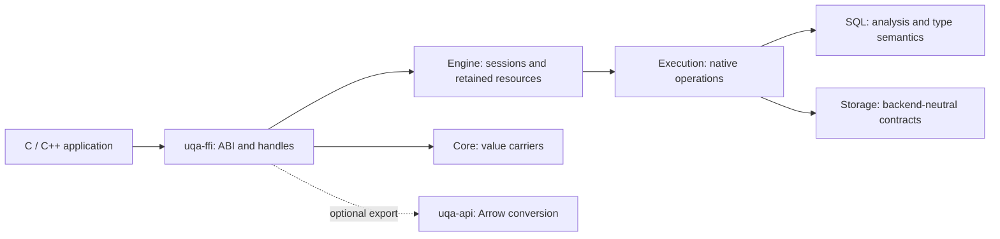

# C Language Binding Design

Status: proposal. Reviewed on 2026-10-24 against UQA Engine 0.6.1 at `0755ae252d7fa98bdc02b5c4b19ebb14cbe0fc05`. The declarations below describe a proposed interface, not an existing release header. The [manual](../manual/README.md) remains authoritative for implemented behavior. This document does not include a preservation proof.

## 1. Design decisions

Add a `uqa-ffi` crate that exports an embedded, synchronous C ABI over the existing Rust Engine. Public functions and types use the `uqa_*` prefix; constants and macros use `UQA_*`. Headers support C11 and C++17 without exposing Rust layouts. The initial interface covers SQL, exact values and metadata, prepared statements, bounded cursors, transactions, cancellation, COPY, notifications, and runtime functions. Arrow export and host logging have separate headers.

Every public `uqa_*` function returns `uqa_status`; payloads use output parameters, including version queries, error inspection, and resource release. Diagnostics are library-managed borrowed records retrieved with `uqa_error_get_last`, with no per-call error output or error destructor. Opaque handle typedefs include the pointer. Ordinary text inputs are `const char *`; explicit-length inputs use `_n` variants without requiring a string-view object.

The root handle is `uqa_engine`. Each handle owns one SQL session and a reference to shared database resources. `uqa_engine_open_session` creates an independent session over the same persistent database. This follows the existing Rust and language-binding ownership model. It does not imply that the current memory backend supports independent sessions.

The C layer owns pointer validation, handles, C/Rust value adaptation, diagnostics, and callback trampolines. Analysis, planning, execution, storage, and scoring stay in their existing owning crates. Necessary native interface additions are explicit implementation dependencies, not algorithms hidden inside the wrapper.



## 2. Verified implementation baseline

The ABI uses borrowed diagnostics with structured status and SQLSTATE fields. Public codes are independent ABI constants, the library owns one current diagnostic per calling thread, and results preserve positional rows. Internal enum values are not public ABI codes. These choices preserve repeated column names, exact NUMERIC values, SQL array lower bounds, and composite descriptors.

### Existing implementation and required adapters

| Area | Inspected implementation | Required binding work |
| --- | --- | --- |
| Sessions | [open/lifecycle.rs](../../crates/uqa-engine/src/open/lifecycle.rs) requires a `PersistentStorageProvider` for `new_session` | Engine lifetime adapter and instance capability reporting |
| Queries and cursors | [queries.rs](../../crates/uqa-engine/src/queries.rs), [native cursor](../../crates/uqa-execution/src/query/cursor.rs), [cursor tests](../../crates/uqa-engine/tests/sql_cursor.rs) | Native SQL-message and batch adaptation, C resource ownership |
| Prepared statements | [Engine adapter](../../crates/uqa-engine/src/prepared.rs), [SQL definitions](../../crates/uqa-sql/src/prepared.rs), [execution owner](../../crates/uqa-execution/src/statement/prepared.rs) | Native handle identity, metadata access, execution and invalidation adapters |
| Values and results | [SQLParam](../../crates/uqa-sql/src/params.rs), [SQLResult](../../crates/uqa-sql/src/result.rs), [Core Value](../../crates/uqa-core/src/types/value.rs) | Positional result views and accessors over native typed observation |
| Runtime functions | [execution contracts](../../crates/uqa-execution/src/functions.rs), [Engine registry](../../crates/uqa-engine/src/sql_registry.rs) | Scalar, streaming table and aggregate trampolines; safe registration retirement |
| Arrow | [QueryBuilder output](../../crates/uqa-api/src/query_builder/output.rs) has a private converter and string fallbacks | Shared public conversion API with explicit conversion policies |
| Notifications | [owned subscriptions](../../crates/uqa-engine/src/notifications/subscription.rs), [native contract](../manual/reference/02-rust-engine-api.md#bounded-notifications-on-one-sql-session) | Bounded receive, terminal diagnostics and completed cleanup |
| Features and dependencies | [workspace](../../Cargo.toml), [Engine](../../crates/uqa-engine/Cargo.toml), [Python](../../crates/uqa-python/Cargo.toml), [Node.js](../../crates/uqa-node/Cargo.toml), [dependency policy](../../scripts/workspace-dependency-policy.json) | Explicit C crate dependency inventory and feature forwarding |

The inspected Engine manifest has empty defaults and independent `arrow`, `duckdb`, `nori`, and `kuromoji` features. Memory FDWs are available without an additional `fdw` feature. The [binding feature contract](../manual/reference/08-bindings-and-extensions.md#foreign-data-wrappers) and manifests govern the proposed forwarding; an older general-reference paragraph mentioning a required `fdw` feature is not a basis for adding one.

## 3. Scope and layout

The embedded interface exposes relational SQL, full-text and vector retrieval, hybrid queries, graph/Cypher, and analyzers through the existing SQL surface. It does not reproduce every low-level Rust document, index, or graph method. Values are passed as parameters rather than interpolated into SQL.

HTTP clients, PostgreSQL wire clients, a custom storage-provider ABI, dynamic extension loading, window UDFs, parallel aggregate serialization, and a row appender are outside the initial interface. Bulk loading uses COPY or prepared execution. A later appender must share ordinary INSERT semantics, including defaults, constraints, triggers, partition routing, and rollback.

```text
crates/uqa-ffi/
  Cargo.toml
  src/
    lib.rs
    handles.rs
    boundary.rs
    config.rs
    engine.rs
    error.rs
    values.rs
    results.rs
    prepared.rs
    cursor.rs
    copy.rs
    notifications.rs
    udf.rs
    arrow.rs
    logging.rs
  include/uqa/
    uqa_export.h
    uqa.h
    uqa_udf.h
    uqa_arrow.h
    uqa_log.h
  tests/
    integration.rs
    cases/
    c/
examples/c/
  unified_search.c
  vector_knn.c
  graph_cypher.c
  storage_transactions.c
  extensibility.c
```

The Rust package is `uqa-ffi`; the native library is `libuqa.so`, `libuqa.dylib`, or `uqa.dll`, with corresponding static libraries. An `rlib` supports internal Rust verification and is not an advertised stable Rust API. The installed headers do not require a Rust toolchain or Arrow runtime headers.

## 4. ABI conventions

Public function names use `uqa_<resource>_<operation>`. The resource comes first, including `uqa_udf_register_scalar`, `uqa_notice_create`, `uqa_engine_execute`, and `uqa_error_get_last`. Library-wide metadata uses the `uqa_library_*` family. Owned handles have one explicit acquisition/release pair: `create/destroy`, `open/close`, `prepare/finalize`, or `register/unregister`. A getter returns a borrowed view or scalar; it must not silently create a handle requiring destruction. Execution, formatting, polling, and fetch operations fill caller-created reusable destinations rather than returning hidden allocations.

All property access uses `uqa_<resource>_get_<property>` and, when writable, `uqa_<resource>_set_<property>`. Every setter has a getter for the same resource and property, with matching value types, units, and selectors. Length-bearing `_n` setters share the ordinary getter because output views already include their lengths. Getters return inspection status and write the property's value through output parameters; a stored status code is a payload, not the getter's return code. Input validation or copying failure leaves the property unchanged. Callback retirement failures follow the explicit completion rules in the logging section.

Library metadata, diagnostics, result cells and descriptors, constructed values, transaction state, cursor/statement metadata, notices, notifications, and recorded callback status are read-only and expose getters only. Boolean observations follow the same convention, such as `uqa_value_get_is_null`. Commands retain their specific verbs, including `execute`, `bind`, `fetch`, `poll`, `take`, and `check`; they are not property setters. Callback result access belongs to `uqa_udf_context`, while registration belongs to `uqa_udf`.

| Writable property | Getter | Setter |
| --- | --- | --- |
| Configuration encryption key | `uqa_config_get_encryption_key` | `uqa_config_set_encryption_key` |
| Configuration compression codec and level | `uqa_config_get_compression` | `uqa_config_set_compression` |
| Configuration FFI memory limit | `uqa_config_get_ffi_memory_limit` | `uqa_config_set_ffi_memory_limit` |
| Configuration log callback and user data | `uqa_config_get_log_callback` | `uqa_config_set_log_callback` |
| Configuration log threshold | `uqa_config_get_log_level` | `uqa_config_set_log_level` |
| Runtime log callback and user data | `uqa_log_get_callback` | `uqa_log_set_callback` |
| Runtime log threshold | `uqa_log_get_level` | `uqa_log_set_level` |
| UDF option volatility | `uqa_udf_options_get_volatility` | `uqa_udf_options_set_volatility` |
| UDF option for Engine mutation | `uqa_udf_options_get_may_mutate_engine` | `uqa_udf_options_set_may_mutate_engine` |
| Callback result slot | `uqa_udf_context_get_result` | `uqa_udf_context_set_result` |

### Export visibility and calling convention

`uqa_export.h` defines the macros before any public function or callback declaration. `UQA_BUILD_SHARED` selects a shared-library producer; `UQA_USE_SHARED` selects a shared-library consumer. Define neither for a static build or consumer. The two shared modes are mutually exclusive and must be selected before including any UQA header.

```c
#ifndef UQA_EXPORT_H
#define UQA_EXPORT_H

#if defined(UQA_BUILD_SHARED) && defined(UQA_USE_SHARED)
#error "UQA_BUILD_SHARED and UQA_USE_SHARED are mutually exclusive"
#endif

#if defined(_WIN32) || defined(__CYGWIN__)
#define UQA_CALL __cdecl
#else
#define UQA_CALL
#endif

#if !defined(UQA_BUILD_SHARED) && !defined(UQA_USE_SHARED)
#define UQA_API
#elif defined(_WIN32) || defined(__CYGWIN__)
#if defined(UQA_BUILD_SHARED)
#define UQA_API __declspec(dllexport)
#else
#define UQA_API __declspec(dllimport)
#endif
#elif defined(__GNUC__) || defined(__clang__)
#define UQA_API __attribute__((visibility("default")))
#else
#error "UQA shared-library visibility requires a supported compiler"
#endif

#endif /* UQA_EXPORT_H */
```

| Compilation mode | Definition | Windows `UQA_API` | GCC/Clang on Linux/macOS `UQA_API` |
| --- | --- | --- | --- |
| Shared-library producer | `UQA_BUILD_SHARED` | `__declspec(dllexport)` | `__attribute__((visibility("default")))` |
| Shared-library consumer | `UQA_USE_SHARED` | `__declspec(dllimport)` | `__attribute__((visibility("default")))` |
| Static-library producer or consumer | Neither | Empty | Empty |

The shared modes use [Windows export/import attributes](https://learn.microsoft.com/en-us/cpp/cpp/dllexport-dllimport?view=msvc-170) and [GCC-compatible default visibility](https://gcc.gnu.org/onlinedocs/gcc/Common-Attributes.html#index-visibility-attribute). `UQA_CALL` uses [the Windows C calling convention](https://learn.microsoft.com/en-us/cpp/cpp/cdecl?view=msvc-170); it is empty elsewhere. Public function declarations always use `UQA_API uqa_status UQA_CALL`. Callback typedefs use `UQA_CALL` but do not export the application's callback implementation.

`uqa.h` includes `uqa_export.h`; the UDF, Arrow, and logging headers include `uqa.h`. Each public header has its own include guard and encloses function declarations in the `extern "C"` guard shown below. Consumers select a linkage mode through the package's build metadata, without defining `UQA_API` or `UQA_CALL` themselves.

```c
#include <uqa/uqa_export.h>
#include <stddef.h>
#include <stdint.h>

#ifdef __cplusplus
extern "C" {
#endif

typedef struct uqa_engine_t *uqa_engine;
typedef struct uqa_config_t *uqa_config;
typedef const struct uqa_error_t *uqa_error;
typedef struct uqa_result_t *uqa_result;
typedef struct uqa_batch_result_t *uqa_batch_result;
typedef struct uqa_statement_t *uqa_statement;
typedef struct uqa_cursor_t *uqa_cursor;
typedef struct uqa_value_t *uqa_value;
typedef const struct uqa_value_t *uqa_value_view;
typedef const struct uqa_type_t *uqa_type;
typedef struct uqa_buffer_t *uqa_buffer;
typedef struct uqa_cancel_handle_t *uqa_cancel_handle;
typedef struct uqa_subscription_t *uqa_subscription;
typedef struct uqa_notification_t *uqa_notification;
typedef struct uqa_notice_t *uqa_notice;

typedef int32_t uqa_status;
typedef uint32_t uqa_type_kind;
typedef uint32_t uqa_notification_failure_kind;

typedef uqa_status (UQA_CALL *uqa_user_data_destroy_fn)(void *user_data);

typedef struct uqa_string_view {
    const char *data;
    size_t size;
} uqa_string_view;

typedef struct uqa_bytes_view {
    const uint8_t *data;
    size_t size;
} uqa_bytes_view;

#define UQA_OK                       INT32_C(0)
#define UQA_DONE                     INT32_C(1)
#define UQA_TIMEOUT                  INT32_C(2)
#define UQA_ERROR_INVALID_ARGUMENT  (-INT32_C(1))
#define UQA_ERROR_STATE             (-INT32_C(2))
#define UQA_ERROR_TYPE              (-INT32_C(3))
#define UQA_ERROR_RANGE             (-INT32_C(4))
#define UQA_ERROR_UNSUPPORTED       (-INT32_C(5))
#define UQA_ERROR_BUSY              (-INT32_C(6))
#define UQA_ERROR_OUT_OF_MEMORY     (-INT32_C(7))
#define UQA_ERROR_SQL               (-INT32_C(8))
#define UQA_ERROR_IO                (-INT32_C(9))
#define UQA_ERROR_PANIC             (-INT32_C(10))
#define UQA_ERROR_LIMIT             (-INT32_C(11))
#define UQA_ERROR_NULL              (-INT32_C(12))
#define UQA_ERROR_NOTIFICATION      (-INT32_C(13))

UQA_API uqa_status UQA_CALL uqa_library_get_abi_version(uint32_t *out);
UQA_API uqa_status UQA_CALL uqa_library_get_version(uqa_string_view *out);
UQA_API uqa_status UQA_CALL uqa_library_get_source_revision(uqa_string_view *out);
UQA_API uqa_status UQA_CALL uqa_library_get_capabilities(uint64_t *out);

#ifdef __cplusplus
}
#endif
```

Opaque typedefs name pointer handles: pass `uqa_engine engine`, return a handle through `uqa_engine *out`, and clear it through `uqa_engine *engine`. Do not add another pointer to an ordinary handle parameter. Public PODs such as `uqa_sql_request`, `uqa_string_view`, and `uqa_subscription_options` remain structs; their pointer parameters retain their usual meaning.

`uqa_type` points to a const descriptor. `uqa_value_view` points to a const value and accepts an owned `uqa_value` through the normal pointer qualification conversion. Borrowed result cells and callback arguments use this view type so they cannot be passed to `uqa_value_destroy` without an invalid conversion. `const uqa_value` would make only the pointer variable const; it is not a read-only value view. Parameter arrays are declared as arrays of `uqa_value_view`, with `uqa_value_view const *` preventing changes to their entries.

All exported operations return `uqa_status`, including metadata accessors and destructors. Returned scalars, handles, and views use required output slots. `uqa_library_get_version` and `uqa_library_get_source_revision` return borrowed string views valid while the library remains loaded. Application callbacks defined by this API also return `uqa_status`; outputs and state use callback context or output parameters. The externally specified Arrow release callbacks retain Arrow's mandated signatures.

All declaration excerpts below retain `UQA_API` and `UQA_CALL`. Header verification must compile these definitions directly; replacing them with empty test macros would hide missing definitions and would not test export/import or calling-convention declarations.

- Ordinary string inputs use NUL-terminated UTF-8 `const char *`, so callers pass string literals or existing C strings directly. These inputs require a non-NULL pointer, including for an empty string. Input APIs do not require `uqa_string_view` construction. SQL text, names, paths, keys, and callback error messages follow this convention.
- String-taking operations also provide explicit-length `*_n` variants using `const char *` followed by `size_t`. Lengths count bytes, exclude a terminator, and permit non-terminated input. A zero-length span may have a NULL pointer; positive lengths require readable contiguous storage. Embedded NUL remains invalid where the native operation/type forbids it. BYTEA uses byte buffers, not C strings. Check length arithmetic, multiplication, and Rust slice-size limits before allocation or pointer conversion.
- `uqa_string_view` is an output-only borrowed view. Returned text need not be NUL-terminated, so consumers use its size; the owning object, callback scope, or loaded library determines its lifetime. String arrays such as subscription channels use `const char *const *`; explicit-length array variants receive a parallel length array. Non-UTF-8 native paths require a separate future path interface.
- Row counts and row indices use `uint64_t`; column and parameter indices use `uint32_t`. Rows and columns are zero-based; parameters are one-based, matching `$1`.
- Booleans use `uint8_t` with only 0 and 1 accepted. Public ABI widths do not depend on C enums, `long`, Rust `bool`, or Rust enum discriminants.
- Public numeric codes never change meaning or get reused. Unknown input codes are rejected. Consumers must handle unknown output type kinds without interpreting Rust internals.
- Fixed PODs have explicit C layouts mirrored by Rust `#[repr(C)]`. Prefer opaque configuration builders. Extensible options begin with `uint32_t struct_size` and `uint32_t version`; accept documented field-boundary sizes, default omitted trailing fields, and reject unsupported versions, unknown flags, or nonzero unknown tails.
- ABI major 1 is independent of the Engine product version. Compatible releases preserve existing symbols, signatures, and POD layouts. New operations use new symbols; callers of those symbols still require the corresponding minimum library release.
- Initial binary targets are Linux x86_64/aarch64, macOS x86_64/arm64, and Windows x86_64. Validate each target ABI separately. This proposal does not advertise 32-bit or browser WASM C packages.

All type-kind, feature, and state constants must receive explicit numeric assignments before the first header release. This document fixes the status values above and specifies the remaining semantic families; it is not a complete generated header.

## 5. Memory ownership and handle lifetime

Input buffers need remain valid only until the call returns. Configuration and binding setters copy their inputs before reporting success. The initial ABI does not expose borrowed parameter storage or a custom allocator vtable. Callback `user_data` follows its separate registration lifetime.

Acquisition functions receive a handle slot that must contain NULL on entry. Success stores a new owned handle; failure leaves it NULL. An acquisition function never silently frees or overwrites a live handle. Operations that fill an existing result, batch result, buffer, or notification instead receive that non-NULL handle by value. They replace its contents only on `UQA_OK`; failure, `UQA_DONE`, and `UQA_TIMEOUT` preserve its previous contents. Borrowed outputs and scalar output slots are separate: they are initialized to NULL/empty/zero when no value is returned and require no release.

```c
UQA_API uqa_status UQA_CALL uqa_config_destroy(uqa_config *config);
UQA_API uqa_status UQA_CALL uqa_result_destroy(uqa_result *result);
UQA_API uqa_status UQA_CALL uqa_value_destroy(uqa_value *value);
UQA_API uqa_status UQA_CALL uqa_buffer_destroy(uqa_buffer *buffer);
UQA_API uqa_status UQA_CALL uqa_engine_close(uqa_engine *engine);
```

Destruction returns `UQA_OK` for a NULL slot or NULL handle and clears the slot after releasing the object. Release functions return status directly and use the same library-managed diagnostic record on failure. Fallible native cleanup is completed before consuming its handle where possible; a rejection before retirement preserves the handle. A cleanup callback failure after irreversible retirement is reported even though the consumed handle is cleared, and the callback is never invoked twice. Callers check both status and the remaining handle before deciding whether further cleanup is possible. Other aliases are not cleared. Passing a freed pointer, a foreign pointer, or a borrowed value to an owning destructor violates the C contract. The library cannot safely validate arbitrary addresses. Memory allocated by Rust must never be released with C `free()`.

| Object | Acquisition / release | Dependency |
| --- | --- | --- |
| `uqa_engine` | `uqa_engine_open*` / `uqa_engine_close` | Owns one session; sibling sessions close independently |
| `uqa_config` | `uqa_config_create` / `uqa_config_destroy` | Owns configuration independently of opened Engines |
| `uqa_statement` | `uqa_statement_prepare*` / `uqa_statement_finalize` | Bound to its creating session and prevents its close |
| `uqa_result` | `uqa_result_create` / `uqa_result_destroy` | Starts unpopulated; filled contents retain their source session lease |
| `uqa_batch_result` | `uqa_batch_result_create` / `uqa_batch_result_destroy` | Owns populated members until transferred or replaced |
| `uqa_cursor` | `uqa_cursor_open*` / `uqa_cursor_close` | Retains its source session and native spill |
| `uqa_value` | `uqa_value_create_*` / `uqa_value_destroy` | Owns a value; copied result values retain required native descriptors/session leases |
| `uqa_buffer` | `uqa_buffer_create` / `uqa_buffer_destroy` | Starts empty and owns formatted bytes after filling |
| `uqa_cancel_handle` | `uqa_cancel_handle_create` / `uqa_cancel_handle_destroy` | Retains the selected cancellation token, not the database |
| `uqa_notice` | `uqa_notice_create` / `uqa_notice_destroy` | Owns one dequeued SQL notice and survives session close |
| `uqa_notification` | `uqa_notification_create` / `uqa_notification_destroy` | Reusable event destination; populated events survive session close |
| `uqa_subscription` | `uqa_subscription_open*` / `uqa_subscription_close` | Independent native subscription; close completes teardown and releases the handle |
| `uqa_udf` | `uqa_udf_register_*` / `uqa_udf_unregister` | Retains its shared registration owner independently of the creating session |
| `uqa_udf_options` | `uqa_udf_options_create` / `uqa_udf_options_destroy` | Owns registration settings; registration copies them |
| Borrowed `uqa_value_view` / `uqa_type` | No caller release | Valid until the owning object is successfully refilled/released, or the callback scope ends |
| `uqa_udf_context` / `uqa_udf_row_sink` | Callback-owned; no caller release | Valid only during the callback invocation |
| `uqa_error` | Library-owned thread-local record; no caller release | Valid until the next non-diagnostic UQA call on that thread, thread exit, or library unload |
| Arrow schema/array | Standard Arrow export/release | Owns buffers independently of the source result, cursor, and Engine |

`uqa_engine_close` returns `UQA_ERROR_BUSY` without destroying the handle when dependent statements, populated results/batches, cursors, values, or active calls remain. Empty destination objects do not retain a session. Otherwise it invokes native `Engine::close` to clean up open transactions. If rollback or completion resolution fails, the error and original handle remain available for explicit resolution. Once native closure has completed, the handle is consumed and cleared. A subsequent user-data cleanup failure is still reported without restoring the closed handle or repeating the callback. A sibling session or independent subscription may still retain the database file.

The table is the complete public opaque-handle lifecycle inventory. Acquisition and release names must stay paired when an API is added. Do not require a second destroy call after close, finalize, or unregister. Result, batch-result, buffer, and notification destinations can be reused across calls; their successful refill invalidates old borrowed views while owned value copies remain valid. Serialize refill, observation, and release of the same destination. A result, batch result, or notification cannot be inspected before its first successful fill; such access returns `UQA_ERROR_STATE`. A newly created buffer is a valid empty byte sequence.

Do not duplicate entire results merely to stabilize string addresses. Borrow native scalar storage; return formatted output in a separate `uqa_buffer`. Cell-view wrappers are created on demand, remain stable until their owner is successfully refilled or released, and count toward FFI retention. Borrowed callback arguments are instead scoped to the invocation.

## 6. Errors, diagnostics, and panics

```c
UQA_API uqa_status UQA_CALL uqa_error_get_last(uqa_error *out);
UQA_API uqa_status UQA_CALL uqa_error_get_status(uqa_error error, uqa_status *out);
UQA_API uqa_status UQA_CALL uqa_error_get_cause(uqa_error error, uqa_error *out);
UQA_API uqa_status UQA_CALL uqa_error_get_sqlstate(uqa_error error, uqa_string_view *out);
UQA_API uqa_status UQA_CALL uqa_error_get_message(uqa_error error, uqa_string_view *out);
UQA_API uqa_status UQA_CALL uqa_error_get_detail(uqa_error error, uqa_string_view *out);
UQA_API uqa_status UQA_CALL uqa_error_get_notification_kind(
    uqa_error error, uqa_notification_failure_kind *out);
UQA_API uqa_status UQA_CALL uqa_error_get_notification_code(
    uqa_error error, uqa_string_view *out);
UQA_API uqa_status UQA_CALL uqa_error_get_hint(uqa_error error, uqa_string_view *out);
UQA_API uqa_status UQA_CALL uqa_error_get_context(uqa_error error, uqa_string_view *out);
UQA_API uqa_status UQA_CALL uqa_error_get_completion(uqa_error error, uint32_t *out);
UQA_API uqa_status UQA_CALL uqa_error_get_statement_index(
    uqa_error error, uint64_t *index);
UQA_API uqa_status UQA_CALL uqa_error_get_position(
    uqa_error error, uint64_t *character_position);
```

Every public function returns `uqa_status`. Ordinary operations have no error-output argument. After a negative status, call `uqa_error_get_last(&error)` to borrow the current thread's diagnostic; `uqa_error` is a const opaque pointer, not a separately allocated application-owned object. There is no `uqa_error_destroy` or public owned-error clone. Constructor failures use the same mechanism even when no Engine exists.

Each non-diagnostic UQA call replaces the thread's diagnostic state. Successful calls, including `UQA_DONE` and `UQA_TIMEOUT`, leave no current error. The borrowed error and its field views remain valid until the next non-diagnostic call on that thread, thread exit, or library unload. `uqa_error_get_last` and all `uqa_error_*` inspection functions never clear, replace, or allocate another diagnostic, even when inspection itself returns an argument error. An unrelated thread cannot invalidate the record. Read or copy needed fields before cleanup or another ordinary API call.

`uqa_error_get_last` returns `UQA_OK` with a borrowed record, or `UQA_DONE` with NULL output when no error exists. `uqa_error_get_status(error, &stored_status)` reports inspection success separately from the original failure code written to `stored_status`. Applications that need longer retention copy fields into their own storage; ordinary error handling requires no allocation or destroy operation from the caller.

Native SQL failures return `UQA_ERROR_SQL` with the original SQLSTATE, detail, hint, position, and routine context. Classify through `SQLError::primary()`; preserve the separate context chain. Do not manufacture SQLSTATEs for C pointer, type-accessor, or handle-state mistakes. Missing optional string fields return `UQA_DONE` with an empty view; missing index/position likewise returns `UQA_DONE`. A present empty string returns `UQA_OK`. Statement indices are zero-based and SQL positions are one-based character positions. Do not infer locations from display messages.

Native notification failures return `UQA_ERROR_NOTIFICATION`. `uqa_error_get_notification_kind` returns a fixed `UQA_NOTIFICATION_FAILURE_*` code, and `uqa_error_get_notification_code` returns the native content-free `NOTIFICATION_*` string. Both return `UQA_DONE` with zero/empty output for other error categories. The primary message is the same content-free code; `uqa_error_get_detail` explicitly exposes any optional private native cause. Allocation failure may omit private detail but preserves the failure status, kind and code. Terminal receive diagnostics are retained by their subscription or configured SQL inbox and republished on later reads without replacing the original failure.

The final diagnostic is published after the operation's cleanup completes. Internally retain its primary cause and any cleanup context; nested callback helpers must not overwrite that pending failure. Callback failure records are scoped to the invocation and captured by the trampoline before cleanup. Worker-thread failures travel with native results and are published on the calling thread when the synchronous operation returns; never inspect another thread's diagnostic slot.

`uqa_error_get_cause` borrows an optional retained cause, or returns `UQA_DONE` with NULL output. The same diagnostic getters inspect that cause, with the same lifetime as its enclosing diagnostic and no release operation. COPY stream failures retain the native `58030` diagnostic and expose the callback's original status and copied message through this cause; native cancellation remains `57014` without a manufactured callback failure.

Distinguish SQL resource failures such as `53200` from FFI allocation failure. The latter returns `UQA_ERROR_OUT_OF_MEMORY`. A fixed fallback diagnostic retains status, available SQLSTATE/completion information, and a static message if richer diagnostic allocation fails. Preserve the original operation's status when only diagnostic formatting fails. Not every process allocator failure is recoverable.

Every exported Rust entry point prevents unwinding across the FFI boundary and translates a caught panic to `UQA_ERROR_PANIC`. Poison the affected session: only status inspection, resource release, and native cleanup remain permitted. Accessors and ordinary memory release must avoid panicking. If an unexpected panic occurs after release has consumed a handle, clear its slot and never release that object twice; do not return a dangling handle or report successful cleanup. Do not resume ordinary execution without a validated recovery contract. `panic=abort`, aborting allocation failures, invalid C addresses, C++ exceptions, and `longjmp` are outside this recovery mechanism. Follow the [Rust FFI unwinding contract](https://doc.rust-lang.org/nomicon/ffi.html#ffi-and-unwinding).

## 7. Opening databases and creating sessions

```c
UQA_API uqa_status UQA_CALL uqa_config_create(uqa_config *out);
UQA_API uqa_status UQA_CALL uqa_config_get_encryption_key(
    uqa_config config, uqa_string_view *out);
UQA_API uqa_status UQA_CALL uqa_config_set_encryption_key(
    uqa_config config, const char *key);
UQA_API uqa_status UQA_CALL uqa_config_set_encryption_key_n(
    uqa_config config, const char *key, size_t key_size);
UQA_API uqa_status UQA_CALL uqa_config_get_compression(
    uqa_config config, uint32_t *codec, int32_t *level);
UQA_API uqa_status UQA_CALL uqa_config_set_compression(
    uqa_config config, uint32_t codec, int32_t level);
UQA_API uqa_status UQA_CALL uqa_config_get_ffi_memory_limit(
    uqa_config config, uint64_t *bytes);
UQA_API uqa_status UQA_CALL uqa_config_set_ffi_memory_limit(
    uqa_config config, uint64_t bytes);

typedef uint32_t uqa_open_flags;
#define UQA_OPEN_MEMORY        (UINT32_C(1) << 0)
#define UQA_OPEN_SQLITE_NATIVE (UINT32_C(1) << 1)
#define UQA_OPEN_SQLITE_KV     (UINT32_C(1) << 2)
#define UQA_OPEN_REDB          (UINT32_C(1) << 3)
#define UQA_OPEN_SQLITE_AUTO   (UINT32_C(1) << 4)

UQA_API uqa_status UQA_CALL uqa_engine_open(
    const char *path, uqa_open_flags flags,
    uqa_config config, uqa_engine *out);
UQA_API uqa_status UQA_CALL uqa_engine_open_session(
    uqa_engine source, uqa_engine *out);
UQA_API uqa_status UQA_CALL uqa_engine_open_session_for_user(
    uqa_engine source, const char *role,
    uqa_engine *out);
UQA_API uqa_status UQA_CALL uqa_engine_get_capabilities(
    uqa_engine engine, uint64_t *out);
```

NULL config selects documented defaults. Open copies configuration and never consumes it, on either success or failure. The caller may reuse or destroy it afterwards. Encryption keys follow the native UTF-8 key contract; keep them out of diagnostics and logs, and clear FFI temporary copies and their native key owners at the appropriate lifetime boundary.

Configuration getters inspect the same stored settings changed by their matching setters, including defaults on a newly created config. `uqa_config_get_encryption_key` returns a borrowed view of the configured key, or `UQA_DONE` with an empty view when unset. The view remains valid until a successful configuration mutation or config destruction. Compression returns the codec and level together; the FFI limit uses bytes in both directions. Opened Engines use their copied settings, so later config changes do not change an existing Engine.

Serialize config and UDF-option mutation with getters, borrowed-view use, and destruction of the same object. Setters copy borrowed inputs before replacing their storage; a key returned by `uqa_config_get_encryption_key` can be passed back through `uqa_config_set_encryption_key_n` without requiring a NUL terminator or invalidating its input before the copy completes.

`uqa_engine_open` selects storage and optional opening behavior through a fixed-width flag mask. Exactly one of `UQA_OPEN_MEMORY`, `UQA_OPEN_SQLITE_NATIVE`, `UQA_OPEN_SQLITE_KV` and `UQA_OPEN_REDB` is required. `UQA_OPEN_SQLITE_AUTO` is an optional modifier combined with either SQLite selector. Zero, unknown bits, multiple storage selectors and modifiers on another storage type return `UQA_ERROR_INVALID_ARGUMENT` before file I/O. The same `uqa_engine_close` releases every successful open.

| Flags | Storage | Path |
| --- | --- | --- |
| `UQA_OPEN_MEMORY` | Memory | NULL required |
| `UQA_OPEN_SQLITE_NATIVE` | Native SQLite | Nonempty UTF-8 file path |
| `UQA_OPEN_SQLITE_KV` | SQLite Key/Value | Nonempty UTF-8 file path |
| `UQA_OPEN_REDB` | redb | Nonempty UTF-8 file path |

A non-NULL path with `UQA_OPEN_MEMORY` is rejected rather than ignored. Both SQLite layouts accept configured encryption and compression. Memory and redb reject configured encryption or compression before opening storage. SQLite validates codec and level through its existing owner. Both SQLite layouts obtain their connection from Storage's `ManagedConnection` and construct their concrete provider; redb constructs its concrete provider directly. All persistent providers enter Engine through `Engine::from_persistent_provider`. All four choices share SQL, result, callback, cancellation and retained-resource contracts.

`UQA_OPEN_SQLITE_AUTO` detects the selected SQLite file's encryption/compression without changing its native or Key/Value layout. Existing containers retain their stored codec; new files use plain SQLite or SQLCipher according to the configured key. AUTO rejects explicit compression settings because it reads them from the file. `ManagedConnection::open_auto` owns format-directed opening, and `Engine::open_auto` delegates to it. A key on an unencrypted file is rejected; encrypted or unrecognized files require a key. Open failures preserve native diagnostics. Storage types, encodings and their combinations do not add C open functions.

`uqa_config_set_trusted_anchor` copies a `uqa_sqlite_container_anchor`; NULL clears it. The matching getter copies the stored fields, returning `UQA_DONE` with zero fields when unset. The structure carries sixteen database-identity octets, a uint64 generation and thirty-two authentication-tag octets. It owns no resources and is not a portable serialized format. An anchor requires a nonempty encryption key and either explicit compression or `UQA_OPEN_SQLITE_AUTO` on an existing encrypted compressed container. Both SQLite layouts use the same open call. Memory, redb and incompatible SQLite options reject the setting before creating storage.

After all writers close, `uqa_sqlite_get_container_anchor(path, key, out)` authenticates and reads the current anchor without opening an Engine or modifying the file; `_n` accepts explicit UTF-8 lengths. A read error leaves zero fields. The application keeps this anchor in independently trusted storage and refreshes it after successful changes. Opening with a stale or mismatched anchor fails; an anchored AUTO open never creates a missing file or accepts an unencrypted file. Native SQLite owns format detection, authentication and rollback validation. Encryption alone must not be documented as full-file rollback protection.

`uqa_engine_open_session` does not inherit private transaction state, prepared statements, cancellation, or mutable session variables. It shares database data and runtime registries. A memory source returns `UQA_ERROR_UNSUPPORTED` with NULL output; constructing another empty memory Engine would not create a session over the same database. Future memory multi-session support must begin in the Storage state and transaction-affine session contracts.

The embedding host authenticates the identity supplied to `uqa_engine_open_session_for_user`. Native role existence, LOGIN, and CONNECT checks still run. OS user names and environment variables are not implicit authentication.

Build capabilities report compiled components; instance capabilities report operations available on a particular Engine, including independent sessions and persistence. Feature discovery does not grant permissions or guarantee that a particular SQL request succeeds.

## 8. SQL execution and transactions

```c
typedef struct uqa_sql_request {
    const char *sql;
    uqa_value_view const *params;
    uint32_t param_count;
} uqa_sql_request;

typedef struct uqa_sql_request_n {
    const char *sql;
    size_t sql_size;
    uqa_value_view const *params;
    uint32_t param_count;
} uqa_sql_request_n;

UQA_API uqa_status UQA_CALL uqa_engine_execute(
    uqa_engine engine, const char *sql,
    uqa_result result);
UQA_API uqa_status UQA_CALL uqa_engine_execute_n(
    uqa_engine engine, const char *sql, size_t sql_size,
    uqa_result result);
UQA_API uqa_status UQA_CALL uqa_engine_execute_params(
    uqa_engine engine, const char *sql,
    uqa_value_view const *params, uint32_t param_count,
    uqa_result result);
UQA_API uqa_status UQA_CALL uqa_engine_execute_params_n(
    uqa_engine engine, const char *sql, size_t sql_size,
    uqa_value_view const *params, uint32_t param_count,
    uqa_result result);
UQA_API uqa_status UQA_CALL uqa_batch_result_create(uqa_batch_result *out);

UQA_API uqa_status UQA_CALL uqa_engine_execute_batch(
    uqa_engine engine, const uqa_sql_request *requests, size_t count,
    uqa_batch_result results);
UQA_API uqa_status UQA_CALL uqa_engine_execute_batch_n(
    uqa_engine engine, const uqa_sql_request_n *requests, size_t count,
    uqa_batch_result results);
UQA_API uqa_status UQA_CALL uqa_batch_result_get_count(
    uqa_batch_result batch, uint64_t *out);
UQA_API uqa_status UQA_CALL uqa_batch_result_take(
    uqa_batch_result batch, uint64_t index,
    uqa_result result);
UQA_API uqa_status UQA_CALL uqa_batch_result_destroy(uqa_batch_result *batch);

UQA_API uqa_status UQA_CALL uqa_transaction_begin(uqa_engine engine);
UQA_API uqa_status UQA_CALL uqa_transaction_commit(uqa_engine engine);
UQA_API uqa_status UQA_CALL uqa_transaction_rollback(uqa_engine engine);
UQA_API uqa_status UQA_CALL uqa_savepoint_create(
    uqa_engine engine, const char *name);
UQA_API uqa_status UQA_CALL uqa_savepoint_rollback(
    uqa_engine engine, const char *name);
UQA_API uqa_status UQA_CALL uqa_savepoint_release(
    uqa_engine engine, const char *name);
UQA_API uqa_status UQA_CALL uqa_transaction_get_state(
    uqa_engine engine, uint32_t *out_state);
```

`uqa_engine_execute` accepts a SQL C string and a result handle created by `uqa_result_create`. The result can be reused across queries; callers do not construct a request or string-view struct for an ordinary query. Use `uqa_engine_execute_params` for values, or the corresponding `_n` variant for a non-terminated SQL buffer. The ordinary form delegates to the same validated length-aware native entry point after measuring its string once. Request structs are reserved for batches, where each member carries its own SQL and parameter array.

Every direct execute form accepts the same SQL message as `Engine::sql`, including multiple statements and empty input. Pass the complete text and parameter array to the native entry point without splitting or imposing a single-statement restriction in C. Execute all statements and publish the final result, matching `Engine::sql`; an empty message produces its empty result without a command tag. Native parsing, implicit transaction segments, explicit transaction control, parameter scope, and failure ordering remain authoritative. Parameters bind values, never identifiers or SQL fragments. Every parameter pointer must identify a value; SQL NULL is an explicit null value object.

`uqa_engine_execute_batch` accepts `uqa_sql_request` entries with ordinary C strings; `uqa_engine_execute_batch_n` accepts length-bearing `uqa_sql_request_n` entries. Both fill an existing `uqa_batch_result` created by `uqa_batch_result_create` and execute requests in order through the native `sql_batch_diagnosed` boundary. Each request may itself contain multiple statements and produces its final result, so the returned batch has one member per request. Existing `sql_batch` rules govern atomicity, nested transactions, and transaction-control statements. Do not publish a partial batch result on failure; keep the destination's previous contents unchanged. Preserve a failing request index through `sql_batch_diagnosed`; begin/commit/rollback failures have no member index. `uqa_batch_result_take` transfers a member into an existing `uqa_result` destination once; taking the same member again is a state error. Validate and admit the transfer before changing either object. Destroying the batch releases members not transferred.

Materialized result contents are published into the supplied destination after native statement/batch completion. Reserve conversion resources before completion where the owning execution path permits it. If unavoidable C result publication fails after commit, preserve the destination's previous contents and report the known completion state rather than implying rollback. `uqa_error_get_completion` distinguishes `UQA_COMPLETION_NONE`, `COMMITTED`, `ROLLED_BACK`, `PENDING`, `IN_TRANSACTION`, and `UNKNOWN`, all with the `UQA_COMPLETION_` prefix. Report only native-confirmed facts. Never automatically replay SQL.

Transaction state distinguishes `IDLE`, `ACTIVE`, `FAILED`, and `COMPLETION_PENDING`. Inspect native `pending_transaction_completion()` before `transaction_failed()`. SQLSTATE `08007` is neither success nor confirmed rollback. Resolve the original attempt with COMMIT/ROLLBACK on the same session without reevaluating the SQL or callbacks. Preserve native `25000` when rollback discovers a previously committed outcome.

Configure isolation, READ ONLY, DEFERRABLE, SET LOCAL, and timeouts through existing SQL. Savepoint functions pass names to native identifier-aware methods, not SQL concatenation. C envelope mistakes detected before native admission do not change transaction state. SQL analysis/execution errors retain their native transaction effects.

A future Simple Query callback interface must expose `Engine::sql_simple_query` ordering and implicit transaction segments separately. Earlier result callbacks may precede a later segment failure; observing a callback does not establish commit. Do not merge this contract with atomic batch execution.

## 9. Results and type descriptors

```c
UQA_API uqa_status UQA_CALL uqa_result_create(uqa_result *out);

UQA_API uqa_status UQA_CALL uqa_result_get_row_count(
    uqa_result result, uint64_t *out);
UQA_API uqa_status UQA_CALL uqa_result_get_column_count(
    uqa_result result, uint32_t *out);
UQA_API uqa_status UQA_CALL uqa_result_get_column_name(
    uqa_result result, uint32_t column,
    uqa_string_view *out);
UQA_API uqa_status UQA_CALL uqa_result_get_column_type(
    uqa_result result, uint32_t column,
    uqa_type *out);
UQA_API uqa_status UQA_CALL uqa_result_get_value(
    uqa_result result, uint64_t row, uint32_t column,
    uqa_value_view *out);
UQA_API uqa_status UQA_CALL uqa_result_get_affected_rows(
    uqa_result result, uint64_t *out);
UQA_API uqa_status UQA_CALL uqa_result_get_command_tag(
    uqa_result result, uqa_string_view *out);
UQA_API uqa_status UQA_CALL uqa_result_get_kind(
    uqa_result result, uint32_t *out);

UQA_API uqa_status UQA_CALL uqa_type_get_kind(
    uqa_type type, uqa_type_kind *out);
UQA_API uqa_status UQA_CALL uqa_type_get_oid(
    uqa_type type, uint32_t *out);
UQA_API uqa_status UQA_CALL uqa_type_get_modifier(
    uqa_type type, int32_t *out);
```

`uqa_result_create` allocates an unpopulated result wrapper without executing SQL. `uqa_engine_execute*`, `uqa_statement_execute`, `uqa_cursor_fetch`, and `uqa_batch_result_take` populate that wrapper without allocating a second public result handle. A successful refill releases the previous contents and its session lease after the replacement is ready. Retain both old and replacement reservations during that transition.

Read cells through `SQLResult::value_at` or native positional column batches. Do not reconstruct rows as name-keyed maps. Preserve both columns of `SELECT 1 AS x, 2 AS x`, descriptors on empty results, and the distinction between a zero-column rowset and a command. Command tags and affected-row counts come from native results. Do not invent rows-scanned counters.

A `uqa_type` describes SQL identity separately from physical value representation. Additional accessors expose available OID, schema/name, modifier, nested element/field descriptors, domain base type, and collation. An optional metadata accessor returns `UQA_DONE` when the native field is absent, rather than inferring it from a first row or column name. A separate PostgreSQL client descriptor accessor may expose `postgres_result_type`, whose scalar-domain representation can use the base type.

Type families include BOOL, INT16/32/64, FLOAT32/64, TEXT/CHAR/VARCHAR, BYTEA, NUMERIC, temporal types, JSON/JSONB, XML, UUID, BIT/VARBIT, ARRAY, ROW/RECORD, ENUM, DOMAIN, RANGE/MULTIRANGE, VECTOR/TENSOR, graph/agtype, and VOID. This is an ABI representation inventory, not an assertion that additional SQL types have been implemented.

## 10. Values and exact representations

```c
UQA_API uqa_status UQA_CALL uqa_value_create_null(uqa_value *out);
UQA_API uqa_status UQA_CALL uqa_value_create_typed_null(
    uqa_engine engine, const char *type_name, uqa_value *out);
UQA_API uqa_status UQA_CALL uqa_value_create_typed_null_n(
    uqa_engine engine, const char *type_name, size_t type_name_size, uqa_value *out);
UQA_API uqa_status UQA_CALL uqa_value_create_from_text(
    uqa_engine engine, const char *type_name, const char *text, uqa_value *out);
UQA_API uqa_status UQA_CALL uqa_value_create_from_text_n(
    uqa_engine engine, const char *type_name, size_t type_name_size,
    const char *text, size_t text_size, uqa_value *out);
UQA_API uqa_status UQA_CALL uqa_value_create_int16(int16_t value, uqa_value *out);
UQA_API uqa_status UQA_CALL uqa_value_create_int32(int32_t value, uqa_value *out);
UQA_API uqa_status UQA_CALL uqa_value_create_int64(int64_t value, uqa_value *out);
UQA_API uqa_status UQA_CALL uqa_value_create_float32(float value, uqa_value *out);
UQA_API uqa_status UQA_CALL uqa_value_create_float64(double value, uqa_value *out);
UQA_API uqa_status UQA_CALL uqa_value_create_text(
    const char *value, uqa_value *out);
UQA_API uqa_status UQA_CALL uqa_value_create_text_n(
    const char *value, size_t size, uqa_value *out);
UQA_API uqa_status UQA_CALL uqa_value_create_numeric(
    const char *value, uqa_value *out);
UQA_API uqa_status UQA_CALL uqa_value_create_numeric_n(
    const char *value, size_t size, uqa_value *out);
UQA_API uqa_status UQA_CALL uqa_value_create_json(
    const char *value, uqa_value *out);
UQA_API uqa_status UQA_CALL uqa_value_create_jsonb(
    const char *value, uqa_value *out);
UQA_API uqa_status UQA_CALL uqa_value_create_vector_f32(
    const float *data, size_t dimensions,
    uqa_value *out);
UQA_API uqa_status UQA_CALL uqa_value_create_copy(
    uqa_value_view value, uqa_value *out);
UQA_API uqa_status UQA_CALL uqa_value_get_is_null(
    uqa_value_view value, uint8_t *out);
UQA_API uqa_status UQA_CALL uqa_value_get_type(
    uqa_value_view value, uqa_type *out);
UQA_API uqa_status UQA_CALL uqa_value_get_int16(
    uqa_value_view value, int16_t *out);
UQA_API uqa_status UQA_CALL uqa_value_get_int32(
    uqa_value_view value, int32_t *out);
UQA_API uqa_status UQA_CALL uqa_value_get_int64(
    uqa_value_view value, int64_t *out);
UQA_API uqa_status UQA_CALL uqa_value_get_text(
    uqa_value_view value, uqa_string_view *out);
UQA_API uqa_status UQA_CALL uqa_value_get_numeric(
    uqa_value_view value, uqa_string_view *out);
UQA_API uqa_status UQA_CALL uqa_value_get_numeric_scale(
    uqa_value_view value, uint32_t *out);
UQA_API uqa_status UQA_CALL uqa_value_get_json(
    uqa_value_view value, uqa_string_view *out);
UQA_API uqa_status UQA_CALL uqa_value_get_jsonb(
    uqa_value_view value, uqa_string_view *out);
UQA_API uqa_status UQA_CALL uqa_buffer_create(uqa_buffer *out);
UQA_API uqa_status UQA_CALL uqa_value_format_sql(
    uqa_value_view value, uqa_buffer buffer);
UQA_API uqa_status UQA_CALL uqa_buffer_get_bytes(uqa_buffer buffer, uqa_bytes_view *out);
```

Owned values and borrowed value views are immutable after construction. Scalar constructors retain their explicit SQL type through `SQLParam::TypedScalar`, so INT16/32/64 select their own SQL overloads and overflow rules, FLOAT32 remains REAL, and TEXT remains a typed text parameter. Typed getters do not hide conversions: INT16 widens to int32/int64, INT32 widens to int64, and FLOAT32 widens to double; wider declared types cannot use narrower getters even when a particular value would fit. FLOAT, NUMERIC, and TEXT are not implicitly converted to integers. SQL casts use the SQL owner. A typed getter on NULL returns `UQA_ERROR_NULL`; an incompatible getter returns `UQA_ERROR_TYPE`; index or representation bounds return `UQA_ERROR_RANGE`. `uqa_value_get_is_null` inspects nullness without reading a typed payload and returns `UQA_OK` with a 0/1 output. Native decoding failures retain SQL diagnostics.

`uqa_value_get_type` returns a descriptor borrowed from the value and with the same lifetime. `uqa_value_create_null` creates an untyped NULL, whose type getter returns `UQA_DONE` with a NULL descriptor. Copying a typed result NULL preserves its existing descriptor without reading a payload. Owned vector parameters retain their dimension descriptor; vector input passes through SQL's `SQLParam::vector_with_control`, which validates the positive 32-bit dimension and finite float32 elements before retaining the copied input.

`uqa_value_create_typed_null` resolves a native SQL type declaration, including modifiers, and validates NULL against that type. `uqa_value_create_from_text` reads UTF-8 text using the same explicit conversion as an unknown SQL input cast to that declaration. Both have `_n` variants; a NULL text pointer is invalid and does not represent SQL NULL. The SQL owner resolves catalog identities and applies input conversion, array bounds, enum labels, composite input, range canonicalization and inherited domain constraints. Type USAGE applies to object declarations and does not add an authorization requirement to these value casts. Session settings and the native input functions' own privileges still apply.

These contextual constructors execute within Engine's existing statement/catalog/transaction scope because domain checks and input functions can invoke routines with effects. Successful input runs once; reusing an admitted typed parameter does not rerun its input checks. Input failure rolls back an implicit statement or aborts the active transaction frame, with ordinary savepoint recovery. FFI allocates its return handle before input begins and only transfers the produced value after native completion, so publishing a successful value introduces no further fallible allocation. Every contextual value retains its creating session and production allowance until destruction, including built-in values created this way; built-in parameters remain portable to other sessions. Contextual constructors use normal Engine admission and callback reentry rules.

`uqa_value_create_numeric`, `uqa_value_create_json` and `uqa_value_create_jsonb`, together with their `_n` forms, run the owning SQL input conversion and preserve its diagnostics. Their matching getters return immutable borrowed text. NUMERIC output never passes through floating point and retains display scale; `uqa_value_get_numeric_scale` returns that nonnegative display scale, or `UQA_DONE` for NaN and infinities. The descriptor's `uqa_type_get_numeric_precision` and `uqa_type_get_numeric_scale` expose optional declared modifiers instead, including negative declared scales. A NUMERIC text view is cached under the value's original allowance; failed formatting publishes no view, preserves the native value and other retained objects, and permits another observation after memory is released. JSON keeps source whitespace and duplicate keys; JSONB uses SQL's normalized representation. The JSON and JSONB getters reject each other's type, and neither is an ordinary TEXT getter.

`uqa_value_create_uuid` and its `_n` form accept native UUID text, while `uqa_value_create_uuid_bytes(data, size, out)` requires exactly sixteen network-order octets. Neither binary input nor SQL UUID semantics restrict the version or variant bits. `uqa_value_get_uuid_bytes` returns a sixteen-byte borrowed view; `uqa_value_get_uuid` returns canonical lowercase hyphenated text. Both reject ordinary TEXT and BYTEA values. The SQL UUID parser and formatter own conversion; the byte view is cached inline in the admitted value wrapper and lasts until that value is released or its containing result is refilled.

`uqa_value_create_bit(data, size, bit_length, out)` and `uqa_value_create_varbit` copy MSB-first packed bytes through SQL's native bit-string owner. The byte count must equal `ceil(bit_length / 8)`; unused low bits in the last byte are discarded. Zero bits with zero bytes create a present empty value and permit a NULL data pointer. The resulting BIT or VARBIT descriptor has no declared length modifier. `uqa_value_get_bit` and `uqa_value_get_varbit` are separate typed accessors returning a borrowed `uqa_bits_view` with `data`, byte `size` and `bit_length`; they retain the logical value length independently of any declared modifier. Contextual input remains available for explicit modifiers and domain constraints. Invalid C spans return `UQA_ERROR_INVALID_ARGUMENT`, native input failures preserve SQL diagnostics, and typed NULL reads return `UQA_ERROR_NULL` with cleared output views.

| Value | C representation and requirements |
| --- | --- |
| Boolean, integer, float | Fixed-width scalar; preserve SQL width in the descriptor. SQL floating NaN/Infinity rules are separate from vector finite-value validation |
| NUMERIC | Exact decimal constructor/output text with precision/scale metadata, including native supported special values; never pass through float64 |
| TEXT/CHAR/VARCHAR | UTF-8 view; retain stored CHAR trailing spaces |
| BYTEA / UUID | Length-delimited bytes; UUID additionally has a 16-byte canonical octet representation and explicit formatter |
| DATE | Signed days from 2000-01-01 with an independent finite/positive-infinity/negative-infinity tag |
| TIMESTAMP / TIMESTAMPTZ | Signed microseconds from 2000-01-01 with an infinity tag; respectively a zone-free wall-clock value and a UTC instant |
| TIME / TIMETZ | Microseconds since midnight; TIMETZ retains seconds-east-of-UTC offset. Preserve TIME 24:00:00 |
| INTERVAL | Signed months, days, and microseconds plus infinity tag; do not convert months to fixed days |
| JSON / JSONB | Distinct kinds and validated native text; preserve JSON whitespace and key order |
| XML | Distinct kind and native SQL type identity; the text accessor preserves admitted XML bytes, while SQL result serialization applies XML declaration output rules |
| BIT / VARBIT | MSB-first packed bytes and logical bit length; unused trailing bits are not part of the value |
| ARRAY | Element descriptor, dimension lengths, signed lower bounds, and row-major elements; distinguish NULL array, empty array, and NULL element |
| ROW / RECORD | Ordered field descriptors and values, including duplicate field names and present all-NULL records |
| ENUM / DOMAIN | Preserve native value and type identity; resolve labels and validate domains through SQL-owned interfaces |
| RANGE / MULTIRANGE | Subtype, empty flag, unbounded/inclusive bound flags, endpoints, and ordered range collection; native SQL owns canonicalization |
| VECTOR / TENSOR | Explicit float32 vector or shaped tensor constructor, separate from SQL arrays; native dimensions, shape, and finite checks |
| graph/agtype and other extension values | Native typed opaque value plus supported structural access or explicit SQL text; no automatic conversion to ordinary JSON |
| VOID | Present zero-width value, distinct from SQL NULL |

Temporal C values use PostgreSQL's epoch, allowing PostgreSQL's finite timestamp range to fit the exposed int64. Epoch conversion uses checked wide arithmetic in Core. The adapter must not narrow a type's valid SQL domain; any native PostgreSQL mismatch discovered here must be fixed in its owner.

The final header uses `uqa_value_create_*` constructors and matching getters for every admitted scalar family and structural operations such as `uqa_value_get_array_shape`, `uqa_value_get_element`, `uqa_value_get_field_count`, `uqa_value_get_field`, and `uqa_value_get_range_bounds`. Returned children are borrowed from their parent. Constructors retain/copy supplied children, so callers may release their original child handles after success. Explicit typed parameters map to `SQLParam::typed_scalar`; vector/tensor constructors map to their dedicated variants. Typed NULL is supported.

Built-in scalar parameters are portable between sessions. Catalog-dependent typed values retain their native database and type identity, not just a numeric OID. Reject binding them into a different database; sibling-session use must validate the original live identity through SQL-owned resolution. Never reinterpret an equal OID from another database or silently convert a composite, enum, domain, or range through text. Binding from a source-owned value copies the necessary native value/descriptor into the target's parameter owner so subsequent execution does not acquire a second session gate.

Native host binding resolves each declared catalog identity in the executing session, including NULL, unused parameters, empty SQL and transaction commands. A removed type reports `UQA_ERROR_SQL` with SQLSTATE `XX000` and the original parameter type's OID; an array reports its own type OID. Renames and schema moves retain identity, rollback restores removed definitions, and rollback of a private declaration invalidates its retained values for later binding. `uqa_statement_bind` retains the supplied value; `uqa_statement_execute` performs the native binding. Prepared execution also resolves the definition's parameter types before argument conversion, so untyped NULL cannot bypass a removed declaration, even for an unused parameter. A failed transaction rejects requests with supplied parameters using `25P02`, including COMMIT and ROLLBACK; the existing parameterless recovery commands remain available. This host-input boundary does not rerun domain input or eagerly observe payloads, and does not change the lazy semantics of already-admitted procedural variables.

Do not expose `Value::Datum` bytes, Rust enum layouts, or pointers as a public serialization. NULL/type inspection and cloning must not eagerly interpret deferred fields. Actual observation uses the existing SQL value/catalog interface. Preserve the approved composite boundary (issue #656): reading beyond the retained owned tuple reports `XX001`.

Formatting a session-associated value uses the catalog and presentation settings at observation time, consistent with the [Rust API](../manual/reference/02-rust-engine-api.md#enum-labels-in-results). Enum renames and `IntervalStyle` changes remain visible; a dropped type may produce a native error. Create a destination with `uqa_buffer_create`, then pass it to `uqa_value_format_sql`. A successful format replaces its bytes; failure preserves the previous bytes. Retain that buffer without refilling it when a fixed textual snapshot is needed. Cloning a value retains its native value and descriptor, not a newly invented catalog snapshot.

## 11. Prepared statements

```c
UQA_API uqa_status UQA_CALL uqa_statement_prepare(
    uqa_engine engine, const char *sql,
    uqa_statement *out);
UQA_API uqa_status UQA_CALL uqa_statement_prepare_n(
    uqa_engine engine, const char *sql, size_t sql_size,
    uqa_statement *out);
UQA_API uqa_status UQA_CALL uqa_statement_prepare_typed(
    uqa_engine engine, const char *sql,
    const char *const *parameter_types, uint32_t parameter_count,
    uqa_statement *out);
UQA_API uqa_status UQA_CALL uqa_statement_prepare_typed_n(
    uqa_engine engine, const char *sql, size_t sql_size,
    const char *const *parameter_types, const size_t *parameter_type_sizes,
    uint32_t parameter_count, uqa_statement *out);
UQA_API uqa_status UQA_CALL uqa_statement_get_parameter_type(
    uqa_statement statement, uint32_t index, uqa_type *out);
UQA_API uqa_status UQA_CALL uqa_statement_get_column_count(
    uqa_statement statement, uint32_t *out);
UQA_API uqa_status UQA_CALL uqa_statement_get_column_name(
    uqa_statement statement, uint32_t column, uqa_string_view *out);
UQA_API uqa_status UQA_CALL uqa_statement_get_column_type(
    uqa_statement statement, uint32_t column, uqa_type *out);
UQA_API uqa_status UQA_CALL uqa_statement_get_parameter_count(
    uqa_statement statement, uint32_t *out);
UQA_API uqa_status UQA_CALL uqa_statement_bind(
    uqa_statement statement, uint32_t index,
    uqa_value_view value);
UQA_API uqa_status UQA_CALL uqa_statement_clear_bindings(
    uqa_statement statement);
UQA_API uqa_status UQA_CALL uqa_statement_execute(
    uqa_statement statement, uqa_result result);
UQA_API uqa_status UQA_CALL uqa_statement_finalize(uqa_statement *statement);
```

Explicit parameter types are SQL type names supplied as C strings; the `_n` form takes a byte length for every name as well as for SQL. Native SQL resolves built-in and catalog-dependent types, and `unknown` requests inference for that position. Higher parameter positions are inferred by the native preparation owner. Parameter indices are one-based; result column indices are zero-based. Descriptor views remain valid until finalize, including across binding replacement, clear and execution. A type getter returns `UQA_DONE` with a NULL output when the native descriptor has no type. Initially every parameter is unbound, distinct from NULL. Execution rejects missing bindings with `UQA_ERROR_STATE`; clear restores unbound state. A successful bind copies its input; failure preserves the previous binding. Execute retains bindings and fills the supplied `uqa_result` created by `uqa_result_create`. Results remain valid if the statement is subsequently finalized.

A statement belongs to its creating session; execute does not accept another Engine. Merely retaining SQL text and calling ordinary execute for each invocation is not a prepared implementation. Use native preparation-time inference and validation, custom/generic plan selection, dependency invalidation, and the owning statement's result-schema contract. Analyzed query results retain their fixed schema. Session utilities such as `FETCH` and SQL `EXECUTE` retain the preparation-time description while execution uses the current named resource; callers read each result's own metadata for its actual rows.

Preparation accepts a single native statement or empty/comment-only input; multiple commands report SQLSTATE `42601`. Empty input retains a native prepared definition with no output descriptor. Its execution returns no rows or command tag, takes no transaction snapshot, and still requires bindings for explicitly declared parameters. The native transaction owner permits empty preparation and description in an aborted transaction but rejects execution with `25P02` until recovery. FFI does not implement a separate empty-query execution path.

Preparation failures, including invalid declarations on empty input, participate in native transaction failure recovery. Transaction exits may be prepared in a failed block and executed there when they have no bound parameters. A prepared `ROLLBACK TO` restores the savepoint; `COMMIT` in a failed block completes as `ROLLBACK`. The native prepared request owner enforces this admission and recovery order before FFI publishes a handle or result.

Prepared CALL uses native procedure analysis for inferred parameters, named/default arguments and OUT/INOUT columns. Its C getters retain the successful preparation descriptor; execution uses native invalidation and fixed-result checks. The native Describe operation reanalyzes invalidated row descriptions without executing the procedure or changing plan-use counters, inside the owning statement and transaction boundaries.

Engine needs a narrow session adapter to create, describe, execute, and release native prepared entries. FFI must not own plans. Track identity and generation independently of a user-supplied SQL name. `DISCARD ALL` and native deallocation invalidate the relevant C handle; subsequent use reports `UQA_ERROR_SQL` with SQLSTATE `26000`, including when a definition with the same SQL name has since been created. Destruction of an already invalidated handle is harmless.

## 12. Cursors and retained resources

```c
UQA_API uqa_status UQA_CALL uqa_cursor_open(
    uqa_engine engine, const char *sql,
    uqa_cursor *out);
UQA_API uqa_status UQA_CALL uqa_cursor_open_n(
    uqa_engine engine, const char *sql, size_t sql_size,
    uqa_cursor *out);
UQA_API uqa_status UQA_CALL uqa_cursor_open_params(
    uqa_engine engine, const char *sql,
    uqa_value_view const *params, uint32_t param_count,
    uqa_cursor *out);
UQA_API uqa_status UQA_CALL uqa_cursor_open_params_n(
    uqa_engine engine, const char *sql, size_t sql_size,
    uqa_value_view const *params, uint32_t param_count,
    uqa_cursor *out);
UQA_API uqa_status UQA_CALL uqa_cursor_fetch(
    uqa_cursor cursor, uint32_t max_rows,
    uqa_result result);
UQA_API uqa_status UQA_CALL uqa_cursor_get_row_count(
    uqa_cursor cursor, uint64_t *out);
UQA_API uqa_status UQA_CALL uqa_cursor_get_column_count(
    uqa_cursor cursor, uint32_t *out);
UQA_API uqa_status UQA_CALL uqa_cursor_get_column_name(
    uqa_cursor cursor, uint32_t column, uqa_string_view *out);
UQA_API uqa_status UQA_CALL uqa_cursor_get_column_type(
    uqa_cursor cursor, uint32_t column,
    uqa_type *out);
UQA_API uqa_status UQA_CALL uqa_cursor_close(uqa_cursor *cursor);
```

Cursor open follows the same direct C-string, explicit-length, and parameterized forms as execute. Use `Engine::sql_cursor`, whose execution completes into an owned bounded spill before the cursor is returned. This is incremental result consumption, not evaluation deferred until fetch. An implicit statement snapshot completes before return; an existing explicit transaction retains its native transaction boundary. SELECT callbacks, row locks, and effects remain subject to native query rules, so the binding must not infer read-only behavior from the word SELECT.

`max_rows` must be positive. Fetch fills an existing `uqa_result` and returns `UQA_OK` for a nonempty batch, `UQA_DONE` at exhaustion, or an error. Non-success statuses preserve the destination's previous contents and do not indicate a newly delivered batch. The cursor's row count is the complete evaluated result count; its column count, names and types remain available for zero-row results and after exhaustion or terminal failure. Column indices are zero-based. Split native batches with retained slices/offsets rather than rerunning queries or materializing the complete cursor. Reusing one destination replaces its prior batch; use separate `uqa_result_create` objects to retain several batches. Populated results survive cursor close. Each populated batch has kind `UQA_RESULT_ROWS`, zero affected rows and no command tag; the binding does not fabricate a native completion tag for a slice.

A failure during an admitted fetch is terminal and retained; later valid fetches report the same failure rather than successful EOF, even after cancellation reset or unrelated calls. Argument validation and busy admission errors do not consume or fail the cursor. Partial output already delivered remains delivered. `uqa_cursor_close` releases remaining spill resources and clears the handle without committing or rolling back a separate transaction. A fetch error after completed evaluation does not imply that earlier query side effects were undone. Its completion field records the successful open's boundary: `UQA_COMPLETION_COMMITTED` for completed implicit evaluation or `UQA_COMPLETION_IN_TRANSACTION` for evaluation within an explicit transaction.

Memory accounting has three distinct scopes: native query workspaces, native provider/session retention, and C-owned copies/handles. `work_mem` is not a process RSS ceiling. A materialized result grows with its output; cursor use bounds native batches/spill buffers but not the sum of batches retained by the application. A single indivisible value can exceed an ordinary batch target.

The proposed default FFI retention allowance is 64 MiB per session, configurable before opening and inherited as an independent allowance by new sessions. Charge C parameter copies, wrappers, formatting buffers, export buffers, and scratch before allocating; retain charges until the corresponding allocations are released. Independently constructed application-owned values are outside this session allowance. A charge owner may outlive the Engine without retaining its database resources. Native result allocations remain under their native contracts, so this limit is not advertised as a bound on total result or process memory. Budget rejection before publication releases temporary reservations; an after-commit rejection carries the completion diagnostic described above.

## 13. Concurrency and cancellation

```c
UQA_API uqa_status UQA_CALL uqa_cancel_handle_create(
    uqa_engine engine, uqa_cancel_handle *out);
UQA_API uqa_status UQA_CALL uqa_cancel_handle_request(uqa_cancel_handle handle);
UQA_API uqa_status UQA_CALL uqa_cancel_handle_destroy(uqa_cancel_handle *handle);
UQA_API uqa_status UQA_CALL uqa_engine_reset_cancellation(
    uqa_engine engine);
UQA_API uqa_status UQA_CALL uqa_engine_check_termination(uqa_engine engine);
```

One Engine accepts one active session operation at a time. Concurrent admission returns `UQA_ERROR_BUSY` rather than silently queueing an unbounded number of calls. Binding/prepared changes, session-backed value observation, and resource mutations participate in this rule. Independent persistent sessions may execute concurrently. Stateless version access, reads of independently constructed immutable values, and reads of owned buffers may run concurrently when no thread refills or releases their owner. Value caches publish one immutable representation atomically; a losing concurrent producer releases its candidate and uses the published view. Diagnostics are local to the calling thread and are not handles to pass between threads.

The caller must synchronize destruction against all uses of a pointer. Operation admission prevents simultaneous valid operations; it cannot make a pointer freed by another thread safe. A cancellation handle retains only the selected native token and is safe to signal from another thread while a query runs. It does not keep the database open, does not target a later session, and may be signaled harmlessly after its original session closes. It is not advertised as async-signal-safe.

Cancellation is cooperative and is not automatically reset at query start. Reset only while the session is idle, then inspect and recover transaction failure as necessary. Preserve SQLSTATE `57014` for user/statement cancellation and `55P03` for lock timeout. `uqa_engine_check_termination` returns `UQA_OK` when the session is not permanently terminated. Otherwise it returns `UQA_ERROR_SQL` and publishes the native termination diagnostic for `uqa_error_get_last`. Reset cannot revive a terminated session.

A thread-local callback guard rejects reentry into Engine/session operations while executing a C UDF, COPY, or logging callback on that thread. Permit value construction, observation and release, the callback's documented argument/result and diagnostic helpers, and cancellation signaling. Check this before acquiring native locks. Helpers operate inside the invoking native scope rather than reacquiring its session gate. Callback declarations about mutation do not authorize recursive Engine calls.

Session-backed value helpers can use the invoking session's values while its callback is active. Values from a different session return `UQA_ERROR_BUSY` before acquiring that session's gate. Independent calls on another thread retain ordinary session admission; the callback guard does not serialize unrelated Engines across threads.

No background async runtime is created by ordinary C SQL calls. Applications can execute synchronous operations on their own workers; future async APIs require explicit scheduling and completion contracts.

## 14. COPY and bulk data transfer

```c
UQA_API uqa_status UQA_CALL uqa_callback_fail(uqa_status status, const char *message);
UQA_API uqa_status UQA_CALL uqa_callback_fail_n(
    uqa_status status, const char *message, size_t message_size);

typedef uqa_status (UQA_CALL *uqa_copy_read_fn)(
    void *user_data, uint8_t *buffer, size_t capacity,
    size_t *bytes_read);
typedef uqa_status (UQA_CALL *uqa_copy_write_fn)(
    void *user_data, const uint8_t *buffer, size_t size,
    size_t *bytes_written);
typedef uqa_status (UQA_CALL *uqa_copy_flush_fn)(
    void *user_data);

UQA_API uqa_status UQA_CALL uqa_engine_copy_from(
    uqa_engine engine, const char *statement,
    uqa_copy_read_fn read, void *user_data,
    uint64_t *rows);
UQA_API uqa_status UQA_CALL uqa_engine_copy_to(
    uqa_engine engine, const char *statement,
    uqa_copy_write_fn write, uqa_copy_flush_fn flush, void *user_data,
    uint64_t *rows);
UQA_API uqa_status UQA_CALL uqa_engine_copy_from_n(
    uqa_engine engine, const char *statement, size_t statement_size,
    uqa_copy_read_fn read, void *user_data,
    uint64_t *rows);
UQA_API uqa_status UQA_CALL uqa_engine_copy_to_n(
    uqa_engine engine, const char *statement, size_t statement_size,
    uqa_copy_write_fn write, uqa_copy_flush_fn flush, void *user_data,
    uint64_t *rows);
```

Adapt callbacks to `Read`/`Write` and use [native COPY](../../crates/uqa-engine/src/copy.rs). COPY supports the text/CSV formats and options in the [manual](../manual/reference/02-rust-engine-api.md#copy-streams); a C function name does not add PostgreSQL binary COPY support.

A successful read with zero bytes means EOF. Partial reads and writes are valid; a writer reporting zero progress for nonempty input is an error. Counts must not exceed supplied capacity/length. Buffers are borrowed only during the callback. A supplied flush callback runs through the native flush boundary before an implicit commit; NULL means the sink has no additional flush operation. The caller owns and closes the source/sink.

Callbacks report details with `uqa_callback_fail(status, message)` or its explicit-length `_n` form, then return the resulting negative status. This helper copies text into the current callback's library-owned failure record; it does not create an object for the host to destroy. It rejects nonnegative failure codes and use outside a supported callback scope. The trampoline captures that record before cleanup and maps COPY failures to native I/O diagnostics while preserving the private cause. A failing callback status without a message still produces a diagnostic. Do not convert callback failure to EOF.

The first recorded callback failure wins, even if the callback later returns `UQA_OK`, invokes another failure helper, or calls an ordinary API that clears its thread's current diagnostic. Diagnostic text counts toward the invoking session's FFI allowance; failed diagnostic admission retains the original status with a static fallback message. A COPY callback must return `UQA_OK` or a negative status; `UQA_DONE` and `UQA_TIMEOUT` are invalid callback statuses. On a failed COPY call the row-count output is zero, even when an external sink has already received bytes.

COPY FROM shares ordinary insertion, constraints, defaults, triggers, partition routing, and rollback. COPY TO uses incremental encoding and the existing spool. Already emitted bytes cannot be retracted on write, flush, cancellation, or transaction failure. The C API does not retry an external sink or replay a mutating input stream.

## 15. Notifications and SQL notices

```c
#define UQA_NOTIFICATION_FAILURE_INVALID_REQUEST UINT32_C(1)
#define UQA_NOTIFICATION_FAILURE_AUTHENTICATION UINT32_C(2)
#define UQA_NOTIFICATION_FAILURE_AUTHORITY_REVOKED UINT32_C(3)
#define UQA_NOTIFICATION_FAILURE_UNSUPPORTED UINT32_C(4)
#define UQA_NOTIFICATION_FAILURE_CAPACITY UINT32_C(5)
#define UQA_NOTIFICATION_FAILURE_BACKPRESSURE UINT32_C(6)
#define UQA_NOTIFICATION_FAILURE_PROTOCOL UINT32_C(7)
#define UQA_NOTIFICATION_FAILURE_SOURCE_UNAVAILABLE UINT32_C(8)
#define UQA_NOTIFICATION_FAILURE_TRANSPORT UINT32_C(9)
#define UQA_NOTIFICATION_FAILURE_TIMEOUT UINT32_C(10)
#define UQA_NOTIFICATION_FAILURE_SERVER_DRAINING UINT32_C(11)
#define UQA_NOTIFICATION_FAILURE_CANCELLED UINT32_C(12)
#define UQA_NOTIFICATION_FAILURE_SEQUENCE_EXHAUSTED UINT32_C(13)

#define UQA_SUBSCRIPTION_OPTIONS_VERSION UINT32_C(1)
#define UQA_SQL_NOTIFICATION_OPTIONS_VERSION UINT32_C(1)

typedef struct uqa_subscription_options {
    uint32_t struct_size;
    uint32_t version;
    uint64_t max_active_subscriptions;
    uint64_t max_channels;
    uint64_t max_queued_notifications;
    uint64_t max_queued_bytes;
    uint64_t max_registry_entries_per_poll;
} uqa_subscription_options;

UQA_API uqa_status UQA_CALL uqa_subscription_open(
    uqa_engine engine, const char *const *channels, size_t count,
    const uqa_subscription_options *options,
    uqa_subscription *out);
UQA_API uqa_status UQA_CALL uqa_subscription_open_n(
    uqa_engine engine, const char *const *channels, const size_t *channel_sizes,
    size_t count, const uqa_subscription_options *options,
    uqa_subscription *out);
UQA_API uqa_status UQA_CALL uqa_notification_create(uqa_notification *out);
UQA_API uqa_status UQA_CALL uqa_subscription_poll(
    uqa_subscription subscription,
    uqa_notification notification);
UQA_API uqa_status UQA_CALL uqa_subscription_wait(
    uqa_subscription subscription, uint64_t timeout_ms,
    uqa_notification notification);
UQA_API uqa_status UQA_CALL uqa_subscription_close(uqa_subscription *subscription);
UQA_API uqa_status UQA_CALL uqa_notification_destroy(uqa_notification *notification);
UQA_API uqa_status UQA_CALL uqa_notification_get_channel(
    uqa_notification notification, uqa_string_view *out);
UQA_API uqa_status UQA_CALL uqa_notification_get_payload(
    uqa_notification notification, uqa_string_view *out);
UQA_API uqa_status UQA_CALL uqa_notification_get_sender_pid(
    uqa_notification notification, int32_t *out);
UQA_API uqa_status UQA_CALL uqa_notification_get_epoch(
    uqa_notification notification, uqa_bytes_view *out);
UQA_API uqa_status UQA_CALL uqa_notification_get_sequence(
    uqa_notification notification, uint64_t *out);

typedef struct uqa_sql_notification_options {
    uint32_t struct_size;
    uint32_t version;
    uint64_t max_channels;
    uint64_t max_queued_notifications;
    uint64_t max_queued_bytes;
    uint64_t max_registry_entries_per_poll;
} uqa_sql_notification_options;

UQA_API uqa_status UQA_CALL uqa_engine_configure_sql_notifications(
    uqa_engine engine, const uqa_sql_notification_options *options);
UQA_API uqa_status UQA_CALL uqa_engine_poll_sql_notification(
    uqa_engine engine, uqa_notification notification);

typedef uint32_t uqa_notice_level;
#define UQA_NOTICE_LEVEL_DEBUG UINT32_C(0)
#define UQA_NOTICE_LEVEL_LOG UINT32_C(1)
#define UQA_NOTICE_LEVEL_INFO UINT32_C(2)
#define UQA_NOTICE_LEVEL_NOTICE UINT32_C(3)
#define UQA_NOTICE_LEVEL_WARNING UINT32_C(4)

UQA_API uqa_status UQA_CALL uqa_notice_create(
    uqa_engine engine, uqa_notice *out);
UQA_API uqa_status UQA_CALL uqa_notice_destroy(uqa_notice *notice);
UQA_API uqa_status UQA_CALL uqa_notice_get_level(
    uqa_notice notice, uqa_notice_level *out);
UQA_API uqa_status UQA_CALL uqa_notice_get_sqlstate(
    uqa_notice notice, uqa_string_view *out);
UQA_API uqa_status UQA_CALL uqa_notice_get_message(
    uqa_notice notice, uqa_string_view *out);
UQA_API uqa_status UQA_CALL uqa_notice_get_detail(
    uqa_notice notice, uqa_string_view *out);
UQA_API uqa_status UQA_CALL uqa_notice_get_hint(
    uqa_notice notice, uqa_string_view *out);
```

All five subscription limits are required and positive; there are no default or omitted limits. Set `struct_size` to the complete known structure size and `version` to `UQA_SUBSCRIPTION_OPTIONS_VERSION`. Reject short structures, unsupported versions and nonzero unknown trailing bytes; accept a larger structure with zero unknown bytes. `uqa_subscription_open` borrows an array of C strings for the call, and `_n` borrows the same array plus one exact byte length per channel. Validate duplicate/empty/NUL-containing channels and the native 63-byte UTF-8 limit before registration. Return success only when all requested channels are ready. Preserve the original memory database or persistent provider, encryption, selected role, and shared admission limits through the native subscription owner. The creating Engine's cancellation handle can cancel pending registration; a ready subscription has an independent lifetime and closes only through its own lifecycle.

Create a reusable event destination with `uqa_notification_create`. Poll/wait fills it and returns `UQA_OK` for one event, `UQA_TIMEOUT` when no event is available within the requested wait, and `UQA_DONE` after ordinary closure. Timeout, closure, and failure leave its previous event unchanged; access that event only as previously received data. Poll uses the same no-event status without waiting. Backpressure, source failure, and sequence exhaustion are retained terminal errors, including after internal delivery cleanup, until the subscription handle is released. Expose the native failure kind/code separately from optional private diagnostics; never turn a terminal error into empty success or reconnect automatically.

Read-only notification accessors expose channel and payload as `uqa_string_view`, sender process ID as `int32_t`, the opaque 16-byte epoch as `uqa_bytes_view`, and the exact sequence as `uint64_t`. Getters return `UQA_ERROR_STATE` with empty/zero outputs before the first received event. Views borrow the destination until successful replacement or destruction, and remain valid across unsuccessful receives. The destination and its FFI allowance reservation can outlive the subscription and Engine. Admit the wrapper and original string capacities before native dequeue; allocation rejection preserves both the queued event and its sequence. Sequences begin at one for each epoch and never wrap or pass through floating point. This is an embedded subscription, with no HTTP request ID, replay, or SSE reconnection contract.

Serialize consumers of one subscription. `uqa_subscription_close` takes the handle slot, stops delivery, wakes an admitted receiver, joins native cleanup and the active receive lease, releases the handle, and clears the slot. It returns `UQA_OK` for a NULL handle. The caller must prevent new receives from starting once close begins; no alias may be used after it returns. A receive already admitted holds an internal lease until it returns. Registration and cleanup can perform native I/O; an application's event loop must schedule those calls appropriately. An independent subscription can outlive the creating Engine, but it must be closed before the last retained database resources are considered released. There is no second subscription destroy call.

SQL LISTEN/UNLISTEN remains distinct from independent subscriptions. `uqa_engine_configure_sql_notifications` configures the native bounded session inbox once, before any transaction, LISTEN registration or queued message. Its version-1 structure requires all four positive limits and the same size/version/tail checks as subscription options. `uqa_engine_poll_sql_notification` fills one reusable destination through the native single-event admission interface; it returns `UQA_TIMEOUT` while a transaction defers delivery or when no message is available. It synchronizes the original provider, preserves LISTEN/UNLISTEN, publisher deduplication, savepoint rollback and native terminal failures, and admits storage before consuming an event. Calling it without configuration returns `UQA_ERROR_NOTIFICATION` with kind `UQA_NOTIFICATION_FAILURE_INVALID_REQUEST`. A terminal failure requires closing that SQL session; it never silently reconnects or replays SQL. SQL notices likewise preserve level, SQLSTATE, message, detail, and hint in emission order; they are not log records.

`uqa_notice_create` creates an owned handle from the next queued SQL notice. It returns `UQA_OK` with that handle, or `UQA_DONE` with NULL output when the queue is empty. Complete allocation/admission before removing the notice so a failed create leaves the queue unchanged. Move the original notice and admit its owned string capacities against the originating session's FFI allowance; preserve emission order and the native emission-time `client_min_messages` filter. The caller releases the handle with `uqa_notice_destroy`, which clears the handle slot and returns `UQA_OK` for a NULL handle. The notice and its allowance reservation can outlive the Engine without retaining its database resources. Extend the native notice owner for bounded dequeue/admission as needed rather than repeatedly copying the complete native notice vector into a second C queue.

Read-only notice accessors are `uqa_notice_get_level`, `uqa_notice_get_sqlstate`, `uqa_notice_get_message`, `uqa_notice_get_detail`, and `uqa_notice_get_hint`. String outputs borrow the notice's storage until `uqa_notice_destroy`; absent optional fields return `UQA_DONE` with empty outputs. Inspecting a notice does not dequeue another notice.

## 16. Runtime functions in uqa_udf.h

```c
typedef struct uqa_udf_t *uqa_udf;
typedef struct uqa_udf_context_t *uqa_udf_context;
typedef struct uqa_udf_row_sink_t *uqa_udf_row_sink;
typedef struct uqa_udf_options_t *uqa_udf_options;

#define UQA_VOLATILITY_IMMUTABLE UINT32_C(0)
#define UQA_VOLATILITY_STABLE    UINT32_C(1)
#define UQA_VOLATILITY_VOLATILE  UINT32_C(2)

/* Defaults: VOLATILE and may_mutate_engine = 1. Setters validate each
 * property; registration validates the complete combination and copies it.
 * Invalid setters preserve the previous value. */
UQA_API uqa_status UQA_CALL uqa_udf_options_create(uqa_udf_options *out);
UQA_API uqa_status UQA_CALL uqa_udf_options_get_volatility(
    uqa_udf_options options, uint32_t *out);
UQA_API uqa_status UQA_CALL uqa_udf_options_set_volatility(
    uqa_udf_options options, uint32_t volatility);
UQA_API uqa_status UQA_CALL uqa_udf_options_get_may_mutate_engine(
    uqa_udf_options options, uint8_t *out);
UQA_API uqa_status UQA_CALL uqa_udf_options_set_may_mutate_engine(
    uqa_udf_options options, uint8_t may_mutate_engine);
UQA_API uqa_status UQA_CALL uqa_udf_options_destroy(uqa_udf_options *options);

typedef uqa_status (UQA_CALL *uqa_udf_scalar_fn)(
    uqa_udf_context context,
    uqa_value_view const *arguments, uint32_t count,
    void *user_data);

/* A successful create transfers scan ownership even when *out_scan is NULL.
 * A failed create remains responsible for its own partial allocations. */
typedef uqa_status (UQA_CALL *uqa_udf_create_scan_fn)(
    uqa_value_view const *arguments, uint32_t count, void *user_data,
    void **out_scan);
typedef uqa_status (UQA_CALL *uqa_udf_next_fn)(
    uqa_udf_row_sink sink, void *scan, void *user_data);
typedef uqa_status (UQA_CALL *uqa_udf_destroy_scan_fn)(
    void *scan, void *user_data);

typedef uqa_status (UQA_CALL *uqa_udf_create_state_fn)(
    void *user_data, void **out_state);
typedef uqa_status (UQA_CALL *uqa_udf_observe_fn)(
    void *state, uqa_value_view const *arguments, uint32_t count, void *user_data);
typedef uqa_status (UQA_CALL *uqa_udf_finish_fn)(
    uqa_udf_context context, void *state, void *user_data);
typedef uqa_status (UQA_CALL *uqa_udf_destroy_state_fn)(
    void *state, void *user_data);

UQA_API uqa_status UQA_CALL uqa_udf_register_scalar(
    uqa_engine engine, const char *name,
    uqa_udf_options options, uqa_udf_scalar_fn function,
    void *user_data, uqa_user_data_destroy_fn destroy_user_data,
    uqa_udf *out);
UQA_API uqa_status UQA_CALL uqa_udf_register_table(
    uqa_engine engine, const char *name, uqa_udf_options options,
    const char *const *columns, uint32_t column_count,
    uqa_udf_create_scan_fn create_scan, uqa_udf_next_fn next,
    uqa_udf_destroy_scan_fn destroy_scan,
    void *user_data, uqa_user_data_destroy_fn destroy_user_data, uqa_udf *out);
UQA_API uqa_status UQA_CALL uqa_udf_register_aggregate(
    uqa_engine engine, const char *name, uqa_udf_options options,
    uqa_udf_create_state_fn create_state, uqa_udf_observe_fn observe,
    uqa_udf_finish_fn finish, uqa_udf_destroy_state_fn destroy_state,
    void *user_data, uqa_user_data_destroy_fn destroy_user_data, uqa_udf *out);

/* These objects and argument views are borrowed for their active invocation.
 * Argument types follow native runtime carriers/physical OIDs, not the lost
 * expression declaration or modifiers; unknown NULL has no type descriptor.
 * Exactly one successful result assignment is required; explicit SQL NULL is
 * a value. Before assignment get_result returns UQA_DONE and a NULL view.
 * Failed/duplicate assignments preserve the previous result. */
UQA_API uqa_status UQA_CALL uqa_udf_context_get_result(
    uqa_udf_context context, uqa_value_view *out);
UQA_API uqa_status UQA_CALL uqa_udf_context_set_result(
    uqa_udf_context context, uqa_value_view value);
UQA_API uqa_status UQA_CALL uqa_udf_context_fail(
    uqa_udf_context context, const char *message);

/* next returns UQA_OK after emitting one row, or UQA_DONE without a row.
 * emit copies the values before returning; wrong width and a second row fail.
 * All other callbacks return UQA_OK or a negative failure status.
 * Every successful create has one destroy call, including on early stop or
 * failure. finish reads aggregate state without consuming it. Destruction
 * consumes ownership even when it fails; it is never retried. */
UQA_API uqa_status UQA_CALL uqa_udf_row_sink_emit(
    uqa_udf_row_sink sink, uqa_value_view const *values, uint32_t count);

/* Register copies options and table column names (UTF-8 C strings, at least
 * one column). Names and order are fixed for the registration, including
 * empty and correlated sources. Failure leaves user_data with the caller. Shared
 * user_data can be invoked concurrently by sibling sessions. Per-scan/group
 * calls are serialized but may move between workers. Engine reentry is
 * prohibited from every callback, including destruction; value/result and
 * callback-diagnostic helpers are allowed. Returning the most recent helper
 * failure status preserves its diagnostic through later successful helpers.
 * Native SQL errors retain their SQLSTATE. No exception/longjmp may escape.
 *
 * A handle keeps the shared registry, not its creating session. Unregister
 * returns UQA_ERROR_BUSY with the handle intact while execution retains it.
 * Success retires only that registration, destroys user_data exactly once and
 * clears the handle even when the destructor returns an error. */
UQA_API uqa_status UQA_CALL uqa_udf_unregister(uqa_udf *function);
```

Registration names identify the function kind consistently: `uqa_udf_register_scalar`, `uqa_udf_register_table`, and `uqa_udf_register_aggregate`. Each accepts its kind's callback contract and returns the same `uqa_udf` handle type, released by `uqa_udf_unregister`. Create reusable options with `uqa_udf_options_create` and release them with `uqa_udf_options_destroy`; registration copies their settings, and NULL selects defaults. The paired options getters/setters use the same explicit volatility codes and 0/1 `may_mutate_engine` flag. Defaults remain VOLATILE and may-mutate. Setters validate individual values; registration validates the complete combination and rejects mutation with a more stable declaration. The C boundary does not add typed SQL overloads, schema lookup rules, or optimizer contracts that the current name-based runtime registry lacks. A future signature-rich registration API must first extend the SQL/Execution interfaces.

All function callbacks, including state and user-data destruction, return `uqa_status`. Their successful outputs are written through the callback context or output parameters; no callback uses a returned value or void return as a second success convention. Arguments and callback context are borrowed for the invocation. `uqa_udf_context_set_result` retains/copies a value through the existing controlled external-value path before returning. Exactly one successful result assignment is required; SQL NULL is explicit. A failed callback or `uqa_udf_context_fail` becomes the native host-function error. No C++ exception or `longjmp` may cross the boundary.

`uqa_udf_context_get_result` borrows the assigned result without consuming it and returns `UQA_DONE` with NULL output before assignment. An assigned SQL NULL is a present value view and returns `UQA_OK`. Its lifetime ends with the callback. A second result assignment returns `UQA_ERROR_STATE` without changing the first assignment; inspection does not count as an assignment.

Registrations are process-local and shared by sibling sessions. On registration failure, `user_data` remains owned by the caller and its destructor is not called. On success, the registration owns its lifetime. Invoke its destructor exactly once after retirement and all in-flight invocations, table scans, aggregate states, and retained executable references have released it. A failing destructor status is reported by the explicit retiring operation; it does not authorize repeating a callback that may already have released its data. The application must keep its callback code loaded for the same interval.

An outstanding registration handle keeps the shared registry owner alive without retaining the creating session or forming an Engine-to-callback-to-Engine reference cycle. Closing that session does not unregister a function used by siblings. The caller must unregister retained handles to release their ownership; registration handles are not borrowed views automatically freed by Engine close.

Engine provides identity-specific `SQLFunctionRegistration` handles and shared-session invalidation for registration retirement. Its runtime revision also invalidates statement caches restored by rollback. The C adapter rejects unregister with `UQA_ERROR_BUSY` while relevant execution is active; retain the handle. Unregister prevents new invocations, invalidates applicable shared plans through their owner, and completes reference retirement before calling the destructor. It clears the consumed handle and returns the destructor failure if cleanup fails; otherwise it returns `UQA_OK`. An old registration handle must never unregister a replacement with the same name.

### Streaming table functions

Use `uqa_udf_register_table(engine, name, options, columns, column_count, create_scan, next, destroy_scan, user_data, destroy_user_data, out)`. Registration copies at least one ordered UTF-8 column name. Names and order remain fixed until retirement; SQL binds the descriptor before invoking a callback, including for empty input and LATERAL sources. Create supplies only per-scan state; next writes at most one row to `uqa_udf_row_sink`; `UQA_DONE` ends the scan. The row sink rejects incorrect width and multiple rows per next call. Each successful scan creation has exactly one status-returning destroy call, including early stop, error, and cancellation. State allocated before a failed scan creation remains the callback's cleanup responsibility.

The adapter declares `SQLTableFunction::output_columns` and uses `SQLTableFunction::call_stream_with_context`, `SQLTableFunctionStream::from_source` and Execution's `SQLRowSource<Vec<Value>>`. Do not collect an unbounded table callback into `SQLTableFunctionResult`. Late errors after emitted rows remain errors. The owned `SQLRowStream` explicitly closes its source at EOF, production failure and early termination, before the enclosing statement reports success. The C adapter's `close` invokes `destroy_scan` and consumes the scan even when that callback fails. Do not erase this owner into an ordinary iterator or rely on `Drop` to report status. Native physical scans, set projections and lateral inputs retain the explicit close path through their adapters. When both execution and cleanup fail, retain the primary typed error and append the cleanup diagnostic with `SQLError::with_cleanup`. Typed output declarations beyond the current native column contract require an owner extension before publication.

### Aggregate functions

Use `uqa_udf_register_aggregate` with `create_state`, `observe`, `finish`, and `destroy_state`. Each group has independent state. `finish` reports status and writes its result through the callback context while reading state without consuming it, matching `SQLAggregateState::finish(&self)`; destruction occurs exactly once even when no rows were observed or execution fails. The adapter implements `SQLAggregateState::close` to propagate `destroy_state` failures before statement completion. Execution consumes state ownership before invoking cleanup, including during partial construction, ordered or DISTINCT replay, window frame replacement, input failure and cancellation. A Rust `Drop` implementation supplies only best-effort fallback cleanup and cannot replace that error channel.

C state creation can fail. The adapter implements Execution's `SQLAggregateFactory::try_create_state_with_context`, which returns a state or the original SQL error. Existing Rust `SQLAggregateFunction` implementations retain their infallible interface through its blanket adapter, and existing states retain the default successful `close`. Do not postpone initialization errors until the first row, which would lose them for empty groups. A window factory starts when its frame is evaluated, including an empty frame; a window input with no rows creates no state. Merge/serialize/deserialize and incremental window callbacks are not advertised until their native execution contracts exist.

Host callback failures carry an owned native `SQLError::Host` cause with SQLSTATE `38000`. The cause survives worker transfer, routine traceback and cleanup attachment; the C diagnostic exposes the original callback status through `uqa_error_get_cause`. Ordinary successful helpers may clear thread-local diagnostics without erasing an explicit callback failure. Each invocation also retains its most recent helper failure; returning that same negative status forwards its original diagnostic even after successful cleanup helpers. Returning success permits recovery from an ordinary helper failure. Forwarded native SQL errors retain their original type and SQLSTATE, including `57014` for cancellation. Scan/state and user-data destruction use separate diagnostic slots admitted before successful ownership transfer, so a prior callback error or an exhausted FFI allowance cannot suppress cleanup.

Native `SQLFunctionContext` supplies the invoking session to contextual scalar/table calls and aggregate creation. Internal readers and portal workers share that session's installation cell; public sibling sessions receive their own C session context. The C adapter installs a weak session reference in the context and upgrades it only during invocation. Registrations and retained scan/state adapters must not capture the creating C session strongly.

Shared `user_data` may be used concurrently across sessions. Per-scan and per-group states have serialized invocation but may move between workers. Document these requirements explicitly; do not infer single-threaded callbacks from a synchronous C query function.

## 17. Arrow export in uqa_arrow.h

```c
struct ArrowSchema;
struct ArrowArray;

UQA_API uqa_status UQA_CALL uqa_result_export_arrow(
    uqa_result result, uint32_t policy,
    struct ArrowSchema *out_schema, struct ArrowArray *out_array);
UQA_API uqa_status UQA_CALL uqa_cursor_fetch_arrow(
    uqa_cursor cursor, uint32_t max_rows, uint32_t policy,
    struct ArrowSchema *out_schema, struct ArrowArray *out_array);
```

Ship the standard Arrow C Data Interface definitions under their standard guards and retain their attribution. `ArrowSchema`, `ArrowArray`, and standard Arrow guards are the intentional prefix exceptions. The consumer needs no Arrow C++ library. Follow the [Arrow ownership specification](https://arrow.apache.org/docs/format/CDataInterface.html).

Require empty output structs with NULL release callbacks. On failure or EOF leave both outputs empty; never overwrite live Arrow objects. On success each top-level release callback frees its owned children/buffers and sets itself to NULL. Schema and array lifetimes are independent. Private owners must not refer back to the caller's original struct address because Arrow consumers may move the structs. The shared library must remain loaded until every exported release callback has run.

Exported arrays keep buffers alive independently of result/cursor/Engine destruction. Allocate or retain appropriate immutable buffers; do not claim universal zero-copy conversion from `Value` rows. Fetch-and-export uses a bounded native batch and releases its intermediate wrapper. If conversion fails after consuming a cursor batch, retain a terminal failure rather than silently skipping that batch.

Provide two explicit policies:

| Policy | Behavior |
| --- | --- |
| `UQA_ARROW_LOSSLESS` | Use a declared, exact mapping; reject any type/value without a qualified mapping |
| `UQA_ARROW_SQL_TEXT` | Export SQL-formatted non-NULL values as large UTF-8, with original type metadata and NULL validity; this is a presentation representation |

Lossless mappings initially cover booleans, declared integer/float widths, text, bytes, UUID, JSON/JSONB text with distinct type metadata, and declared NUMERIC values fitting a qualified Arrow decimal representation. Unconstrained NUMERIC, decimal special values, temporal infinities, array lower bounds, domains, ranges, and composite identities must not silently lose information. Admit them only with a documented exact mapping/extension; otherwise return unsupported. SQL_TEXT is an explicit alternative, not an automatic fallback.

Attach `uqa.sql.type_oid`, `uqa.sql.type_name`, `uqa.sql.type_modifier`, and available schema/nested-type metadata. Preserve column order, duplicate labels, and empty-result schemas. Catalog OIDs retain database-local meaning, not a portable schema identity. Do not inject `_doc_id` or `_score` into arbitrary SQL results.

The existing QueryBuilder conversion belongs to `uqa-api` and has name-specific handling and string fallbacks. Extend its shared output interface to accept native result/batch descriptors and an explicit policy; keep QueryBuilder's compatibility behavior separate. The C adapter handles Arrow ABI ownership only. Enabling export does not enable the Arrow FDW.

## 18. Host logging in uqa_log.h

Implementation is deferred at the maintainer's request. Keep only the FFI declarations in `uqa_log.h`; the contract below remains a future design. This delivery includes no logging implementation, runtime observer, event emission, worker attribution or callback adapter. These declarations are not available as callable library exports.

```c
typedef struct uqa_log_record {
    uint32_t struct_size;
    uint32_t version;
    uint32_t level;
    int64_t timestamp_unix_us;
    uqa_string_view target;
    uqa_string_view message;
} uqa_log_record;

typedef uqa_status (UQA_CALL *uqa_log_callback)(
    const uqa_log_record *record, void *user_data);

UQA_API uqa_status UQA_CALL uqa_config_get_log_callback(
    uqa_config config, uqa_log_callback *callback,
    void **user_data, uqa_user_data_destroy_fn *destroy_user_data);
UQA_API uqa_status UQA_CALL uqa_config_set_log_callback(
    uqa_config config, uqa_log_callback callback,
    void *user_data, uqa_user_data_destroy_fn destroy_user_data);
UQA_API uqa_status UQA_CALL uqa_config_get_log_level(
    uqa_config config, uint32_t *level);
UQA_API uqa_status UQA_CALL uqa_config_set_log_level(
    uqa_config config, uint32_t level);

UQA_API uqa_status UQA_CALL uqa_log_get_callback(
    uqa_engine engine, uqa_log_callback *callback,
    void **user_data, uqa_user_data_destroy_fn *destroy_user_data);
UQA_API uqa_status UQA_CALL uqa_log_set_callback(
    uqa_engine engine, uqa_log_callback callback,
    void *user_data, uqa_user_data_destroy_fn destroy_user_data);
UQA_API uqa_status UQA_CALL uqa_log_get_level(
    uqa_engine engine, uint32_t *level);
UQA_API uqa_status UQA_CALL uqa_log_set_level(
    uqa_engine engine, uint32_t level);
UQA_API uqa_status UQA_CALL uqa_log_get_callback_status(
    uqa_engine engine, uqa_status *out);
UQA_API uqa_status UQA_CALL uqa_log_check_callback(uqa_engine engine);
```

`uqa_log_callback` receives a borrowed, size/version-tagged record containing severity, target, a Unix-microsecond timestamp, and a length-delimited message. The common `uqa_user_data_destroy_fn` type is declared in `uqa.h`, so `uqa_log.h` does not depend on the UDF header. Install the callback through `uqa_config_set_log_callback` before open or `uqa_log_set_callback` on an existing shared runtime. The matching getters inspect the installed callback, user data, and cleanup callback without transferring ownership. An unset callback returns `UQA_DONE` with all three outputs NULL. Getter outputs remain borrowed until replacement or owner release; the caller must synchronize replacement and release with any use of those outputs. Do not invoke the returned cleanup callback to release library-owned data.

`uqa_config_get_log_level` / `uqa_config_set_log_level` and `uqa_log_get_level` / `uqa_log_set_level` use the same explicit `UQA_LOG_LEVEL_*` codes for a minimum-severity threshold, including `OFF`. Config access affects future opens; runtime access selects the shared runtime through an Engine and is visible to its sibling sessions. Filter before formatting. Do not log SQL text, parameters, rows, or keys by default.

Callback setters validate and prepare a replacement before retiring the previous sink. Success adopts the supplied user data; validation/allocation failure preserves the previous sink and leaves supplied data with the caller. A NULL callback removes the sink and requires NULL user data and cleanup callback. Replacement waits for active delivery before releasing the old ownership. If the old owner's final cleanup fails after retirement, leave the callback unset, return that failure, and leave the replacement's user data with the caller. Do not restore the retired sink or repeat its cleanup. A callback retained by reusable config and several opened engines uses shared ownership; its user-data destructor runs once after all retaining owners and deliveries are gone.

Setting the identical callback/user-data/cleanup tuple on the same owner is a no-op that preserves ownership and recorded callback failure. Other replacements require independently owned incoming user data; borrowed getter outputs do not grant ownership for another installation.

The library does not install stdout/stderr/file sinks or replace the process-global Rust tracing subscriber. Native worker attribution must retain the relevant runtime observer explicitly. The existing query-diagnostic counters do not, by themselves, establish a logging implementation; the observer adapter is additional work.

Callbacks may run concurrently and must return promptly. Records are valid only during the callback. Retain the first failed callback status and its diagnostic, and disable further delivery to that sink. `uqa_log_get_callback_status` returns `UQA_OK` for successful inspection and writes the retained callback status to `out`, or writes `UQA_OK` if no failure is recorded. It does not consume the stored failure or publish it as an inspection error. `uqa_log_check_callback` separately returns the retained failure and publishes its diagnostic for `uqa_error_get_last`, or returns `UQA_OK` if no failure is recorded. Successful callback replacement or removal clears the retained failure. A diagnostic-sink failure does not retroactively change SQL completion. Reentry is prohibited. No implicit unbounded logging queue is introduced.

SQL NOTICE/WARNING delivery uses the separate notice API. Panic hooks installed by the embedding process remain under that process's control; the C API does not silently replace them.

## 19. Crate ownership, features, and distribution

| Owner | Work |
| --- | --- |
| `uqa-ffi` | C layouts, handle/resource leases, pointer checks, status mapping, callback trampolines, exported-symbol and header verification |
| `uqa-engine` | Session admission/ownership adapters, native prepared entry access, registry lifecycle, retained catalog/resource access, completion facts |
| `uqa-sql` | SQL/type analysis, descriptor interpretation, casts, parameter typing, text formatting, deferred value observation |
| `uqa-execution` | SQL-message and batch scheduling, prepared execution, cursor production, callback invocation, fallible aggregate-state creation, and explicit fallible scan/state finalization |
| `uqa-core` | Value carriers, checked temporal conversion, exact decimal/array/bit representation, controlled memory production |
| `uqa-storage` and providers | Session capabilities, transactions, durable completion, encryption, compression, anchored storage |
| `uqa-api` | Shared Arrow output conversion and policy, retaining QueryBuilder compatibility |
| Existing analysis/scoring/graph/planner crates | Existing algorithms; no relocation into Engine or FFI |

The minimal runtime workspace dependencies are `uqa-engine`, `uqa-core`, `uqa-sql`, `uqa-storage-sqlite` and `uqa-storage-redb`. FFI selects concrete providers through their public constructors; provider algorithms remain in Storage. Arrow export adds optional `uqa-api` plus the required Arrow FFI dependencies. Engine re-exports the native callback/cursor contracts, so FFI does not need a direct Execution dependency merely to name them. Add the exact inventory to `scripts/workspace-dependency-policy.json`; retain existing transitive boundaries and capability restrictions. No owner depends back on `uqa-ffi`.

The initial optional `uqa-api` dependency carries its currently declared Arrow/Parquet dependencies. Do not claim that export builds exclude Parquet unless that existing crate is separately refactored and its public compatibility verified. The default C build avoids this dependency by leaving Arrow export disabled.

| C crate feature | Default | Effect |
| --- | --- | --- |
| `nori` | On | Forward to `uqa-engine/nori` |
| `kuromoji` | On | Forward to `uqa-engine/kuromoji` |
| `arrow` | Off | Forward to `uqa-engine/arrow` for native Arrow FDW |
| `duckdb` | Off | Forward to `uqa-engine/duckdb` |
| `arrow-export` | Off | Enable C Data Interface export and shared conversion only |
| Core SQL, COPY, UDF, notifications | Always | Part of the base C interface after implementation |
| Host logging | Deferred | FFI declarations only; no runtime implementation in this delivery |

Dictionary defaults match existing distributed Python/Node.js bindings. `--no-default-features` produces a smaller build. Runtime capability checks report omitted components; requests fail explicitly instead of selecting a different analyzer, handler, or exporter. Keep optional entry-point symbols available as unsupported stubs so a feature variation does not silently change ABI-major symbol availability. Test negative feature combinations, particularly DuckDB without Arrow FDW and Arrow export without Arrow FDW.

Use `cdylib`, `staticlib`, and internal `rlib` crate types. Keep workspace unsafe denial; confine justified allowances to reviewed FFI boundary items/modules without weakening other crates. Validate `Send`/`Sync` assumptions around callback data and native handles explicitly. A raw pointer in an opaque handle is not evidence of thread safety.

The header macros govern C/C++ declarations and any native shim definitions. Rust entry points use `#[unsafe(no_mangle)]` on `pub unsafe extern "C" fn` definitions with the exact public names and ABI-compatible types; declaring `UQA_API` in a header does not export a Rust function. Each such item has the required local unsafe allowance and boundary justification. The Rust library target and linker must retain those exports. Follow the [Rust ABI attribute contract](https://doc.rust-lang.org/reference/abi.html#the-no_mangle-attribute), and keep callback function-pointer types on the same `extern "C"` ABI.

Release packages contain headers, the target library, source revision/build-feature manifest, `uqa.pc` for shared linkage, `uqa-static.pc` for static linkage, CMake imported targets, and required license/notices. `UQA::uqa` selects the packaged shared target and propagates `UQA_USE_SHARED`; `UQA::uqa_static` selects the static archive and propagates neither shared-mode macro. `UQA_BUILD_SHARED` is private to producer-side C/C++ compilation and never propagates to consumers. The static pkg-config file must not inherit shared-consumer definitions. Windows packages distinguish the DLL import library from the static archive. Publish target-specific dynamic/static link requirements instead of asking users to guess crypto, threading, or platform libraries.

Use ABI-major SONAME/compatibility metadata independently of product version. Restrict exported dynamic symbols to the reviewed C ABI using the platform's export controls in coordination with Rust's linker invocation; native parser/SQLite dependencies must not accidentally enlarge it. Compare the final PE export table, ELF dynamic symbol table, or Mach-O export list against the declared API. Header attributes and a successful link alone do not establish the exported symbol inventory.

Package with the existing automated release workflow after qualification. Match the repository release version and exact source identity, and include the dictionary and native dependency notices already required for other bindings. This proposal does not create or announce a C release.

## 20. Implementation dependencies and acceptance

Implement in dependency order. Every row below is proposed work, not a completed checklist or delivery claim.

| Unit | Prerequisites | Completion evidence |
| --- | --- | --- |
| C boundary and lifecycle | ABI declarations, resource leases, error model | Real export/import macros in C/C++ header checks, final-library symbol inventory, ownership and failed-close tests |
| Native prepared and statement adapters | SQL/Execution entry contracts | Owner tests for prepare-time errors, metadata, generic/custom selection, invalidation, completion boundaries |
| Values, SQL and transactions | Native adapters and typed observation | Actual C ABI tests for exact values, duplicate labels, empty descriptors, rollback and indeterminate completion |
| Cursors and COPY | Native cursor/COPY contracts | Bounded batch retention, spill cleanup, sink/source faults, cancellation and partial-output behavior |
| Runtime functions | Registry retirement; fallible aggregate init and callback cleanup | Callback failure, concurrent siblings, create/release counts, late table errors, empty aggregate groups |
| Notifications | Native owners | Ready/close behavior, queue overflow, exact sequence and concurrent close |
| Host logging | Deferred by the maintainer | Preserve FFI declarations only; implementation and runtime qualification are excluded from this delivery |
| Optional Arrow | Shared conversion policy | Independent release order, moved structs, duplicate names, exact mapping or explicit rejection |
| Packaging and parity | Completed implementation and focused checks | Actual target artifacts, five C scenarios, final-source CI results |

Maintain one integration test target in `uqa-ffi` with `autotests = false`; register Rust test modules under `tests/integration.rs`. Keep C test translation units under `tests/native`; the single Rust harness compiles each as C11 and C++17 and executes both clients against the actual shared library. Run the same client fixtures separately against Memory, native SQLite, SQLite Key/Value and redb through the public C open flags, and verify durable session, failure recovery and close/reopen behavior on all three persistent providers. Header-only checks additionally verify inclusion, declarations and linkage modes. Examples remain the five public runnable scenarios.

Required verification includes:

- Resource-first names, `get_<property>` / `set_<property>` pairs for every writable property with matching resource/value types and units, getter-only read-only properties, explicit acquisition/release pairs for every owned opaque handle, borrowed-only getters, ABI layout, calling convention, export visibility, minimum-version compatibility, NULL/zero-length inputs, checked size overflow, borrowed diagnostic lifetime, and reusable-destination/release/alias rules on each supported target.
- Compile every installed header independently and together in C11 and C++17 using its real macros in shared-producer, shared-consumer, and static modes. Reject conflicting shared-mode definitions. Link C and C++ consumers to the actual Rust shared/static artifacts, inspect exports, and check that a hidden-by-default native build still exposes the declared ABI without exposing internal helpers. Do not replace `UQA_API` or `UQA_CALL` in the test harness.
- Exact scalar and nested values, typed NULL, arrays with nondefault lower bounds, present all-NULL composites, deferred observation, enum rename/drop, temporal boundaries/infinities, NUMERIC precision, and vector/tensor distinction.
- Actual SQL behavior through the compiled C artifact, including multi-statement and empty messages, final-result selection, quoted semicolons, failure ordering, explicit transaction segments, and multi-statement batch requests, with independent PostgreSQL 18 expected results where PostgreSQL semantics apply; reuse the repository fixtures rather than deriving an oracle from C output.
- Persistent independent sessions, isolation, savepoints, explicit failure recovery, cancellation/reset, permanent termination, retained completion `08007`, close failure, closed reopen, encrypted/compressed modes, and trusted anchors when exposed.
- Rust ownership tests in the owning crates, C-side ASan/UBSan and leak checks, supported Rust sanitizer coverage, and fuzzing of valid allocated buffer/length combinations. Fuzzing must not treat arbitrary invalid C addresses as safe API inputs.
- Repeated-column and zero-row output across materialized, cursor, and Arrow paths; callback destructor exactly-once behavior; bounded allocation/work/output checks. Large tests must not merely measure elapsed time.
- Execution of all five C examples through the shipped artifact, with the [example matrix](../../examples/README.md), platform README, manual binding reference, and CI updated together.

Run the existing ownership gates when implementation changes dependencies or owner interfaces:

```sh
python3 scripts/check-workspace-dependencies.py
python3 scripts/check-engine-capabilities.py
python3 scripts/check-integration-test-harnesses.py
```

Product delivery additionally requires automatic performance regression results for the actual final source on Linux and macOS, including bounded work, memory, and output correctness. Build/archive success alone is insufficient. Follow the repository's draft-PR and ready-for-review batch workflow; use configured repository events and do not manually dispatch, rerun, or cancel workflows. Keep generated reports in ignored output directories or CI artifacts. Performance claims require a controlled host and an independently established noise bound.

This change is a design document only. Reviewing declarations and document links does not verify a C runtime, package, benchmark, or release. Product implementation and qualification remain outstanding.

## 21. Minimal proposed usage

This example illustrates the proposed API and ownership order. It is not executable against the current release, which does not yet contain these C symbols.

```c
#include <uqa/uqa.h>
#include <inttypes.h>
#include <stdio.h>

static void report_error(uqa_status status)
{
    uqa_error error = NULL;
    uqa_string_view message = {NULL, 0};

    fprintf(stderr, "UQA status: %" PRId32 "\n", status);
    if (uqa_error_get_last(&error) == UQA_OK &&
        uqa_error_get_message(error, &message) == UQA_OK &&
        message.size != 0) {
        fwrite(message.data, 1, message.size, stderr);
        fputc('\n', stderr);
    }
}

#define CALL(expression) do { \
    status = (expression); \
    if (status != UQA_OK) { \
        report_error(status); \
        goto cleanup; \
    } \
} while (0)

int main(void)
{
    uqa_engine engine = NULL;
    uqa_result result = NULL;
    uqa_value_view cell = NULL;
    uqa_status status = UQA_OK;
    int64_t answer = 0;
    int exit_code = 1;

    CALL(uqa_engine_open(NULL, UQA_OPEN_MEMORY, NULL, &engine));
    CALL(uqa_result_create(&result));
    CALL(uqa_engine_execute(engine, "SELECT 42::bigint AS answer", result));
    CALL(uqa_result_get_value(result, 0, 0, &cell));
    CALL(uqa_value_get_int64(cell, &answer));
    printf("%" PRId64 "\n", answer);
    exit_code = 0;

cleanup:
    status = uqa_result_destroy(&result);
    if (status != UQA_OK) {
        report_error(status);
        exit_code = 1;
    }
    status = uqa_engine_close(&engine);
    if (status != UQA_OK) {
        report_error(status);
        /* Retain a non-NULL engine to resolve unfinished cleanup. */
        exit_code = 1;
    }
    return exit_code;
}
```

`uqa_engine_execute_params` and prepared bindings accept explicit vector parameters for KNN/hybrid retrieval and SQL graph functions for graph/Cypher workflows. Those examples must use the existing manual contracts and fixture intent rather than adding separate C query semantics.

