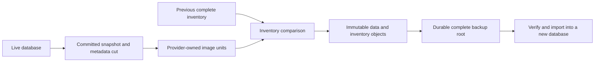

# Online and incremental backup

Status: proposal based on UQA Engine 0.6.3 (`1b5c22971d75b8db0e6900c8aa7b7e5613962bcb`). This design and its [implementation plan](../plans/0031-online-and-incremental-backup.md) are independently implementable from the released storage interfaces. No replication journal, CDC event stream, replication position, or network service is a prerequisite. The proposal does not describe a released backup API.

## Decision and delivery scope

Build online full backup first, using a consistent snapshot of committed database-owned state. Add incremental backup by comparing that snapshot's storage-unit inventory with a completed backup's inventory. Reuse unchanged immutable data objects and store replacements for changed units; remove deleted units from the new inventory. Backup describes the state at a selected snapshot, not the operations that produced it.

Every completed backup has a complete inventory root. An incremental backup shares immutable repository objects with its parent but does not require replaying a chain of delta manifests. Its parent ID records provenance and the comparison input, not an instruction to fetch missing state. Removing a parent backup cannot remove objects still reachable from a retained child. A standalone copy materializes all objects reachable from one root into another repository without opening the source database.

The first public interface is embedded Rust with a local filesystem repository. The source continues to accept reads and writes while the snapshot is exported. Initial restore creates a new database using the same provider and data mapping: memory to memory, native SQLite to native SQLite, SQLite KV to SQLite KV, and redb to redb. Native SQLite and SQLite KV remain distinct archive formats even though both use SQLite. Destination encryption and compression can differ where that provider's verified import capabilities permit it.

Cross-provider conversion, SQL dump formats, arbitrary-time recovery between backup snapshots, continuous archiving, online replacement of an existing database, remote repository protocols, scheduling, and language-binding expansion are separate work. The backup core does not require any of them. Full backup remains useful and deliverable before incremental comparison or fingerprint acceleration is implemented.

## Existing implementation and missing interfaces

| Existing owner | Foundation | Required extension |
| --- | --- | --- |
| [Committed record snapshots](../../crates/uqa-storage/src/mvcc/view.rs) | Stable record sequence, ordered scans, visible revisions/tombstones, bounded visitors, and retained source ownership | A complete provider-owned backup inventory, streaming unit reads, and a snapshot of state outside the record sequence |
| [Common persistence](../../crates/uqa-storage/src/mvcc/persistence.rs) | Commit admission, durable outcomes, identifier allocation, snapshot retention, and resource leases | Joint admission of data, autonomous metadata, namespace identities, and required artifact roots at one backup cut |
| [SQLite record reads](../../crates/uqa-storage-sqlite/src/mvcc/read.rs) | Native/KV mappings, logical MVCC snapshots, and key/revision reads | Native and KV image adapters, import validation, and snapshot-qualified optional content fingerprints |
| [redb record owner](../../crates/uqa-storage-redb/src/mvcc/mod.rs) | Provider read transactions, committed records, durable metadata, and explicit restore | A complete redb image adapter and bounded fresh-database import |
| [Memory Engine construction](../../crates/uqa-engine/src/open/lifecycle.rs) and [storage snapshots](../../crates/uqa-storage/src/read_only_snapshot.rs) | Actual memory stores, retained immutable generations, and transaction/session adapters | A joint committed catalog/data/index/resource snapshot and owner-specific memory image codecs |
| [DatabaseRestore](../../crates/uqa-storage/src/mvcc/restore.rs) | Caller-retained source/target incarnation identities and idempotent completion | Repository-owned durable restore intent and staging around the existing provider transition |
| [DiskANN backup restoration](diskann-backup-restoration.md) | Closed-file restoration preserves namespaces, selected artifacts, uncovered changes, and subsequent writes | Online capture and archive import with the same data-preservation obligations |

Current restore acceptance starts from a closed, consistent provider-file copy. It is not evidence for copying a database while it is open. SQLite's [public Online Backup API](https://www.sqlite.org/backup.html) provides a SQLite-native copying mechanism, but does not define a common UQA archive or cover the memory and redb engines. The current `uqa-rusqlite` feature configuration does not enable its `backup` module. This design uses the UQA-owned snapshot boundary and requires no dependency patch, private page hook, or dependency upgrade.

A record snapshot alone is insufficient. `allocate_identifiers` changes durable watermarks without advancing record visibility; native SQLite can defer synchronization of sequence-only publications; data namespaces are distinct from transaction-history identities; and memory Engine does not use the reference `MemoryVersionStore`. These are explicit integration requirements, not values to collect from the latest database after a data scan finishes.

## Ownership and feature configuration

| Owner | Responsibility |
| --- | --- |
| `uqa-storage` | Backup image interfaces, bounded inventory merge, archive framing, repository publication, integrity verification, retention/garbage collection, and backup/restore state machines |
| `uqa-storage-sqlite` | Native and KV image enumeration, metadata capture, optional fingerprints, physical import, encryption/compression handling, and history transition |
| `uqa-storage-redb` | redb image enumeration, metadata capture, optional fingerprints, physical import, and history transition through public redb interfaces |
| Existing memory Storage, Graph, Analysis, and ML owners | Immutable image units, resource definitions, and import of their own evaluated state |
| `uqa-sql` and `uqa-execution` | Existing catalog/type/resource interpretation and restoration contracts where those owners are needed; no new SQL statement replay algorithm |
| `uqa-engine` | Export/import authority, committed session/state adapters, source admission, retained handles, and public lifecycle orchestration |
| `uqa-api` and later bindings | Adapters for the verified embedded contract |

The audited Engine default Cargo feature set is empty; redb is an Engine development dependency. Common Storage depends on Core and Analysis, SQLite also uses Graph, and redb's only workspace runtime dependency is Common Storage. Preserve these directions and the [workspace dependency policy](../../scripts/workspace-dependency-policy.json). Common Storage cannot import Engine, Execution, SQL, or a concrete provider to understand a backup unit. Semantic or numerical algorithms stay with their owners. No new crate is required by this proposal.

Provider support is explicit. Full export, import, and snapshot-qualified fingerprints are separate capabilities; a provider without an implementation returns unsupported before creating a completed artifact. Generic collecting defaults cannot be mistaken for bounded streaming or payload-free inventory access. A shared KV interface does not by itself prove complete backup coverage.

## Consistent online snapshot

A `BackupCut` is an opaque provider-owned descriptor containing the source incarnation, data namespaces, image-format versions, record snapshot boundary where applicable, autonomous metadata snapshot identity, and the roots of required immutable resources. Wall-clock timestamps are descriptive only. The backup records this cut, rather than claiming that all data equals the database at the time the copy finishes.

Backup uses an independent committed read context. It excludes the invoking session's private writes, unfinished statements, savepoints, and transactions. A transaction committed before the cut is included in full; a transaction committed after it is excluded in full. Transactions may run across capture. Normal publication admission orders their commit relative to the cut; backup does not hold that admission while it serializes database contents or writes repository files.

1. Validate export authority, provider capability, format compatibility, resource budgets, and the repository destination. Retain the selected physical source identity rather than reopening an arbitrary path later.
2. Enter the owning publication boundary. Resolve admission according to the existing transaction state machine, establish the required durability certificate, and jointly pin data/catalog/index/resource generations and autonomous metadata. Allocate only bounded capture metadata under this boundary.
3. Release publication admission. Enumerate image units and serialize them through controlled, bounded source read windows. Later source writes preserve the versions needed by the retained snapshot.
4. Publish a completed repository root only after its inventory and all new referenced data are durable. Release the source snapshot as soon as its required bytes have been captured; repository verification and final publication need not keep it pinned.

Large metadata collections require retained immutable roots or versioned metadata snapshots, not an unbounded copy under the writer gate. Identifier namespaces, allocation high watermarks, sequence records, catalog definitions, and data namespaces must describe the same cut. Extending this metadata snapshot contract is a prerequisite to public full backup; reading current watermarks after exporting old rows is not sufficient.

The [sequence durability owner](sequence-publication-durability.md) certifies any deferred native sequence publications covered by the cut. Backup must not manufacture a synchronous commit per sequence value or alter `currval`/`lastval`. A successful archive publication provides repository durability even for a memory source; it does not make the original in-memory database crash-persistent.

Restore does not revive unused session sequence caches. Future allocation follows the restored owner's persisted reservations and watermarks, preserving no-reuse and exhaustion behavior even where this leaves gaps. Verification distinguishes durable sequence state from the next value a still-running source session could return from its private cache.

Plain and encrypted SQLite use WAL, while compressed SQLite uses rollback journaling in the current [connection owner](../../crates/uqa-storage-sqlite/src/connection.rs). A native read transaction retained for the entire export would block rollback-journal writers. Both mappings therefore require logical retained snapshots and short physical read windows, including a suitable metadata snapshot implementation. A mode that cannot meet this contract must reject online backup; it cannot advertise an offline lock-and-copy as online support.

redb export uses the already-open database owner and its supported session model; it does not independently open the live file from another process. Memory export pins the actual Engine's committed catalog, data, graph, model, and index generations. Neither a toy memory record store nor a conversion of the live memory engine to a different backend satisfies that requirement.

## Backup image and covered state

A backup unit is an owner-defined stable address plus a versioned encoded state. Its address is scoped by provider image kind, data namespace, object generation, and record/artifact identity. It is not a source filesystem path. A unit may represent a catalog record, document, posting segment, index page in the owner's logical format, model/resource segment, or autonomous metadata. Common archive code treats its bytes as opaque; only the owning adapter interprets and imports them.

Full inventory includes every unit needed to reconstruct the selected state, including required tombstone records and semantic metadata. It excludes unreachable historical versions and abandoned build artifacts unless an owner proves that they are still required by the selected state. Stable data namespaces and allocated maxima remain part of the image even where old transaction history is discarded during restore.

| State | Backup/import contract |
| --- | --- |
| Schemas, types, stored routines, views, constraints, roles/grants, and database-owned configuration | Preserve owned encoded definitions, logical identities, dependency closure, and security metadata |
| Rows, documents, materialized contents, graph entities/memberships/properties, vectors, and tensors | Preserve the committed encoded state at the cut; import does not execute INSERT statements or user callbacks |
| Text postings, weights/positions, retrieval statistics, and evaluated expression-index keys | Preserve the state consumed by existing query operators; do not reconstruct it by rerunning analyzers or expressions |
| IVF/HNSW/DiskANN topology, assignments, selected generations, exact-side records, and uncovered canonical changes | Preserve all query-observable artifacts reachable at the cut, with their generation and namespace identities |
| Sequence state and identifier watermarks | Preserve the owner's published state and no-reuse/exhaustion contract; exclude session-local sequence observations |
| Owned model/analyzer definitions, dictionaries, and immutable resources | Include required owned content or an explicit digest-qualified external requirement; never silently omit required state |
| Non-temporary unlogged objects | Include their committed contents as an explicit snapshot import; this does not change the source's SQL logging or crash-reset semantics |
| Temporary objects, private transactions, prepared statements, portals, locks, and session settings | Exclude session execution state |
| Receipt/SSI authority, live lease files, notification registrations/delivery, and source backup jobs | Recreate destination-local authority; never revive source participants or replay notifications |
| Host UDF code, external runtimes/credentials, FDW remote contents, and external side effects | Record required compatibility/binding descriptors where applicable; do not copy executable pointers or external systems |

Preserving unlogged contents in an explicit archive import does not promise recovery of live unlogged writes after a source crash. The source's PostgreSQL 18 persistence and sequence semantics still require independent verification; existing crash-reset defects are not waived by backup support. The image does not turn unlogged objects into logged objects.

The image format is provider-specific and versioned, using deterministic field encodings and explicit lengths, never Rust struct memory or SQL text. Preserve existing opaque stored representations when their owner guarantees round-trip restoration. Codecs for memory-only state belong to their current data-model owners. A storage format migration or incompatible resource codec starts a new full-backup lineage unless an explicit tested image conversion exists.

## Repository and manifest format

The initial repository is a directory with immutable data packs, immutable inventory pages, completed backup roots, and separately owned temporary operations. A root becomes discoverable as a completed backup only through the repository's durable publication boundary. Temporary files and orphan objects are not backups.

| Field | Meaning |
| --- | --- |
| `RepositoryId` | Identity and protection domain of the object store; references cannot silently resolve in another repository |
| `BackupId` | Unique identity of one immutable completed snapshot |
| Source identity and `BackupCut` | The exact captured source, namespace and state boundary |
| Image/protocol versions and capabilities | Provider mapping, codec versions, required build/runtime resources, and import compatibility |
| Parent `BackupId`, if incremental | Provenance and comparison input; not a dependency needed to reconstruct the child inventory |
| Complete inventory root | Every selected unit's address, kind, encoded length, strong digest, and immutable object references |
| Object framing and integrity | Encoded/decoded lengths, compression/encryption versions, frame checks, and root integrity |
| Counts and descriptive metadata | Unit and byte counts, source label, capture timestamps, and format-qualified diagnostics |

The root also carries an image digest over the format-qualified ordered unit identities, kinds, lengths, and image digests. Repository object locations, encryption nonces, labels, and timestamps are excluded from that logical-image digest. This lets standalone copying verify unchanged image content while producing new repository objects and a new backup ID; it does not require identical archive bytes.

Use bounded frames packed into immutable files, rather than one filesystem file per small database record. A large unit spans frames; record boundaries and lengths remain explicit. Inventory pages are ordered and streamable, so readers and merges do not allocate a map containing the entire database. New inventory pages may reuse identical immutable pages, but metadata scanning and rewriting are not assumed proportional only to changed rows.

Object references identify exact immutable pack content and bounded frame locations. Pack digests, frame integrity, decoded lengths, and unit digests are verified at the appropriate read boundary. Reject duplicate unit addresses, overlapping or out-of-range frame references, unsupported required fields, invalid encodings, and oversized decoded input. A manifest cannot supply a path to write outside the repository or restore directory.

## Full and incremental algorithms

A full backup walks the selected source inventory, streams every required unit, computes its image digest, writes protected frames, and builds a complete ordered inventory. It is independent of any earlier backup root. Repository-level object reuse is permitted only when the referenced immutable bytes and protection domain match; a full backup is not a promise to duplicate identical bytes physically.

An incremental backup first retains a completed parent root in the same repository and validates source/image compatibility. It merge-scans the parent's complete inventory and the current snapshot inventory:

| Comparison | Child inventory and data action |
| --- | --- |
| Unit present only in the current snapshot | Encode it and add its object references |
| Unit present on both sides with equal strong image digests | Reuse the parent's immutable object references |
| Unit present on both sides with different image state | Encode the replacement and use its new references |
| Unit present only in the parent | Omit it from the child inventory; no source deletion history is required |
| Unit changes between live and tombstone state | Preserve the current owner-defined state explicitly |

An insert then delete between backups can therefore leave no unit in the later inventory. Multiple updates to one unit require only its final snapshot image. DROP, TRUNCATE, namespace changes, and object recreation are handled by the complete inventory and stable generation-qualified addresses, not by trying to recover an old SQL operation sequence. Old source tombstones can already have been reclaimed; a key present in the parent and absent at the new cut still disappears correctly.

Strong image equality is the reuse authority. A matching commit sequence, page number, file modification time, size, or SQLite change counter alone is not enough, especially after file copies or divergent histories. `CommitSequence` is useful snapshot metadata but is not a backup cursor and does not cover autonomous metadata by itself. Source restore changes the incarnation and requires a new full baseline.

The baseline algorithm can stream and hash any unit whose digest is unavailable. That is a correct incremental stored representation, but can require a full payload read. Payload-read reduction requires a separate provider capability returning a content digest tied to the exact captured unit image. Where implemented, the owner maintains the digest atomically with the corresponding encoded state, or backfills it only after validating that exact immutable version. Missing, stale, or incompatible fingerprints cause a controlled payload read, never assumed equality. A digest computed for the latest value cannot certify an older pinned version.

Initial full backup does not require fingerprint metadata or write-path changes. Incremental delivery reports metadata units visited, source payload bytes read, bytes hashed, reused bytes, and newly stored bytes separately. Its steady-state acceptance proves that certified unchanged payloads are not fetched; its fallback tests prove and report the extra reads for missing fingerprints. This is an O(source inventory + parent inventory) comparison with bounded workspace, not a claim of O(changed units) source discovery. A changed-unit index is an optional future acceleration, not a prerequisite.

## Independent restore roots and retention

For example, after full backup A and incremental backups B and C, C's inventory names every unit required for C, including objects first written during A or B. C does not consult A's or B's manifests to decide its state. Deleting A removes A's root, but packs referenced by B or C remain live. Deleting B likewise cannot break C. Branching two children from the same parent is supported because both publish complete immutable inventories.

This differs from a delta-file chain that must be combined in order. [PostgreSQL's backup combiner](https://www.postgresql.org/docs/18/app-pgcombinebackup.html) documents that chain model; UQA instead resolves all inherited references into the child's complete inventory at creation. The repository still must retain every referenced data and inventory object. A missing object is corruption, never an instruction to substitute a newer backup.

Garbage collection computes reachability from all retained completed roots and active repository leases. Creating a backup, reading a parent, verifying, restoring, standalone copying, and publishing new objects each retain the required roots or temporary object set. Root publication/removal and collection admission share a repository generation protocol. Collection must not delete newly written objects between a writer's object creation and root publication; after discovering work it revalidates ownership before bounded deletion.

Initially reclaim only entirely unreferenced packs. A pack containing one live frame remains retained, and statistics distinguish live bytes from retained pack bytes. Repacking can be a later optimization. Standalone copying into a new repository already provides a source-independent way to materialize and repack one selected root; verify the new copy before removing any old root. Retention never advances a source cursor or requires historical source versions between backups.

## Durable publication, failure, and resume

Repository job state is `Preparing -> Capturing -> Publishing -> Complete`, with cancellation/failure permitted before publication. Source snapshot ownership and repository temporary ownership are explicit resources. A failed backup does not change the source transaction outcome or remove a previously completed backup.

Write new packs and inventory objects into private locations, finalize and synchronize their contents, install them without overwriting existing immutable objects, then atomically install and synchronize the completed root and its directory entry. The local repository advertises durability only on filesystems where its required publication and synchronization operations are supported. Source and repository may be on different filesystems; no cross-filesystem rename is used as a commit primitive. Repository I/O or space failure leaves at most unreachable temporary/immutable objects.

An operation ID identifies one attempted snapshot independently of the caller's handle. If publication or its acknowledgement is uncertain, the repository owner checks that ID and the completed root before reporting success, retry, or failure. A durable completed root remains complete after a lost reply or late cancellation. It is not rewritten under the same ID with a different source cut. Retrying an object installation verifies an existing object's identity rather than overwriting it.

Capture may resume only while the original source snapshot and its retained controls remain valid. Source process loss can destroy that lease; then an incomplete attempt is abandoned and a new snapshot gets a new operation/backup ID. Verified immutable objects can be reused by content, but progress offsets from two cuts cannot be spliced together. Once source capture has finished, repository publication can resume from its durable staging state without reopening the live source. No caller-side `ensure_*` or state-reset sequence is required.

## Restore lifecycle

Restore accepts one completed backup root and a new empty target. It verifies repository identity, protection keys, required formats/resources, the complete inventory, and target provider/mapping compatibility before exposing a database. The source database need not exist. Ordinary application opens reject the target while restore is incomplete.

1. Create a private target and persist the operation's source/target history identities in repository-owned restore intent outside the target database. Reuse that exact request only to resolve this restore attempt.
2. Stream verified units into provider-owned staging using bounded transactions. Preserve logical IDs, native data namespaces, allocated maxima, committed sequence state, and query-observable artifacts. Importers validate owned structure and dependency closure; they do not execute source SQL, triggers, UDFs, or generated expressions.
3. Verify the assembled image and run the owning format/integrity checks. Complete supported format migration within the unopened target if required; a failed migration leaves it unavailable.
4. Close import snapshots and owners before entering the persistent provider's exclusive `DatabaseRestore` entry point. That transition recreates coordination state and retires old receipts/SSI authority. Memory import creates a new process-local source identity. Historical mutation-origin bytes that are part of data retain their original identity.
5. Durably mark the restore complete and publish the new target. Only then allow normal sessions. Reopening the completed target preserves later writes; resolving a lost final reply never imports the backup a second time.

SQLite's existing [restore intent and coordinator transition](../../crates/uqa-storage-sqlite/src/mvcc/restore.rs) and redb's [atomic history transition](../../crates/uqa-storage-redb/src/mvcc/restore.rs) remain the authority for their respective outcomes. The archive layer must not replace them with file-existence checks or relabel source transaction receipts as destination transactions. Caller closure of all original source handles is unnecessary for online capture; target exclusivity is mandatory during restore.

Restore does not overwrite a live or populated database. Replacement is a separate application operation after the new database has been verified and all handles to any replaced target are closed. A destination path collision, symlink substitution, incompatible provider, missing pack, unknown codec, wrong key, or failed integrity check leaves the existing target untouched. No fallback rebuild of a corrupt approximate index is reported as an exact restore.

For persistent targets, close all import/provider handles before installing the staged target directory at its final location, then open normal sessions there. Include newly created auxiliary state in that publication and synchronize the containing directory. Do not rename files beneath a live SQLite pool. Compressed/encrypted targets receive their own physical container identity and required trusted anchor through the existing provider security owner; logical data namespaces remain preserved. Memory activation publishes the fully validated owner graph without a filesystem installation step.

## Encryption, integrity, and access

Export and restore require explicit database export/import authority because the archive includes database-owned security metadata and contents beyond a normal SELECT result. Source encryption does not automatically protect serialized backup bytes. Repository protection is selected explicitly; encrypted sources require an encrypted repository by default, and plaintext export is an explicit opt-in. The manifest records the protection mode.

Use the project's existing authenticated-encryption and hashing primitives through the owning storage security interface. Keep archive key material separate from source SQLCipher/container keys and outside the archive. Encrypt inventory and sensitive metadata as well as payload frames. Authenticate format, object identity, lengths, and frame position; use fresh nonces under a key, never a content-derived encryption nonce. Reuse a protected immutable object only within its recorded key/protection domain. Digests detect accidental corruption; unkeyed checksums alone do not authenticate an untrusted repository.

Key rotation does not make old objects readable under a new key. Either retain the required old key versions for every reachable object or create and verify a standalone copy re-encrypted under the new key. Removing an old key before those references are retired destroys recoverability. Private source/export/import spill follows the selected protection boundary and cannot silently contain plaintext from an encrypted source. No payload, stored credential, or key is diagnostic output.

Missing external code or resource bindings are reported before target activation. The archive never downloads a dictionary, executes supplied code, or restores a raw function pointer. Verification and restore use compatible installed runtimes whose identities match the manifest.

## Resource and verification contract

Configure explicit limits for live memory, source snapshot retention, local staging bytes, decoded frame size, and job duration. Charge snapshot wrappers, images, inventory pages, digest workspace, compression/encryption buffers, and import staging to existing budgets. Large units need streaming encoding and bounded frame reads; a provider that can only materialize an oversized unit returns a typed unsupported/limit error rather than exceeding the allowance.

Bound source read windows and release them before repository I/O or application callbacks. A slow repository must not retain a native writer or a query lock needed by source writers. Long snapshots can retain source history, so the snapshot owner enforces its retention limit and cancellation. Exhaustion fails the backup cleanly before completing its root; it cannot produce a partial-success archive or silently discard state still needed by an active read. Abandoned source leases are reclaimed through authoritative ownership, not PID reuse assumptions.

Verification has distinct levels. Manifest verification checks root authenticity, format compatibility, inventory structure, bounds, and referenced-object presence. Full verification reads and authenticates every reachable frame and unit and validates owner image structure. A restore drill additionally imports into a fresh database, performs provider integrity checks, and runs selected application-level read assertions. Manifest verification alone does not establish payload integrity or recoverability. Creating an incremental root verifies new content and its inherited reference graph; it does not imply that every reused payload was read again.

Backup reports distinguish snapshot cut, capture completion, durable repository completion, verification level, units scanned, source bytes read, bytes reused/written, and retained source/repository resources. “Online” means source operations can progress during bounded capture/export; it does not mean zero I/O cost or zero lock waits. No latency or throughput improvement is claimed before controlled measurement.

## Proposed API responsibilities

Names below describe proposed responsibilities, not released signatures or C ABI symbols.

| Resource | Operations |
| --- | --- |
| Backup repository | Create/open/close, list/inspect completed backups, verify, remove a root, collect unreferenced objects, and copy one complete root to another repository |
| Backup job | Start a full or parent-based incremental capture, advance bounded work, inspect progress, cancel/close, and resolve the completed backup ID |
| Restore job | Create a new target from a backup ID, advance bounded import, inspect progress, cancel/close before activation, and resolve the new database |
| Provider image adapter | Capture/release a cut, enumerate units, read bounded images/fingerprints, validate formats, and import owned state |

Handles have deterministic Rust resource ownership. Closing a handle releases its temporary resources; deleting a completed backup is an explicit repository operation. The owning job state machine admits retries and resolves uncertain completion. Application code chooses scheduling and I/O pacing without owning internal transition repair. Later C exposure uses the established `uqa_*`, `UQA_API`, `uqa_status`, error-lifetime, and paired resource-lifecycle conventions.

## Acceptance and implementation boundary

Required acceptance includes actual memory, native SQLite, SQLite KV, and redb engines; all eight native/KV combinations of plain, encrypted, compressed, and compressed-encrypted SQLite; committed/private transaction separation; concurrent DDL and autonomous sequences; every required graph/text/vector/model artifact; deletions and generation reuse; missing/stale fingerprints; source and target restart; corrupt/truncated/missing objects; lost publication replies; parent removal and concurrent garbage collection; and bounded large-unit behavior. The [implementation plan](../plans/0031-online-and-incremental-backup.md#acceptance-matrix) assigns these checks to their owners.

Correctness requires that importing a completed root reconstructs the selected owned state, that every reused reference denotes the same image bytes, that publication cannot expose an incomplete root, and that retention cannot delete reachable content. Preservation arguments cover existing SQL values, graph carriers, decorated text postings, ranked scores, and approximate-index artifacts; matching document IDs alone is insufficient. Product feature delivery supplies the argument required by [AI_POLICY.md](../../AI_POLICY.md#prove-feature-additions) alongside owner tests.

Full backup, incremental comparison, fingerprint acceleration, repository retention, and public adapters are separate coherent implementation units, each subject to the 10,000-changed-line limit. The [implementation plan](../plans/0031-online-and-incremental-backup.md) and [#1322](https://github.com/cognica-io/uqa-engine/issues/1322) track completed owner primitives and remaining delivery requirements. An implemented primitive does not establish complete Engine backup support.

## Evaluated value and memory document images

Core owns the versioned `UQAVAL01` format in [`value_image`](../../crates/uqa-core/src/types/value/image.rs). Its input is an already evaluated `Value`; import does not resolve a catalog, dereference a SQL datum, rerun an analyzer, evaluate an expression or execute a host callback. Common Storage owns the `UQADOC01` document envelope and streams the actual `MemoryDocumentStore` layout and values through the Core codec. These interfaces are independent of repository publication and provider record formats. A retained store supplied by Engine still needs the joint committed catalog/data/index/resource capture specified above.

Every fixed integer uses little-endian bytes. A blob is a `u64` byte count followed by that many bytes; text uses UTF-8 without normalization. An optional OID is a one-byte flag, zero for absent or one followed by a `u32`. A value begins with its one-byte tag. Unknown tags, flags, versions, invalid UTF-8, inconsistent shapes, invalid enum keys and noncanonical packed bits are errors. Nesting is limited to 128 containers. Standalone decoders reject trailing bytes; streaming readers consume exactly one image so the enclosing format can enforce its own unit boundary.

| Tag | Carrier | Payload |
| --- | --- | --- |
| 0, 1 | NULL, void | No payload; the carriers remain distinct |
| 2 | Boolean | One byte, zero or one |
| 3, 4 | Integer, float | Signed `i64` or the exact IEEE-754 `f64` bit pattern |
| 5, 6, 7, 10, 11 | String, fixed character, bytes, JSON, JSONB | One blob, retaining original text or binary bytes |
| 8 | Temporal | Kind byte followed by original numeric fields: date 0, time 1, time with zone 2, timestamp 3, timestamp with zone 4, interval 5 |
| 9 | Decimal | A text blob produced and parsed by the existing controlled decimal owner, preserving scale and special values |
| 12 | Array | Rank `u64`, each dimension `u64` and lower bound `i32`, optional element OID, then a counted sequence of recursively encoded values |
| 13 | Legacy vector | Kind byte, zero for `int2vector` or one for `oidvector`, followed by the same array payload |
| 14 | List | `u64` count and recursively encoded values |
| 15 | Row | Counted values, a descriptor-presence flag, then one `u32` OID, `i32` modifier and optional collation OID per field when present |
| 16 | Record | Optional type OID, `u64` count, then each name blob and recursively encoded value in physical order; duplicate names remain distinct slots |
| 17 | Map | `u64` count, then each name blob and recursively encoded value in strictly increasing name order |
| 18 | Enum | `u32` type OID, optional label OID and the original label-key blob |
| 19 | Datum | `u32` type OID, `u32` offset, original tuple-byte blob, descriptor-presence flag and optional counted physical fields |
| 20 | Bit string | `u32` bit length and canonical packed-byte blob |

Temporal fields retain their owner's widths: date days and interval months/days are `i32`; time, timestamp and interval microseconds are `i64`; a time-zone offset is `i32` seconds. A physical Datum field preserves its name blob, `u32` type OID, `i32` modifier, optional collation OID, `i64` length, one-byte alignment and Boolean dropped marker. The original offset can remain outside the tuple because only a subsequent SQL consumer owns lazy physical interpretation. Array import uses the existing borrowed shape validator and retains the original normalized child carriers without reconstructing values through SQL.

A document is `UQADOC01`, a tuple-`xmin` presence flag, optional `u32` tuple `xmin`, and one complete `UQAVAL01` Map image. Public fields named `xmin`, historical internal-looking names, and `$uqa_type` remain ordinary names. The enclosing backup inventory owns document IDs, table identities and generations; this document envelope does not infer them from fields. Absence returns no image and writes no bytes, while an empty document has a complete empty-Map image.

For preservation, let `E` encode an admitted evaluated value of depth at most 128, and `D` decode a complete valid image. Equality here means the same carrier, payload bits or bytes, ordered children and opaque descriptor metadata, rather than Core's possibly weaker comparison equality. For primitive tags, `D(E(v)) = v` follows from fixed-width integer inverses, UTF-8 byte identity and explicit carrier tags. Float bit encoding preserves signed zero and every NaN payload. Temporal numeric fields are unchanged. Decimal encoding uses the existing owner's scale-preserving format/parse inverse. Enum and bit-string validation accept their constructors' valid representations; Datum construction retains bytes and metadata without reading through its address.

For a composite of depth `n + 1`, assume identity for each child of depth at most `n`. Its count and type tag determine the same sequence, and each child returns unchanged by the induction hypothesis. Array shape validation checks the retained dimensions without changing child values, bounds or element OID. Row and record construction retains descriptors and positional duplicates; Map's strict ordering yields the same name-to-value function, including tag-shaped maps, without tagged-JSON recognition. Thus the constructors recover the identical composite. Induction proves the value identity. The document envelope independently preserves optional tuple metadata and applies that identity to its field Map, establishing the same stored tuple without re-evaluation.

Consequently, a deterministic existing operation over the restored tuple receives the same inputs and therefore has the same defined result and state effects under the same surrounding catalog and runtime requirements. This statement introduces no algebraic operator or optimizer rewrite and does not assert that document identity alone preserves decorated postings, ranked scores or index artifacts. Those owners' full-image obligations remain separate. Source encoding borrows immutable state and performs no mutation; later source replacement or deletion cannot alter a previously retained memory store generation.

Output uses at most 16 KiB per I/O request and no payload-sized temporary copy for strings, bytes or tuple backing. Decimal formatting uses its original controlled scratch allowance. Import reserves buffers, live map entries, descriptor conversions and boxed/shared headers before construction; temporary descriptor buffers are released after their immutable destinations exist. The returned `Budgeted` value retains decoded payload admission. Traversal stack depth is fixed by the format limit; native B-tree slack and allocator bookkeeping retain Core's existing accounting boundary. The source generation and caller-owned output have separate owners. A decoded document larger than its allowance fails with a typed memory error, and every failed decode retires its partial allocations. Partial output after I/O, quota or cancellation failure is discarded by the enclosing publication owner. Local codec success neither publishes an archive nor activates an Engine.

## Memory document generation retention

Common Storage's `MemoryDocumentStore` retains one immutable root containing the row map, ordered field layouts and row metadata. `DocumentStore::snapshot_with_control` admits that root through its existing `StorageReadControl` and returns a read-only owner. The ordinary mutation owner tracks newly stored value payloads with Core's iterative retained-value accounting, caches each row's total, and tracks new layout names and candidate capacities when they are installed. Removal subtracts the cached row total. Layouts, including those no longer named by any live row, stay charged until the root is cleared. Cloning recomputes only capacities that the existing clone changes; shared value and layout payloads keep their original extents. Capture performs no corpus traversal or payload copy.

The generation footprint consists of its header, live row-map entries, each shared value-vector header and exposed capacity, Core's retained value payload sizes, immutable field arrays and string capacities, layout-vector capacity, and exposed hash/candidate capacity. Opaque standard-library B-tree/hash slack, allocator metadata and reference-count bookkeeping remain outside this accounting boundary. Shared payloads reached through distinct rows or generations are conservatively charged per retained owner. This is a source-retention bound; working copies, projection buffers and output belong to their invoking read/codec allowances and existing API contracts. Source retention is separate from the 512-byte working allowance used by the large document-image export fixture.

Let a generation be `G = (L, R)`, where `L` maps layout identities to immutable ordered names and `R` maps document identities to `(layout, values, tuple metadata)`. Snapshot capture increments immutable ownership of exactly `G` and does not change either mapping. A source mutation with another owner of `G` first creates a distinct root `G'`; its row/layout updates cannot mutate the shared immutable payloads reachable from `G`. Without another owner, changing the source root cannot affect any captured observer. Induction over source replacement, patching, deletion, clear and later layout-identity reuse therefore preserves every captured field and tuple-metadata observation. The image codec receives the same ordered names, evaluated values and metadata, so its existing preservation result composes with this capture without adding a query operator or optimizer rewrite.

Admission uses the root's tracked footprint before publishing a reader. The cached reservation is weak and can be reused only when its allowance is identical to the new reader's allowance; a separate allowance reserves the entire generation independently. Reader wrappers retain the shared reservation, and row/layout ownership is dropped before their retention fields. Mutations invalidate only their own root's cache; they cannot retire the old generation's live leases. A failed or cancelled construction publishes neither a reader nor a replacement cached lease. Thus no successful capture escapes its source admission, and each allowance releases its charge when its final reader retires, even if another allowance still retains the same generation.

The read owner carries its original cancellation independently of the shared reservation. Re-capture cannot replace that scope with a fresh token or larger allowance. Every fallible read enters that owner, borrowed callback traversal checks it between rows, and image output checks it between writes while preserving the original typed error. Controlled copies use the invoking read allowance and retain their own returned payload charges. Infallible shared-row carriers have no reservation slot, so controlled readers do not advertise those optional capabilities. Ordinary source snapshots and transaction rollback retain their existing writable behavior; controlled readers reject mutation within the storage owner.

The six owner tests cover one and 20,000 rows with less than 2 KiB of capture allocation, exact captured bytes/metadata after source replacement and loss, oversized capacity and dormant-layout retention, failed admission and cancellation, independent and nested readers, final-owner retirement, read-only admission and callback cancellation, and four MiB of image output under a separate 512-byte allowance. These guarantees cover one document generation. Joint committed Engine capture and complete catalog, index, graph, model and resource images remain separate requirements of #1322.

## Evaluated memory graph images

Graph's [versioned image contract](backup-image-format.md#evaluated-memory-graph-images) preserves evaluated entity properties, named memberships, label registries and unused allocation state. Its importer reconstructs derived adjacency and label indexes under the original allowance and validates a complete standalone candidate before return. Existing graph set-operation and label-drop behavior is preserved without replaying graph mutations. Engine still owns selecting one committed graph/catalog/data/resource cut and activating the complete restored database.
