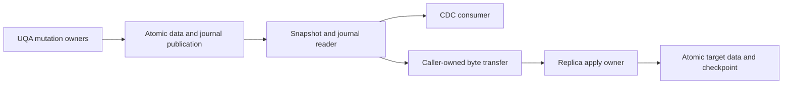

# Replication and change data capture

Status: proposal, based on UQA Engine 0.6.3 (`1b5c22971d75b8db0e6900c8aa7b7e5613962bcb`). This document defines a transport-independent replication and change data capture (CDC) core. It does not describe an implemented API. The [implementation plan](../plans/0030-replication-and-change-data-capture.md) tracks delivery units and acceptance; the [manual](../manual/sql/09-compatibility.md) remains authoritative for released behavior.

## Decision and scope

Use a database-owned change journal whose publication is atomic with the changes it describes. CDC reads committed semantic events from that journal. Replication transfers a consistent snapshot followed by committed state changes from the same journal, and atomically applies each publication with its source checkpoint. The application moves the exported bytes: an in-process loop, a file, or a future transport can use the same interface.

The core supports one source authority per replicated database, multiple independent CDC consumers, and multiple read-only replicas. Concurrent writing sessions at the source remain supported; their committed publications have one database-wide order. Replicas may use a different built-in storage provider when their format and capability manifests are compatible. The completion target covers memory, native SQLite, SQLite KV, and redb separately.

Networking, discovery, authentication protocols, remote scheduling, synchronous replica acknowledgement on source commit, consensus, leader election, automatic failover, promotion, multi-source merges, cascading replication, and conflict resolution are outside this design. Replication is asynchronous: source commit confirms local publication and durability, not receipt by another database. No HTTP, SSE, PostgreSQL wire, Tokio, or socket dependency is required by the core.

This is a UQA state-transfer protocol. It does not introduce PostgreSQL publication/subscription SQL or claim compatibility with PostgreSQL replication protocols. Existing SQL behavior, including transaction, sequence, trigger, and replica-identity semantics, must remain compatible with PostgreSQL 18. A future PostgreSQL-facing replication adapter needs its own compatibility implementation; missing replication catalog relations remain part of [#1049](https://github.com/cognica-io/uqa-engine/issues/1049).



## Existing implementation and missing contracts

| Existing owner | Reusable foundation | Work still required |
| --- | --- | --- |
| [Common persistence](../../crates/uqa-storage/src/mvcc/persistence.rs) | Database identity, transaction allocation, immutable commit fingerprints, outcome resolution, snapshots, and receipt retention | Durable journal membership, independent replay retention, source positions, and atomic consumer checkpoints |
| [Prepared commits](../../crates/uqa-storage/src/mvcc/commit.rs) and [private batches](../../crates/uqa-storage/src/mvcc/session/batch.rs) | Bounded immutable replacements, spill, conditional validation, and typed graph/vector effects | Ordered semantic events before write coalescing and portable, owner-defined replication effects |
| [SQLite publication](../../crates/uqa-storage-sqlite/src/mvcc/write.rs) | Native and KV records, current sequence, and receipt share a physical transaction | Journal entries, frontier metadata, and replica progress in that same transaction |
| [redb publication](../../crates/uqa-storage-redb/src/mvcc/mod.rs) | Conditional publication and receipts use one immediate-durability transaction | The same journal and progress contract through redb's public interfaces |
| [Memory engine construction](../../crates/uqa-engine/src/open/lifecycle.rs), [transaction finish](../../crates/uqa-engine/src/transactions/frame_finish.rs), and [publication](../../crates/uqa-engine/src/transactions/publication.rs) | Memory stores, transaction snapshots, publication gates, and session adapters | An atomic in-process journal boundary coordinated with all memory data/catalog owners |
| [Sequence durability](sequence-publication-durability.md) | Autonomous sequence publications and an explicit synchronized-prefix certificate | A journal durability frontier that cannot export a recoverable-but-unsynchronized suffix |
| [Notification publication](../manual/internals/03-storage.md#atomic-publication) | Sealed commit intent and uncertain-outcome handling | A replay log with multiple independent consumers; notification delivery itself is not that log |

`CommitSequence` is a record visibility boundary. Empty record commits can reuse it, and allocation and durability operations have different publication rules. `StorageTransactionId` identifies an allocated transaction, not commit order; `StorageMutationOrigin` identifies a private mutation, not committed visibility. None is sufficient as the public CDC cursor by itself.

Commit receipts can be acknowledged and reclaimed. Record histories retain only the versions required by their existing snapshot contracts. `PreparedRecordCommit` contains final per-key replacements and can order spilled writes by key, so it cannot reconstruct the order of SQL row operations. An insert followed by a delete must not disappear from operation-level CDC merely because its final row state is absent.

`MemoryVersionStore` is a [record-contract reference implementation](../../crates/uqa-storage/src/mvcc/memory.rs), not the storage path used by `Engine::new()`. Extending that type alone would leave the public memory engine uncovered. The memory integration must prepare all fallible work before jointly publishing data, catalog changes, and the journal through the existing owning state machines; it must not replace the memory engine with a different backend as an incidental shortcut.

## Ownership and dependency direction

| Crate | Responsibility |
| --- | --- |
| `uqa-core` | Existing typed values, identities, cancellation, and memory accounting; only genuinely shared value-format primitives belong here |
| `uqa-storage` | Journal framing, positions, sealed publication identity, bounded staging, persistence capabilities, retention, consumer state, snapshot/log coordination, and atomic apply checkpoints; SQL and graph payloads remain typed owner envelopes or opaque versioned bytes |
| `uqa-storage-sqlite` | Native/KV physical journal persistence, migration, encryption, cross-process admission, synchronized frontiers, and atomic data/progress commits |
| `uqa-storage-redb` | redb physical persistence, migration, durability, and atomic data/progress commits |
| `uqa-sql` | Catalog/type definitions, stable schema descriptions, and SQL value interpretation; no storage or provider dependency |
| `uqa-execution` | Semantic capture after successful row/catalog mutations, savepoint participation, SQL-owned snapshot codecs, dependency validation, and applying evaluated SQL effects through storage interfaces |
| `uqa-graph`, existing storage/index owners, and `uqa-ml` | Their own graph, search, vector, and model state codecs, validation, snapshot export, and evaluated-effect application |
| `uqa-engine` | Source/replica lifecycle, session and transaction adapters, authority checks, retained handles, and coordination of the owning capabilities |
| `uqa-api` and language bindings | Later public adapters for the same core contracts, with language-appropriate lifetimes and error translation |

The [workspace dependency policy](../../scripts/workspace-dependency-policy.json), crate manifests, and [storage boundary](../manual/internals/03-storage.md#storage-boundary) determine interface placement. Common Storage cannot import SQL, Execution, Engine, or a provider. Execution cannot import Engine or a concrete provider. redb cannot depend on SQLite. Semantic codecs and application algorithms do not move into Engine to avoid these boundaries; Engine supplies the existing adapters to the owners.

The audited configuration has no default Engine Cargo features; redb is an Engine development dependency, not a runtime dependency. Common Storage has a `test-support` feature, not a replication implementation. The design does not require a new crate or a new default dependency. Provider journal support must be an explicit capability with a conservative unsupported default for third-party providers. The capability identifies the implementation's complete atomic contract; it is not inferred from the presence of a raw KV interface or a SQLite handle.

## Source lifecycle and activation

Capture is explicitly enabled for a database. Its persisted configuration records the journal format, supported owner codecs, retention limits, and active stream identity. Capture-off databases keep the existing mutation path without constructing CDC payloads. Every UQA opener observes capture and replica mode through the database owner; a per-session flag is insufficient.

Activation closes admission to new writers and lets already admitted writers finish, resolving uncertain outcomes without holding a physical writer or any publication lock those writers need. Once that writer generation is quiescent, a short exclusive publication boundary validates managed objects and mutation coverage, installs the capture configuration and initial journal boundary, and reopens writer admission. A transaction that started reading earlier must acquire current capture admission before its first write. This prevents a transaction containing uncaptured earlier writes from committing into a newly enabled stream. Cross-process native SQLite and SQLite KV openers obey the same boundary. Read-only work need not be drained unless the snapshot owner requires it.

Each admitted writer retains the capture generation and a bounded event accumulator. The mutation owner admits and stages its event with the mutation, so an allocation or encoding failure cannot leave the data effect eligible to commit without its event. Direct managed document, graph, vector, catalog, maintenance, COPY, and SQL paths must reach this boundary. Raw modification of SQLite tables or redb records outside UQA's owning interfaces is not a captured write API; UQA-owned raw writers require typed coverage or are refused while capture is active.

Disabling capture is refused while durable consumers or snapshot exports retain the stream. Explicitly removing those resources precedes disabling it; the disable transition also drains its admitted writer generation before changing mode. Re-enabling after a gap creates a new epoch and requires a new baseline; it never pretends the old cursor is continuous. A source may be enabled only when its declared capability set covers all managed objects and all admitted mutations. Intermediate implementation PRs do not expose an incomplete database-wide source capability.

## Journal identity, ordering, and encoding

The following names describe proposed concepts, not existing Rust types or frozen ABI declarations.

| Concept | Contract |
| --- | --- |
| `SourceId` | Persistent opaque identity of the source authority, distinct from a provider's local database identifier |
| `JournalEpoch` | Opaque incarnation of a continuous exported history; restore, cloning into an independent source, or restarting capture after a gap creates a new epoch |
| `JournalPosition` | `(SourceId, JournalEpoch, offset)`, with an unsigned 64-bit offset assigned in publication order; overflow fails before publication |
| `PublicationId` | Stable identity of one sealed publication within its stream, retained across uncertain-outcome resolution and physical retries |
| `EventId` | Stream identity, publication identity, and event ordinal; independent of delivery attempts, chunk boundaries, and consumer filters |
| `Checkpoint` | A complete publication position and digest, qualified by the journal format and stream identity |

One journal entry is one atomic source publication. An ordinary transaction contains its committed semantic events and final replication effects; an autonomous sequence or identity publication has its own entry. Transaction allocation order, timestamps, SQL transaction IDs, and physical page positions do not define delivery order. Pure reads and journal administration need no event entry. A transaction with semantic events but no final row difference still publishes an entry. Relevant index maintenance can have replication effects without user row events.

Each envelope contains a format version, stream identity, position, predecessor checkpoint, publication identity, publication kind, required owner-codec versions, bounded chunk descriptors, semantic events, final replication effects, and a digest over canonical content. Internal record visibility and receipt identities may be attached for diagnostics but are not portable resume tokens. The entry and its position are assigned at successful publication; an aborted attempt creates no visible entry. No timestamp is used to prove continuity.

The journal uses a versioned binary envelope with deterministic field encoding, lengths checked before allocation, per-chunk integrity, and an envelope digest. SQL text replay, native Rust memory layouts, general JSON conversion, and provider-private record keys are not its canonical representation. Typed SQL values preserve distinctions such as NULL versus absent document fields, array dimensions and lower bounds, exact numeric values, temporal variants, and composite/domain descriptors. Each owner specifies its codec and compatibility fixtures before implementation; this proposal does not reserve byte tags or on-disk format numbers.

The envelope shares immutable payload references between CDC events and replication effects where possible. CDC preserves operation order; replication can use a coalesced final change set. Neither representation is reverse-engineered from the other's incomplete information. Source schema descriptions needed to interpret an event remain reachable even when the object is subsequently altered or dropped in the same transaction.

### Transaction and durability boundary

1. Mutation owners stage evaluated effects and semantic events within the current command/savepoint, using existing cancellation, retained-memory, and spill owners. Statement failure or savepoint rollback removes exactly that scope's transactional events and effects.
2. Complete deferred checks and deferred trigger effects, then seal the publication's canonical logical changes, ordered events, and identity. Prepare the attempt's derived artifacts and bounded chunks, and reserve journal capacity before opening the physical writer. Application callbacks cannot run during publication or retry.
3. Under database publication admission, resolve an existing receipt for the same sealed identity before validating fresh state. Otherwise validate the current heads and owner generations, allocate the next journal position, and stage data, owner artifacts, journal entry, receipt, and frontier metadata in one physical transaction.
4. Commit using the provider's durability contract. Persistent readers expose only the certified durable journal prefix. Memory readers expose only the jointly published in-process prefix.
5. Publish cache observations and wake readers after the outcome is known. Failure of wakeup, cache refresh, or caller acknowledgement cannot turn a committed transaction into an abort or remove its journal entry.

An indeterminate commit retains the same sealed publication and receipt-resolution rights. A retry either discovers that exact committed publication or completes it once; it does not execute SQL, triggers, generated expressions, or UDFs again. The sealed fingerprint covers ordered events and canonical logical changes. The finalized envelope digest additionally binds the assigned position, predecessor, and actual committed derived artifacts. Existing owners may re-prepare derived artifacts only after a definite safe rejection, preserving the sealed events and canonical changes; an uncertain or confirmed commit must resolve to its original envelope. This distinction avoids making retry identity depend on a position that has not yet been assigned. The source's journal cannot be a second database, an after-commit callback, or an independently committed side file.

Autonomous sequence state and allocation watermarks cannot be undone with ordinary row changes. Their owning publication paths participate separately. Preserve the existing distinction between reserved identities, persisted sequence records, and session-local `currval`/`lastval`; do not emit one fabricated transactional row event for every cached `nextval` call. A sequence publication that survives rollback remains represented even if the consuming transaction aborts.

Native SQLite can defer synchronization of eligible sequence-only publications. Their data and journal entry still commit atomically, but their offsets remain beyond the exported durable frontier until the existing consuming-transaction barrier or another certified synchronized commit covers them. Such a barrier advances the durable journal frontier even when it writes no logical event. Snapshot creation also certifies the prefix it exports. This avoids publishing a CDC checkpoint for a suffix that may disappear after power loss, without replacing the existing sequence durability optimization with a FULL commit per value.

For file-backed providers, journal entries, durable frontier updates, and target checkpoints inherit the same durability and encryption guarantees as database state. Memory streams explicitly have process-lifetime durability. Restarting an in-memory database creates a different stream; a persistent consumer must not interpret that restart as continuation.

## Semantic CDC contract

CDC delivers committed operations in publication order and, within each ordinary transaction, in the order that the mutation owners accepted the effects. It does not expose uncommitted work, aborted statements, or rolled-back savepoint effects. This is operation-level CDC, not a diff between consecutive database snapshots.

| Event | Required content |
| --- | --- |
| Row/document insert | Stable object and row identity, schema generation, and complete after image |
| Row/document update | Stable identity, schema generation, complete before and after images, including identity-key changes |
| Row/document delete | Stable identity, schema generation, and complete before image |
| Truncate | The complete affected object/partition set and generation transition; no invented sequence of row deletes |
| Catalog change | Typed created, replaced, renamed, or dropped definitions with dependency identities and schema versions |
| Graph change | Node, edge, membership, or property operation with its stable identities and applicable images |
| Vector/model change | Owned logical payload and metadata change; low-level index maintenance is distinguished from user data |
| Autonomous state change | Published sequence state or identity watermark, with its separate publication kind |

An insert followed by two updates and a delete in one successful transaction produces four row events even though no row remains afterward. A no-op UPDATE that is an actual accepted row operation remains an update event. Trigger and cascading effects are captured as their actual effects; submitting a statement is not itself an event. Physical storage work implementing a graph or row event does not generate a duplicate logical event. Multi-statement autocommit yields separate transaction envelopes; an explicit transaction yields one envelope after all of its surviving effects.

Full before/after images are the initial contract. They cost storage but keep delete and update interpretation independent of later source reads and of a declared primary key. Stable row identities are scoped by source, object identity, and object generation, not by mutable table names. A future key-only projection must explicitly represent unavailable images and negotiate its semantics; it cannot silently weaken an existing consumer.

Initially, a CDC subscription covers the database's captured scope without row, table, or column filters. Filters, schema transforms, sink connectors, and parallel partition delivery are separate extensions. They must not be implemented by weakening source retention or replication continuity. Large committed transactions are read in bounded chunks, with explicit beginning and completion metadata; a consumer can stage its work until the complete transaction is verified. Chunk size does not change atomicity or event identity.

Delivery is at least once. Reading does not acknowledge. A consumer acknowledges only a complete delivered publication after its sink has accepted the corresponding effects. A crash after sink commit but before acknowledgement can redeliver that transaction; stable event IDs permit sink deduplication. Atomicity between an arbitrary external sink and UQA's acknowledgement is not promised. The replica applier has stronger local guarantees because its data and checkpoint share one target transaction.

## Replicated state and compatibility

Replication covers the complete supported set of permanent UQA-owned database objects, not a selected set of tables. Schema and data changes commit together at the destination. Temporary objects and session state are excluded. Unlogged relations are excluded from the durable stream and snapshot, with dependencies validated so a durable object cannot silently arrive with a missing required object. This exclusion is a replication scope rule; it does not change the SQL behavior of unlogged or temporary relations.

| State | Transfer/application rule |
| --- | --- |
| Schemas, tables, types, routines, views, constraints, roles, and grants | Transfer versioned owned definitions and dependency identities; include required security metadata, not only row shapes |
| Permanent rows, documents, materialized contents, graph data, and vectors | Transfer owned typed values and stable source identities; apply evaluated effects without SQL re-execution |
| Sequence state and identifier watermarks | Snapshot and stream the owner's published state, including nontransactional publications; preserve no-reuse and exhaustion semantics |
| Stored expression-index keys and full-text state | Preserve already evaluated keys and owned token/posting state, unless an owner proves reconstruction preserves the same observations without application callbacks |
| IVF, HNSW, DiskANN, and other query-observable index artifacts | Transfer versioned logical topology/assignments and required immutable artifacts through their owners; do not assume rebuilding from vectors preserves search results |
| Stored model/analyzer definitions and owned resources | Transfer immutable resources by digest and bounded chunks; require compatible runtime capabilities before application |
| Physical records, pages, WAL, file offsets, storage receipts, leases, and local transaction IDs | Remain provider-local; never copied as source execution authority |
| Session settings, prepared statements, locks, temporary catalogs, LISTEN registrations, and notification deliveries | Remain local; CDC and replication do not replay runtime notifications or host-side effects |
| Host UDF code, external runtimes, credentials held outside the database, and FDW remote contents | Require explicit compatible destination bindings where referenced; do not serialize function pointers, fetch dependencies, or copy external systems |

The target preserves source-visible logical object IDs, row/document IDs, and graph identities within the imported database. It has its own physical database incarnation and internal transaction allocations. Codec owners validate compatibility with built-in catalog identities and reserve imported logical ID ranges before exposing any object; they must not silently remap SQL-visible identities. Provider-local references can be translated internally without changing those logical identities. Initial import therefore requires an empty target rather than merging into an independently populated database.

A manifest states the protocol and owner-codec versions, schema/resource digests, required features, collation/analyzer/model runtime identities, object capabilities, and source checkpoint. The destination validates it before accepting the snapshot and validates new requirements before publishing each later transaction. Missing code, resources, codecs, or compatible index behavior cause an explicit unsupported-capability error with no visible partial apply. Existing streams never skip an unknown required event. The first implementation accepts only explicitly tested version combinations; matching an envelope version alone does not establish cross-release compatibility.

Approximate index state is part of the compatibility contract where it affects observable search results. An implementation unit may expose a narrower capability only when admission explicitly rejects uncovered databases and future mutations; it must not claim universal replication and silently rebuild unsupported state. Full source activation remains unavailable until the implementation plan's coverage gates pass.

Equivalence means matching owned logical state and deterministic query observations under compatible runtimes, including the preserved search artifacts. It does not require identical physical layout, local transaction metadata, query plans, wall-clock values, random outputs, runtime counters, or results supplied by external systems. New SQL-facing interfaces must preserve PostgreSQL 18 semantics independently of this UQA protocol. PostgreSQL's own logical replication does not transfer DDL or sequence state; this proposal's UQA state-transfer scope is deliberately defined by its own manifest. See [PostgreSQL 18 logical replication restrictions](https://www.postgresql.org/docs/18/logical-replication-restrictions.html).

## Snapshot and journal handoff

A source export operation jointly establishes a consistent owned-state snapshot and a retained journal boundary. A plain table scan followed by asking for the latest position has a race and is not an export operation.

1. Under publication admission, certify the exportable prefix, pin the matching data/catalog/index/resource state, record its checkpoint, and establish the durable subscription that retains every later journal entry. Autonomous sequence and identity owners participate in the same cut.
2. Release publication admission and stream the manifest and snapshot chunks from the pinned owners with bounded read windows. New source transactions can commit. The export includes definitions before their dependent data and a digest tree covering all chunks and object versions.
3. Import into a target in `Initializing` state. It is unavailable for application reads and writes while bounded local transactions load verified chunks and record import progress. A failed or interrupted import cannot expose a partly populated replica.
4. Validate the complete snapshot, dependency closure, identity ranges, resources, and digests. Atomically mark the target `Following` with the snapshot checkpoint. Then apply journal entries strictly after that checkpoint.

The source export handle owns its snapshot pins; the durable subscription owns log retention independently. Closing or losing the handle releases the snapshot, not the subscription. Source process loss can invalidate a snapshot handle: resumable snapshot export across source restarts is not assumed. The subscription remains retained or explicitly invalidated, and the client starts a fresh consistent export when necessary. Target chunk resume requires the exact same live export identity and manifest; otherwise it starts a new import into a fresh target.

An interrupted target import remains explicitly `Initializing` after reopen and cannot become readable merely because some data files exist. A complete import can resume from its persisted checkpoint. Reseeding an existing replica uses a new empty target; the application replaces its database handle only after that target is complete. In-place replacement of a serving database and transparent migration of its active readers are outside the core scope.

Long exports consume both snapshot retention and journal retention. Their byte/time budgets are admitted before progress continues, and cancellation releases the resources owned by that export. An expired export or journal gap returns a typed reseed-required result with the available range. No API silently jumps to the current head. The snapshot-plus-stream model has an analogous consistency boundary in [PostgreSQL 18 exported logical-decoding snapshots](https://www.postgresql.org/docs/18/logicaldecoding-explanation.html#LOGICALDECODING-EXPORTED-SNAPSHOTS).

## Replica lifecycle and apply

The persisted replica state machine owns admission: `Initializing` accepts only import operations; `Following` accepts queries and ordered apply; a failed apply preserves the last complete checkpoint and accepts either an exact retry or an explicit recovery operation. Ordinary source writes are refused for the lifetime of a replica, including direct managed APIs and autonomous sequence mutation. Read admission cannot observe a partially applied transaction. Source mode and replica mode are mutually exclusive, so applied changes cannot accidentally create a replication loop.

The apply owner validates stream identity, predecessor checkpoint, required codecs, schema generations, integrity, limits, and complete publication framing before making target effects visible. It stages effects through their owning crates, then commits data, catalog/index state, imported logical watermarks, and the source checkpoint in one physical transaction. Large publications can be staged in bounded private storage but are not divided into independently visible commits. The memory target uses the equivalent atomic publication gate.

Replica application consumes evaluated changes. It does not submit source SQL, call user triggers or UDFs, recompute generated columns, or make new sequence allocations. Structural invariants, object identities, and dependency closure are validated through owner-specific import/apply interfaces; bypassing SQL evaluation is not permission to insert unchecked bytes. Setting `session_replication_role` is insufficient and is not the apply mechanism.

| Incoming publication | Result |
| --- | --- |
| The next position with the expected predecessor and compatible content | Apply once and persist its checkpoint atomically |
| The current checkpoint with the same identity and digest | Return the already-applied checkpoint without mutation |
| An earlier position whose digest is still retained in the bounded replay window | Return already-applied only if the retained identity and digest match |
| An older position outside that window | Return a stale-replay result and the current checkpoint; do not claim to have compared forgotten content |
| A retained position reused with different content | Reject as divergent history |
| A missing predecessor, out-of-order position, another source/epoch, or an unsupported format | Reject without changing the last complete target state |

Apply replies and source acknowledgements can be lost. After an indeterminate local commit, resolve the local receipt and persisted source checkpoint before admitting another publication. The receiver never infers rollback from a lost reply. Only after the target commit is confirmed may the caller acknowledge the source subscription. The bounded replay window and a durable current checkpoint avoid keeping an unbounded hash table merely to recognize every historical duplicate.

No promotion or writable detachment operation is included. Restore and cloning must explicitly establish a new source epoch before accepting source writes; they cannot reuse a checkpoint history whose suffix may differ. Restored source subscriptions are invalidated rather than silently moved into the new epoch. A restored replica must verify its checkpoint against the source's retained history and reseed if continuity cannot be established. These local identity rules do not provide distributed fencing or make failover safe without a future authority protocol.

## Subscriptions, retention, and resource limits

A subscription is a durable named retention obligation; a reader is a transient lease on it. Creation records its start checkpoint and codec contract, either at an available retained checkpoint or atomically at the current exportable head. An unavailable historical start returns a gap instead of silently starting later. Opening a reader acquires an exclusive generation-tagged consumption lease. Closing it releases that lease but does not delete the subscription or advance its checkpoint. Dropping the subscription explicitly releases its retention requirement. Peer openers and crash recovery use authoritative ownership, not process-ID guessing or wall-clock expiry alone.

Acknowledgements are monotonic, qualified by stream identity and lease generation, and accepted only at complete delivered publication boundaries. Duplicate acknowledgements of the current checkpoint are idempotent; a stale lease, an unseen future position, or a checkpoint in the middle of a transaction is rejected. A new reader resumes after the last persisted acknowledgement, so a lost acknowledgement may produce redelivery but not loss. The commit making acknowledgement durable precedes deletion of entries it releases.

Journal reclamation is independent of record-version and commit-receipt reclamation. It considers every active subscription, snapshot handoff, in-flight reader chunk, and unresolved publication. It reclaims bounded amounts of complete committed history only below their common retained frontier. A stored digest at the retained boundary permits continuity checks without retaining all older payloads. Consumer administration and pruning do not generate new CDC entries and thereby keep their own stream alive forever.

Configuration requires explicit finite journal byte, private staging, and snapshot-retention limits; consumers can additionally have lag limits. The default overflow behavior is to reject a new captured publication before it commits, with a typed journal-capacity result, while preserving every active consumer's history. Reclamation, acknowledgement, or explicit consumer removal can restore capacity. There is no implicit wait holding a physical writer, silent loss, or unbounded growth.

An optional explicit expiration policy can mark a consumer invalid before releasing its retained range. Once invalid, opening, reading, or acknowledging that consumer returns reseed-required even if some old bytes remain. Export cancellation or retention expiry must similarly invalidate its snapshot lease before reclaiming pins. Limit enforcement and invalidation belong to the owning state machines and must be atomic with their authority changes.

Staging, encoding, retained images, dictionaries, manifests, chunk descriptors, hash workspace, reader batches, and apply buffers are charged to the existing memory owners. Large transactions and values use bounded streaming/spill rather than collecting the whole envelope in a `Vec`. Byte limits are checked before allocation and decompression; compression ratios do not bypass decoded limits. Failure before publication preserves the original data/checkpoint. Spill and journal encryption follow the database's existing encryption boundary and cleanup ownership.

Readers have a nonblocking bounded read operation that distinguishes available data, caught-up, expired/gap, cancellation, and permanent errors. An optional local wait primitive may provide wakeups, but the journal remains authoritative after a missed wakeup. Poll scheduling, retry delays, transport buffering, and remote backpressure belong to callers. Diagnostic counters report committed/read/acknowledged offsets, retained bytes, consumer lag, and classified errors without adding an FFI logging interface.

## Proposed API responsibilities

The first public surface is a Rust embedded API; these operation names describe responsibilities rather than final signatures. Source handles and reader handles are retained resources with deterministic `Drop`; explicit `close` reports fallible cleanup where necessary. Durable object creation/removal is distinct from handle opening/closing.

| Object | Operations and lifetime |
| --- | --- |
| Source | Enable/disable capture, inspect capabilities/configuration, open snapshot export, and inspect retained/exportable ranges |
| Subscription | Create/drop, inspect acknowledged checkpoint and retention state; persists after reader close |
| Change reader | Open/close, read bounded committed chunks, acknowledge complete publications; owns one consumption lease |
| Snapshot export | Open/close, read manifest/chunks, report checkpoint; owns consistent snapshot pins and links a subscription |
| Replica | Create an empty target in replica mode, import/finish a snapshot, apply bounded publication input, and read the confirmed checkpoint |

Illustrative control flow, not executable API code:

```text
source: create subscription together with a consistent snapshot export
caller: copy snapshot chunks into an initializing target
target: verify and finish snapshot -> confirmed checkpoint
source: open the subscription reader after that checkpoint
loop:
    reader: read one committed publication in bounded chunks
    caller: transfer chunks to target private staging
    target: apply complete publication -> confirmed checkpoint
    reader: acknowledge that checkpoint
```

The API owns state transitions even when callers cancel, drop handles, repeat an operation, or receive an uncertain-outcome result. Callers never need to invoke `ensure_*` or reset internal state before retrying. Rust futures, language callbacks, and asynchronous scheduling can adapt these operations later without moving commit responsibility outside the database.

Later C exposure follows the established `uqa_*`, `UQA_API`, opaque-handle, `uqa_status`, error-lifetime, and paired resource-lifecycle conventions in the [C binding design](c-bindings.md). No provisional C symbols are frozen in this proposal. Python, Node.js, and browser adapters must expose equivalent checkpoints, transaction boundaries, cancellation, and durability qualifications rather than substituting a best-effort notification callback.

## Access and integrity boundary

Full-database CDC and snapshots can contain deleted values, historical values, and security metadata. They require explicit database export authority; ordinary SELECT access or a row filter is not an authorization substitute. Reader creation and resumption validate that authority through Engine's session adapters, and revocation invalidates the relevant retained capability before further payload delivery. Replica application similarly requires a dedicated import capability, not ordinary SQL write admission.

Database-owned credentials and security definitions cannot be silently omitted while declaring a complete replica. Each owning codec must classify its fields as transferable protected state or a required external binding, and fail admission if a necessary binding is absent. Exported bytes cross the database encryption boundary and are owned by the caller. The core provides integrity framing, not transport encryption or peer authentication; checksums alone do not authenticate a source. No payload, before image, or credential belongs in diagnostic logging.

## Correctness and acceptance obligations

The implementation must establish the following invariants at each owner boundary. Owner-specific arguments and finite regression tests are complementary; a successful demonstration loop does not establish crash safety or coverage of all writers.

1. A captured committed mutation has exactly one matching committed journal publication; an aborted transactional mutation has none. Independent sequence publications retain their own outcomes.
2. A consumer can resume only within the same continuous stream and never advance beyond a complete verified publication. Explicit retention loss is distinguishable from being caught up.
3. The snapshot plus all subsequent retained publications describes one continuous source history, including schema, identities, and query-observable artifacts.
4. A replica checkpoint is visible if and only if all state required by that checkpoint is visible. Retry cannot execute user code or duplicate a committed effect.
5. Memory, disk, read windows, cancellation, and cleanup remain bounded across large values, long transactions, slow readers, and failure.
6. Existing SQL/operator observations and transaction ownership remain unchanged when capture is disabled, and preserved within the stated replicated scope when it is enabled.

Qualification covers all four actual Engine providers, all sixteen source/target provider pairs for portable replication, and persistent reopen/crash cases for the three durable providers. It includes transaction/savepoint rollback, triggers/cascades/COPY/direct APIs, net-zero transactions, DDL and dropped identities, sequence durability, graph/vector/search artifacts, multiple sessions/processes, unknown commit outcomes, duplicate/gapped/corrupt input, snapshot handoff races, expired subscriptions, and bounded large publications. The [implementation plan](../plans/0030-replication-and-change-data-capture.md#acceptance-matrix) assigns these checks to delivery units.

No product feature, format migration, binding API, external dependency change, or runtime qualification is delivered by this proposal. Product documentation and release notes change only with verified implementation. Future implementation PRs preserve the repository's 10,000-changed-line limit and the existing dependency, ownership, single-test-target, and automatic Linux/macOS performance qualification policies.
