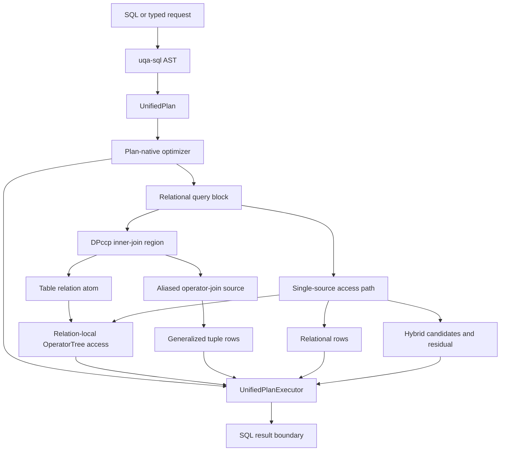

# Internal Architecture

UQA Engine unifies planning and execution without forcing SQL rows, document postings, graph contexts, and join tuples into one physical type. `uqa-engine` is the composition root; lower crates retain narrow ownership.

## Design goals

- One compiled planning boundary for relational SQL, retrieval, fusion, and graph operations
- Explicit carrier laws rather than implicit conversions between incompatible representations
- Replaceable persistence behind catalog and storage traits
- Transactional publication across rows, indexes, graphs, models, and caches
- Bounded blocking work through `work_mem`, spill structures, cursors, and columnar batches
- Errors propagated across every layer instead of converted to empty support

## Workspace layers

```mermaid
graph TD
    core[uqa-core]
    analysis[uqa-analysis]
    storage[uqa-storage]
    sqlite[uqa-storage-sqlite]
    redb[uqa-storage-redb]
    scoring[uqa-scoring]
    fusion[uqa-fusion]
    operators[uqa-operators]
    graph[uqa-graph]
    joins[uqa-joins]
    parser[uqa-pg-query]
    sql[uqa-sql]
    execution[uqa-execution]
    planner[uqa-planner]
    ml[uqa-ml]
    fdw[uqa-fdw]
    engine[uqa-engine]
    api[uqa-api]
    adapters[uqa-cli, uqa-pg-wire, Python, Node.js, WASM]
    analysis --> core
    storage --> core
    storage --> analysis
    sqlite --> storage
    sqlite --> graph
    sqlite --> analysis
    sqlite --> core
    redb --> storage
    scoring --> core
    scoring --> storage
    fusion --> scoring
    operators --> storage
    operators --> scoring
    operators --> fusion
    graph --> core
    graph --> analysis
    graph --> operators
    graph --> storage
    joins --> core
    joins --> graph
    joins --> sql
    sql --> core
    sql --> parser
    execution --> core
    execution --> analysis
    execution --> sql
    execution --> graph
    execution --> operators
    planner --> sql
    planner --> operators
    planner --> graph
    ml --> operators
    engine --> sql
    engine --> planner
    engine --> execution
    engine --> storage
    engine --> sqlite
    engine --> graph
    engine --> scoring
    engine --> fusion
    engine --> ml
    engine --> fdw
    api --> engine
    adapters --> engine
```

The executable dependency policy is stored in [`scripts/workspace-dependency-policy.json`](../../../scripts/workspace-dependency-policy.json) and checked by [`scripts/check-workspace-dependencies.py`](../../../scripts/check-workspace-dependencies.py). The policy checks exact runtime edges, dependency budgets, transitive workspace boundaries, forbidden provider packages, and source ownership paths, including build and platform-specific declarations. The engine directly depends on the SQLite provider because it composes the default persistent implementation; common storage, graph algorithms, SQL analysis, planning, and execution have no runtime dependency on that provider. Execution's SQLite spill implementation is separate from durable database ownership. Install `bash scripts/install-git-hooks.sh` to run the same check against the Git index on every commit. See [SQL crate boundaries](../../design/sql-crate-boundaries.md) for the ownership contracts.

## Crate responsibilities

| Crate | Ownership |
| --- | --- |
| `uqa-core` | Shared cancellation and byte-reservation primitives, notification values and subscription event identities, canonical relation identities, role OID/incarnation values, index catalog rows, values, exact decimal representation and operations, document sets, relations, posting lists, ranked views, generalized postings, predicates, and shared graph value types including agtype envelopes, ordering, and rendering |
| `uqa-analysis` | Character filters, tokenizers, token filters, analyzers, stemming, and highlighting primitives |
| `uqa-storage` | Backend-neutral document, inverted, vector, tensor, B-tree, block-max, spatial, catalog, ordered catalog-version migration, and Key/Value contracts |
| `uqa-storage-sqlite` | SQLite connections, catalog migrations, document and retrieval indexes, transactions, graph persistence, Key/Value storage, encryption, and compressed VFS |
| `uqa-storage-redb` | redb implementation and persistent session provider |
| `uqa-scoring` | BM25, Bayesian BM25, score domains, calibration, learning, WAND, and Block-Max WAND |
| `uqa-fusion` | Exact Bayesian evidence, positive-evidence pooling, probabilistic Boolean, learned, and attention fusion |
| `uqa-operators` | Retrieval, Boolean, staged, sparse, aggregation, fusion, and model operator trees |
| `uqa-graph` | Named graph stores, Cypher, RPQ automata, graph algebra, centrality, temporal traversal, and graph indexes |
| `uqa-joins` | Relational and cross-paradigm join algorithms |
| `uqa-pg-query` | Imported PostgreSQL 18 `libpg_query` pin used through the `pg_query` library name |
| `uqa-pg-regex` | Imported PostgreSQL 18.4 regular expression engine with admitted allocations, cancellation, stack limits, and collation-specific character classes and case folding |
| `uqa-sql` | Parser frontend, AST, scalar and statement IR, lowering, catalog definitions, name and type binding, routine signature and stored-definition binding, overload ranking, replacement and privilege rules, role declarations and dependency analysis, prepared parameter inference, Cypher call and result-column rules, SQL validation, and value expressions |
| `uqa-execution` | SQL batch and cursor scheduling, portal declaration and directional streaming, unified statement execution, physical rows and buffers, runtime scalar evaluation, batches, materialization, spill structures, distinctness, sorting, grouping, windows, joins, routine definition, invocation, scoped caller-state restoration, role lifecycle and privilege execution, table-function streams and result rows, and SQL Cypher invocation |
| `uqa-planner` | Cardinality, cost, statement statistics, prepared-plan estimates, rewrite-rule input pruning, DPccp join ordering, unified-plan optimization, and physical access selection |
| `uqa-engine` | Composition, public SQL API boundaries, session and cache state, transactions, restore, publication, and public API |
| `uqa` | Application facade over `uqa-engine` with the core `Value` type re-exported |
| `uqa-fdw` | Foreign server and table contracts plus DuckDB, Arrow, and memory handlers |
| `uqa-ml` | Serializable model specifications, CPU inference, analytical training, and an experimental direct-crate MLX probe |
| `uqa-api` | Fluent `QueryBuilder` and result adapters |
| `uqa-pg-wire` | PostgreSQL v3 message decoding and encoding without server socket ownership |
| `uqa-cli`, `uqa-python`, `uqa-node`, `uqa-wasm` | User-facing adapters over the engine contract |

Core's `TemporalTimeZone` owns immutable IANA, fixed-offset and POSIX zone values and UTC/local offset resolution. Its pinned `tz-rs` and `tzdb_data` dependencies use bundled IANA 2026b historical data without host filesystem access or allocation during lookup and conversion. SQL owns timezone setting validation, calendar truncation and selected-overload volatility; Engine supplies its existing session parameter adapter. The independent PostgreSQL reference uses official IANA source compiled with the same historical-data profile, recorded in the timezone truncation fixture.

Core's `DecimalValue::parse_budgeted` validates borrowed syntax, display scale and expanded coefficient precision before allocation. Ordinary and controlled parsing share the same constructor. Controlled parsing reserves the digit buffer, coefficient conversion workspace and boxed representation together, then transfers only the retained decimal charge into its result. Exponent expansion is charged from its validated shape, including short inputs that represent large coefficients; cancellation and allocation failures preserve other results sharing the allowance.

Core's `ProductionControl` carries the existing memory allowance and both original and invoking cancellation scopes. `Produced<T>` preserves a completed value with its constructor's reservation; string and vector producers share ordinary and controlled construction, retain replacement capacity before allocation and transfer completed buffers without a second copy. Array shape/header normalization and decimal/temporal/float conversion stay in Core. `Value::cmp_with_control` retains decimal, JSONB and array traversal scratch through the comparison while preserving native ordering; it does not replace ordinary `Value::Ord`. SQL owns type-name/modifier construction, selected fixed-signature lookup, cast/assignment semantics and array/range/JSON result construction. Decimal binary/power/transcendental construction admits coefficient scratch in Core. SQL's shared binders retain inferred types, ordered argument selections, CASE common types and in-place binding replacements under the original parent lease. Scalar string/casing/LIKE, numeric/binary and immutable PostgreSQL families use the same ordinary and controlled algorithms; parameters and borrowed row lookups retain copied values through handoff. ICU casing streams into the admitted string owner through its existing `writeable` interface. Completed external callback values enter through `ProductionControl::retain_external_value`, which retains their exposed existing capacities without copying. SQL catalog callback types enter through its catalog payload walker before derived names or conversions are produced. SQL-owned cast names, arrays and regtype output reserve before allocation. Successful callback absence checks cancellation before another lookup or a missing-object diagnostic; earlier typed callback failures retain precedence. Bound ANY/ALL uses Core array traversal, and BETWEEN/DISTINCT share SQL controlled comparisons.

Core's `DatumValue` retains an opaque type OID, byte offset and immutable shared tuple allocation. Its native equality and serialization preserve representation identity; SQL owns physical interpretation and typed comparison at the consuming operation. Tuple formation reuses captured original descriptors for nested composite fields and array elements; projection of unchanged-position nested values separately uses their current descriptors, preserving the immutable source. NULL and type inspection do not read the bytes. Execution spill and provider codecs retain the complete carrier, while SQL result output and binding conversions observe it through SQL's decoder. Each independently retained view charges the complete backing capacity; controlled decompression and numeric conversion use the invoking production allowance. SQL's JSON owner forms and reads PostgreSQL JSONB container bytes using its existing parser, numeric codec and string writer. Physical JSONB output and comparison share a lazy walk over borrowed entries with an admitted explicit stack. Comparisons retain physical key order and duplicates, compare container counts before children, and read numeric/string payloads only when reached. A fresh JSONB operand uses the existing admitted parser and canonical key order. Traversal scratch is released before returning a completed observation.

Core arrays optionally retain an opaque SQL element OID. Native equality, order and hashing remain element/shape operations; representation identity additionally checks this OID. SQL stamps admitted arrays, interprets the physical header independently of a changed declaration, and rejects incompatible element identities before array comparison. JSON/provider codecs, budgeted copying and binary spill retain the OID, and SQL decoding admits nested elements and array metadata to the invoking allowance. Domain-array formation retains the domain OID while SQL's existing base-type codec supplies its layout. Output resolves the retained catalog element identity through Execution's existing OID lookup; Engine only forwards that capability and SQL chooses the formatter.

SQL's native range definitions in `expr/range/semantics.rs` select endpoint input, comparison, output and optional canonicalization independently. Existing range adapters borrow those static definitions through input, ordering, containment, multirange normalization and formatting. SQL's `expr/range/construction.rs` shares those actual producers with selected declared operations; canonical invocation is separate from read-only value observation, and range-specific normalization preserves PostgreSQL's equal-bound permutation and union spelling. Exact-key consumers continue to observe the same admitted canonical fields; Core carriers and provider formats are unchanged. User-defined typed endpoints and catalog declarations remain tracked by the [range implementation plan](../../plans/0018-user-defined-ranges.md). SQL's `expr/range/datum/encoding.rs` serializes completed declared ranges through the shared admitted Datum, tuple, array and JSONB codecs; it preserves selected identity and actual endpoint alignment without re-invoking declared input or canonical support. Core admits only the existing immutable byte carrier and shared header.

SQL's `NumericCast` and `ResolvedCast` select builtin numeric and eligible scalar conversion kernels from resolved identities. Execution retains successful row-cast descriptors and admitted source names within one immutable expression and type-schema scope; later rows keep operand evaluation, invoking callbacks, cancellation and output admission while omitting textual type resolution. Real-to-text spelling and character modifiers use the original value constructors. Changed schemas, unqualified type names, parameter-dependent inputs and catalog-defined or session-dependent types keep the generic path. See the [preservation argument and remaining scope](../../design/resolved-numeric-casts.md).

Core enum values optionally retain an opaque physical label OID in addition to their type OID and immutable order key. Native equality, ordering and hashing still use only the type and key; representation identity also compares the physical OID. Ordinary and controlled JSON, typed SQLite storage and binary spill preserve the optional metadata, and legacy payloads without it remain readable. SQL stamps the physical identity at enum admission and fills missing legacy constant metadata through its existing catalog. Its tuple/array codec writes the retained four-byte identity; label output continues to resolve the current name. Core and provider codecs perform no catalog lookup. Retained scalar enum observations resolve the raw OID through SQL and the statement catalog; Execution indexes physical label identities in the same pinned enum generation, while Engine only supplies its snapshot. SQL result and string-cast boundaries share this output path, and unread fields remain deferred. Named enum support functions read physical OIDs directly for equality and hashes, preserve selected values without output, and request catalog order only for nontrivial odd-OID comparisons. The same Execution index returns the actual enum type and declaration position as fixed-size metadata, avoiding copies of label keys during these comparisons. Execution retains immutable prepared expressions and their fixed call-state metadata across input rows, groups and window partitions; cloning prepares independent state. Call-state storage is limited to expressions that reuse comparison, cast, numeric-operator or column-resolution work. SQL preserves the actual type selected by the first slow comparison and bypasses the cache for equal/even OIDs. Scalar enum comparison operators use the same kernel and private state while retaining their analyzed binary syntax; non-enum, non-datum operands skip this dispatch. Membership and selection share the same SQL catalog-aware kernel. SQL compilation expands BETWEEN and its negated/symmetric forms into independent comparisons before binding, giving each operand its own coercion, subquery slot and enum cache. Planner strict-NULL folding then preserves the other reached comparisons. Retrieval lowering keeps one range access path for inclusive bounds on the identical uncoerced column. Existing compound syntax and physical carriers also retain separate comparison states and lazy bound evaluation. GREATEST/LEAST compare the selected value first and preserve its original representation. Ordinary and projected hash aggregation use the statement catalog to compare and hash physical enum OIDs without requesting label output.

Core bit-string and enum carriers retain their variable-width metadata in boxed headers so adding metadata does not enlarge every `Value` slot. Each carrier exposes the complete owned allocation through `retained_bytes`, including its header and packed bytes or label key. Controlled construction, copying, tagged decoding and native SQLite decoding reserve those allocations before creating them and keep the original cancellation scope. Transparent serialization retains the existing fields and type tags; this in-memory layout correction requires no durable format change.

SQL owns [runtime operand type spelling and integer width selection](../../../crates/uqa-sql/src/type_resolution/scalar_input.rs), named-argument ordering, fixed-signature return types and [generated built-in dispatch](../../../crates/uqa-sql/src/expr/call_dispatch/production.rs). Controlled and ordinary calls share their existing semantic kernels. Evaluated positional arguments move their values into an admitted argument vector; their original payload lease remains live until dispatch returns. Generated calls have no session, user-function or query-runner callback. The generated-column validator still determines eligibility; this resource interface does not redefine volatility or add a separate SQL interpreter.

SQL owns [resolved numeric operator selections](../../../crates/uqa-sql/src/expr/numeric_operator/resolved.rs), including operand conversions and final integer/real width enforcement. Execution retains one fixed descriptor per immutable operator occurrence and shared input schema after successful evaluation. Parameters and changed schemas keep live type selection; unknown and catalog-defined conversions use their original path. Every row still evaluates its arguments, checks current EXECUTE privileges and converts through the existing kernels using the invoking memory and cancellation controls. The retained descriptor contains no input value or invocation resource owner.

[Execution evaluates generated scalar IR](../../../crates/uqa-execution/src/scalar/evaluator.rs) through the same recursive evaluator used for ordinary physical expressions. The generated entry supplies borrowed row fields and the original memory and cancellation controls. Literal and column copies, child arrays and rows, function arguments, type metadata, casts and final values retain their producer reservations. Lazy CASE, COALESCE, AND and OR preserve their existing evaluation order. Preparation retains the lowered and bound expression through evaluation. Selected projection callbacks hold generated results until the receiving row/page owner adopts their leases; whole-row insertion adopts each produced field before insertion, so a later failure cannot leave an uncharged partial row.

SQL keeps native pattern operators separate from the routine namespace through `PatternOperator` and structural `FunctionDispatch` variants. The existing named operator selector owns input types and catalog identity; strict escape helpers remain child expressions. LIKE borrows binary input bytes and preserves character padding. Execution's projected matcher and foreign pushdown require native identity, while view reconstruction uses selected routine visibility for ordinary calls. SQL's shared retained-expression transformer upgrades predecessor markers before binding; existing catalog owners publish the changed definitions only inside initial-open restoration. Engine supplies the retained-table adapter. Escape buffers and selection scratch retain the existing production-control reservations and cancellation scopes.

[SQL regular-expression calls](../../../crates/uqa-sql/src/expr/regex.rs) use PostgreSQL's imported ARE compiler and matcher through `uqa-pg-regex`. SQL admits input code points, transformed patterns, match spans, replacement buffers and returned values. The regex wrapper reserves each allocation in an operation's PostgreSQL memory context before calling its allocator, retains compilation allocations until the compiled expression is dropped, and releases temporary execution allocations after each search, including cancellation, allocation failure and unwinding. Compilation failure also releases its context when allocating a separate native stack fails. SQL owns a session cache of at most 32 completed compiled patterns, keyed by pattern text, compile flags and input collation. Cache keys, slots and compiled contexts share the session retention allowance; pressure evicts idle least-recently-used entries before a compile allocation is refused. A call checks out its entry while matching, so no cache mutex spans the matcher, and concurrent active entries remain charged to the same allowance. Execution carries the cache through nested and worker thread contexts; Engine only supplies its session-owned handle. Each search uses the invoking call’s scratch and cancellation hooks, independently of the original compiled reservation. Eviction, explicit cache clearing and session destruction release owned state, while clearing invalidates outstanding returns. Outside a session/cache scope, compilation retains the original one-invocation lifetime. Only admitted SQL values cross the result boundary. Native recursion is bounded by PostgreSQL's stack budget; Emscripten uses a conservative upper bound on live engine frames, verified under both V8 compilation tiers.

SQL binding receives immutable `BindingContext` inputs, `AnalysisCatalog` relation definitions, and `RoutineResolution` signature lookup. These contracts expose no physical operators, row buffers, transaction mutation, or engine recovery. Engine adapters preserve namespace privileges and statement snapshots while returning SQL-owned definitions. A narrow catalog-input capability delegates domain-array input to SQL's existing array and domain coercion owners; the analyzed executable plan retains the resulting typed value so input-function constraints are not invoked again by execution. `uqa-sql` can reach only `uqa-core`, `uqa-pg-query` and `uqa-pg-regex`; importing the engine, planner, execution, or storage through another crate also violates the dependency policy.

SQL's [catalog expression codec](../../../crates/uqa-sql/src/catalog/node_tree.rs) owns typed PostgreSQL node-tree parsing, CHECK expression binding, Datum representation and SQL reconstruction. It reuses SQL's operator and cast catalogs and receives column schemas and routine/type identities through borrowed interfaces; reconstruction does not execute user routines. Physical array constants reuse the tuple array encoder and Datum decoder, preserving dimensions, lower bounds, NULLs, physical element identity and retained composite descriptors. Array reads use typed `SUBSCRIPTINGREF` nodes with distinct omitted and supplied endpoints, integer assignment casts, original column identities and selected result collations. Reconstruction preserves nested access, explicit casts and empty-array types in both PostgreSQL output modes. Composite selection uses `FIELDSELECT` with physical attribute numbers, retained result identity and the selected field collation. Reconstruction resolves current attribute names through the input type descriptor, preserving renames and dropped slots; anonymous ROW inputs retain all children and their unknown result types through nested access and explicit conversion. Concatenation syntax retains structural dispatch and shares SQL overload selection with typed OPEXPR encoding. Native text, bytea, JSONB and array kernels keep their carrier semantics; mixed text output retains the non-array operand type for catalog-aware conversion under the invoking session. JSON extraction shares the existing named operator catalog for its typed OPEXPR and operand conversions. Coercion reconstruction preserves each original child's grouping even when implicit conversions are hidden. Domain casts retain conversion semantics separately from their display label; binary-compatible inputs use the enclosing domain identity without an extra base relabel, retaining the base modifier conversion. Scalar enum Datums keep their physical label OID. Typed result output and reconstruction share the borrowed SQL value catalog; Engine-backed output retains the live interval-style scope around the complete recursive observation. Remaining expression coverage and catalog-function projection are tracked in [issue #119](https://github.com/cognica-io/uqa-engine/issues/119), separately from the [completed concurrent-storage implementation](../../plans/0008-concurrent-storage-transactions.md). Runtime catalog projection remains execution's responsibility.

Core's `json` reader owns the shared JSON token and container grammar. Its borrowed events preserve numeric text, escaped string tokens, field order and source offsets; each consumer owns its value representation and duplicate-field policy. Controlled readers reserve an explicit nesting stack and string-token decoding workspace under the original allowance. JSONB comparison construction reuses these events with its existing numeric representation and last-key-wins semantics. Storage continues to own document roots, durable envelopes, tuple metadata and provider-specific binary payloads.

`JsonValueDecoder` constructs values and document field maps under the shared allowance. Field-map roots preserve ordinary user keys; nested objects reuse the canonical private-number and tagged-value rules. Replaced fields release their old payloads, recognized tags move existing buffers, and new record, byte, array and decimal representations reserve before allocation. Payload counting and reservation share one iterative traversal, so immutable owners can transfer validated leases without reserving the same payload twice. Durable-envelope consumers may scan ignored string bytes with serde's historical validation rules, then strictly decode their selected fields and keys.

## Carrier boundaries

| Representation | Identity and combination contract |
| --- | --- |
| `DocSet` | Document membership only; finite Boolean algebra relative to an explicit universe |
| `Relation<K>` | Finite-support mapping from document identity to a value in `K`; combination follows `K` |
| `PostingList` | Sorted unique document identities with payload collision rules for positions, scores, and fields |
| `RankedView` | Score order and top-K selection, separate from posting storage order |
| `GraphPostingList` | Document support plus invariant-checked graph context and explicit overlap policy |
| `GeneralizedPostingList` | Join tuple identity without inventing one scalar document identity |
| `PhysicalRow` and `RowSchema` | Positional SQL row values and qualified logical slot identity |

The support projection

$$
\mathrm{support}: \mathrm{PostingList} \rightarrow \mathrm{DocSet}
$$

is lossy because payload is removed. The supported round trip is

$$
\mathrm{support}(\mathrm{PostingList::from}(D)) = D.
$$

The reverse direction cannot reconstruct positions, scores, or fields. Optimizer laws that rely on idempotence therefore apply only to membership-only trees unless a payload-specific proof exists.

Prepared rewrite-rule events and original UPDATE/DELETE candidates are owned by Execution's indexed spill store. Ordinary UPDATE, UPDATE FROM, DELETE and DELETE USING move each original image into that owner as candidates are selected; automatic-view projection and supplementation stream into bounded replacement owners, and suppressed candidates are rejected before decoding for publication. OLD/NEW documents and full-width storage identities use the existing tagged value codec; source contexts retain their complete immutable SQL schema and the physical-row codec preserves lock origins. Shared readers decode one original event at a time, and an ordered supplemental projection replaces its owner only after completion. SQL still owns action binding and logical field metadata; Engine supplies the existing session, catalog and transaction adapters. Evaluated DELETE publication actions use the common mutation prepared-action spill codec shared with MERGE; neither command re-evaluates expressions when replaying its publication sequence.

## Composition boundary



`uqa_sql::plan::UnifiedPlan` is the shared statement model; `uqa_sql::ir::ScalarExpr` is its scalar expression model. Planner and execution re-export the same types, without duplicate representations. The statement plan owns query blocks, command plans, CTEs, mutations, prepared bodies, and explained bodies. `OperatorTree` remains a specialized child algebra for posting, graph, scoring, fusion, model access, and tuple-producing operator joins; it does not absorb arbitrary SQL row semantics. A joined query can use an optimized `OperatorTree` as a table relation's local access path or use an aliased operator join as a costed relation source, so these are nested planning domains rather than mutually exclusive top-level planners.

All INSERT, UPDATE, DELETE, and MERGE entry points use one mutation-command boundary for implicit transaction selection and one scoped command overlay for statement-visible staged rows. The shared DML protocol owns typed candidates, physical identities, lock outcomes, row images, deferred checks, prepared insert/rewrite/delete actions, trigger and referential event state, and publication batches; command modules retain SQL-specific selection and policy, while spill codecs are versioned at the command boundary and reject malformed or unknown layouts.

Responsibility roots remain facades over semantic children rather than line-count fragments. SELECT execution, filter-pushdown subqueries, row-lock leaf validation, constraint rewriting and referencing, MERGE action execution, trigger transition tables, and indexed spill storage each have a dedicated owner. The repository rejects every hand-maintained Rust file at or above 1,000 physical lines and grants no root or module descendant-wide structural lint allowance; these guards preserve the implemented ownership map but do not replace its capability checks and behavior tests.

## Source entry points

| Area | Entry point |
| --- | --- |
| Core carriers | [`crates/uqa-core/src/lib.rs`](../../../crates/uqa-core/src/lib.rs) |
| Shared graph values | [`crates/uqa-core/src/agtype.rs`](../../../crates/uqa-core/src/agtype.rs) |
| Exact decimal value | [`crates/uqa-core/src/types/decimal`](../../../crates/uqa-core/src/types/decimal) |
| SQL compiler | [`crates/uqa-sql/src/compiler.rs`](../../../crates/uqa-sql/src/compiler.rs) |
| SQL value expressions and casting | [`crates/uqa-sql/src/expr`](../../../crates/uqa-sql/src/expr) |
| Planner | [`crates/uqa-planner/src/lib.rs`](../../../crates/uqa-planner/src/lib.rs) |
| Query optimizer | [`crates/uqa-planner/src/query_optimizer.rs`](../../../crates/uqa-planner/src/query_optimizer.rs) |
| Execution | [`crates/uqa-execution/src/lib.rs`](../../../crates/uqa-execution/src/lib.rs) |
| Physical scalar evaluation | [`crates/uqa-execution/src/scalar`](../../../crates/uqa-execution/src/scalar) |
| SQL scalar IR and traversal | [`crates/uqa-sql/src/ir`](../../../crates/uqa-sql/src/ir) |
| Routine signature resolution | [`crates/uqa-sql/src/type_resolution/routine_signature`](../../../crates/uqa-sql/src/type_resolution/routine_signature) |
| Catalog routine overloads | [`crates/uqa-sql/src/routines/resolution.rs`](../../../crates/uqa-sql/src/routines/resolution.rs) |
| Routine definition and privilege execution | [`crates/uqa-execution/src/routines`](../../../crates/uqa-execution/src/routines) |
| DISTINCT execution | [`crates/uqa-execution/src/distinct`](../../../crates/uqa-execution/src/distinct) |
| Hash-join execution | [`crates/uqa-execution/src/join`](../../../crates/uqa-execution/src/join) |
| Engine composition | [`crates/uqa-engine/src/lib.rs`](../../../crates/uqa-engine/src/lib.rs) |
| Engine capability adapters | [`crates/uqa-engine/src/capabilities.rs`](../../../crates/uqa-engine/src/capabilities.rs) |
| Statement catalog adapter | [`crates/uqa-engine/src/capabilities/catalog_execution.rs`](../../../crates/uqa-engine/src/capabilities/catalog_execution.rs) |
| Schema declaration binding adapter | [`crates/uqa-engine/src/capabilities/schema_analysis.rs`](../../../crates/uqa-engine/src/capabilities/schema_analysis.rs) |
| Unified plan dispatcher | [`crates/uqa-execution/src/statement/plan_executor.rs`](../../../crates/uqa-execution/src/statement/plan_executor.rs) |
| Batch and cursor scheduling | [`batch`](../../../crates/uqa-execution/src/statement/batch.rs), [`cursor`](../../../crates/uqa-execution/src/statement/cursor.rs) |
| SQL-plan optimization contract | [`crates/uqa-sql/src/plan/optimization.rs`](../../../crates/uqa-sql/src/plan/optimization.rs) |
| Mutation command entry | [`crates/uqa-execution/src/mutation/entry.rs`](../../../crates/uqa-execution/src/mutation/entry.rs) |
| Shared mutation state and snapshots | [`crates/uqa-execution/src/mutation/command_scope.rs`](../../../crates/uqa-execution/src/mutation/command_scope.rs) |
| Portal declaration, binding and streaming | [`portal`](../../../crates/uqa-execution/src/statement/portal.rs), SQL [cursor restrictions](../../../crates/uqa-sql/src/semantics/portals.rs) and [snapshot dependencies](../../../crates/uqa-sql/src/binding/portals.rs), Engine [worker lifetime](../../../crates/uqa-engine/src/session/portals/worker.rs) |
| Catalog projection | [`crates/uqa-execution/src/catalog/projection.rs`](../../../crates/uqa-execution/src/catalog/projection.rs) |
| Catalog relation families | [`crates/uqa-execution/src/catalog/projection/pg_catalog.rs`](../../../crates/uqa-execution/src/catalog/projection/pg_catalog.rs) |
| Catalog projection policy | [`crates/uqa-execution/src/catalog/projection/helpers.rs`](../../../crates/uqa-execution/src/catalog/projection/helpers.rs) |
| SQL schema and parameter binding | [`crates/uqa-sql/src/binding`](../../../crates/uqa-sql/src/binding) |
| Statement binding context | [`crates/uqa-execution/src/query/binding/context.rs`](../../../crates/uqa-execution/src/query/binding/context.rs) |
| TRUNCATE binding and execution | [`SQL target binding`](../../../crates/uqa-sql/src/schema/truncate.rs), [`execution scheduling`](../../../crates/uqa-execution/src/schema/truncate.rs) |
| Executable statement analysis | [`crates/uqa-sql/src/binding/statements.rs`](../../../crates/uqa-sql/src/binding/statements.rs) |
| Role declarations, dependencies and publication | [SQL definitions](../../../crates/uqa-sql/src/catalog/roles/definition.rs), [dependency analysis](../../../crates/uqa-sql/src/catalog/roles/dependencies.rs), [native lifecycle](../../../crates/uqa-execution/src/catalog/security/role_lifecycle.rs), [Engine state adapters](../../../crates/uqa-engine/src/capabilities/roles.rs) |
| Prepared definition and cache entry | [`SQL analysis`](../../../crates/uqa-sql/src/prepared/definition.rs), [`shared entry`](../../../crates/uqa-sql/src/prepared/entry.rs) |
| Prepared registration and selection | [`execution registration`](../../../crates/uqa-execution/src/statement/prepared.rs), [`planner selection`](../../../crates/uqa-planner/src/statement_planning/prepared/selection.rs) |
| Compiled statement scheduling | [`crates/uqa-execution/src/statement/compiled.rs`](../../../crates/uqa-execution/src/statement/compiled.rs) |
| Engine query API and scopes | [`crates/uqa-engine/src/queries.rs`](../../../crates/uqa-engine/src/queries.rs) |
| Analysis before optimization | [`crates/uqa-planner/src/statement_planning/executable.rs`](../../../crates/uqa-planner/src/statement_planning/executable.rs) |
| Scoped Engine query callbacks | [`crates/uqa-engine/src/capabilities/query_expressions.rs`](../../../crates/uqa-engine/src/capabilities/query_expressions.rs) |
| SELECT command execution | [`crates/uqa-execution/src/query/statement/execution.rs`](../../../crates/uqa-execution/src/query/statement/execution.rs) |
| Filter-pushdown subqueries | [`crates/uqa-planner/src/filter_pushdown/subqueries.rs`](../../../crates/uqa-planner/src/filter_pushdown/subqueries.rs) |
| Row-lock leaf validation | [`crates/uqa-execution/src/query/locking/leaf_validation.rs`](../../../crates/uqa-execution/src/query/locking/leaf_validation.rs) |
| Physical query construction | [`crates/uqa-execution/src/query/relational/mod.rs`](../../../crates/uqa-execution/src/query/relational/mod.rs) |
| Constraint rewrite and referencing policy | [`crates/uqa-execution/src/mutation/constraints/`](../../../crates/uqa-execution/src/mutation/constraints) |
| Dependent constraint and column removal | [`schema/constraints/drop.rs`](../../../crates/uqa-execution/src/schema/constraints/drop.rs), [`schema/columns/removal.rs`](../../../crates/uqa-execution/src/schema/columns/removal.rs) |
| MERGE action execution | [`crates/uqa-execution/src/mutation/merge/actions.rs`](../../../crates/uqa-execution/src/mutation/merge/actions.rs) |
| Trigger transition tables | [`crates/uqa-execution/src/mutation/triggers/transitions.rs`](../../../crates/uqa-execution/src/mutation/triggers/transitions.rs) |
| Indexed spill storage | [`crates/uqa-execution/src/spill/indexed/`](../../../crates/uqa-execution/src/spill/indexed) |
| Storage contracts | [`crates/uqa-storage/src/lib.rs`](../../../crates/uqa-storage/src/lib.rs) |
| SQLite provider | [`crates/uqa-storage-sqlite/src/lib.rs`](../../../crates/uqa-storage-sqlite/src/lib.rs) |
| SQLite catalog migrations | [`crates/uqa-storage-sqlite/src/catalog/migration`](../../../crates/uqa-storage-sqlite/src/catalog/migration) |
| Exact WAND and Block-Max WAND | [`crates/uqa-scoring/src/wand`](../../../crates/uqa-scoring/src/wand) |
| Graph runtime | [`crates/uqa-graph/src/lib.rs`](../../../crates/uqa-graph/src/lib.rs) |

The longer [system architecture design](../../design/architecture.md) records detailed performance paths and design rationale.

Declared range definitions are owned by SQL's `catalog/range_type.rs`; Execution's `catalog/range_type` persists claims, reconciles private records and derives pinned value descriptors. Engine retains registry generations and adapts the existing definition transaction. [The catalog integration proof](../../plans/0018-declared-range-catalog.md) records ownership and preservation obligations. SQL range declarations and generated constructor routines remain required work.

Execution owns admitted SQL equality-key production in `distinct/encoding`; it shares the existing exact encoder and forwards one caller control through physical decoding, numeric/JSONB normalization, range-key support and traversal. Core owns bounded copy-only buffer extension. The [key preservation argument](../../plans/0018-declared-range-support.md) records byte equality, resource ownership and remaining selected-operation obligations. Selected record-image comparison and field observation stay in SQL, sharing the admitted Datum codec; Execution frames those observed bytes into exact image keys with the same control. The [image-key argument](../../plans/0018-record-image-comparison.md) distinguishes this selected storage equality from ordinary value equality.

SQL selected B-tree invocation observes already admitted inputs through the selected class and reuses scalar, array, range and record-image comparison owners. Array elements inherit the selected collation; record fields use their retained descriptor selections. Fixed deterministic Unicode comparison admits private scratch and preserves PostgreSQL normalization options, while pattern support uses byte order. Equality retains the same byte classes after selected padding normalization and reports an indeterminate collation only when a non-NULL string operation is reached. These internal boundaries support the pending user-defined range declaration work; they do not publish that syntax.

Execution's `catalog/range_type/support.rs` connects a pinned declared range definition to SQL's selected comparison and the existing exact-key encoder. The generation retains the OID lookup index; the session retains independent range subtype call states, shared by each range and its multirange. Engine supplies those owners through the value-catalog adapter. This internal connection does not publish custom range declaration syntax; the [invocation proof](../../plans/0018-range-support-invocation.md) records the selection and state boundaries.

Execution's `catalog/range_type/input.rs` connects retained declarations to SQL's existing range construction and physical encoding. Catalog constants, explicit casts and array members share this input path; read-only observation and binary identity casts never invoke it. The routine owner invokes canonical support by catalog identity using its existing callback and transaction boundary. [The input preservation argument](../../plans/0018-declared-range-input-invocation.md) records effect order and retained resource ownership; complete range declarations and generated constructors remain required.
