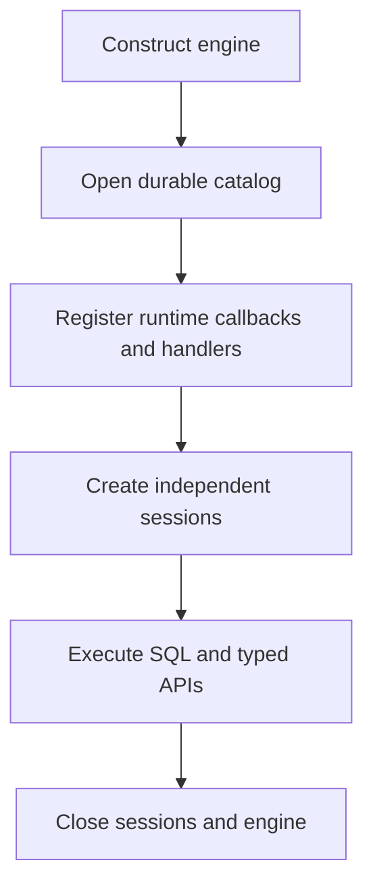

# Bindings and Extensions

UQA Engine exposes the same durable embedded engine through Rust, Python, Node.js, and browser WASM, and exposes direct local and Cloud HTTP SQL in those same environments. Rust has the widest low-level extension surface; other bindings focus on SQL, retrieval, graphs, and common runtime integrations.

## Capability overview

| Capability | Rust | Python | Node.js | Browser WASM |
| --- | --- | --- | --- | --- |
| In-memory SQL | Yes | Yes | Yes | Yes |
| Persistent SQLite | Yes | Yes | Yes | IndexedDB-backed filesystem |
| SQLCipher | Yes | Yes | Yes | No |
| Text, vector, and hybrid APIs | Yes | Yes | Yes | Yes |
| Custom analyzer catalog through SQL | Yes | Yes | Yes | Yes |
| Native Nori analyzer and `analyze_text` diagnostics | Feature-enabled | Bundled | Bundled | Bundled |
| Native Kuromoji, completion and Japanese diagnostics | Feature-enabled | Default | Default | Default |
| Cypher | Yes | Yes | Yes | Yes |
| Runtime scalar/table/aggregate callbacks | Yes | Yes | Yes | Yes |
| Memory FDW | Included | Included | Included | Included |
| Native Arrow / DuckDB FDWs | `arrow` / `duckdb` feature | Custom feature build | Custom feature build | No |
| Independent persistent sessions | Yes | Engine dependent | Yes | Yes |
| Local and Cloud HTTP SQL/batch/stream | Yes | Yes | Yes | Yes, subject to CORS |
| Project lookup through installed `uqa` CLI | Yes | Yes | Yes | No |

Check the type declaration files in the target package for the exact release surface.

The 0.6.1 CLI and language-binding builds enable both `nori` and `kuromoji`; the Rust Engine and facade retain empty defaults. Use `--no-default-features` and optional `--features nori` or `--features kuromoji` for a smaller custom artifact. Each process opening a persistent database must provide its retained analyzer features and exact resources. The [Japanese binding contract](../../../tests/parity/kuromoji/BINDINGS.md) describes shared SQL verification, and the [upgrade notes](10-upgrading.md#japanese-analysis-and-distribution-features) describe feature selection and Rust source migration from 0.3.0.

The HTTP class is named `HttpEngine` in every package. Rust and Python reuse `uqa-client`; Node.js implements the same typed protocol in JavaScript using its built-in HTTP modules. All three can resolve local or Cloud projects through the installed CLI once during construction. Browsers use `fetch` and require explicit connection material. See the [HTTP Engine reference](09-http-engine.md) for construction, lifecycle, CORS, request metadata, and streaming contracts.

Across every binding, `hybrid_search` or `hybridSearch` uses exact signed single-prior log-odds fusion and has no `alpha` argument. The separately named `robust_hybrid_search` or `robustHybridSearch` accepts `alpha` and selects gated, confidence-scaled positive-evidence pooling. SQL follows the same split: mixed same-relation text and vector conjunctions are exact by default, `fuse_bayesian_evidence` and `fuse_log_odds` are exact explicit functions, and `pool_positive_evidence` is the explicit heuristic.

## Runnable parity suite

The repository provides the same five complete scenarios for every public binding: unified search, vector KNN, graph and Cypher, storage and transactions, and extensibility. Use the [example matrix](../../../examples/README.md) to move between equivalent implementations.

| Target | Examples |
| --- | --- |
| Rust | [`examples/rust`](../../../examples/rust) |
| Python | [`examples/python`](../../../examples/python) |
| Node.js | [`examples/node`](../../../examples/node) |
| Browser WASM | [`examples/browser`](../../../examples/browser) |

The binding workflows execute all five scenarios through their built artifacts. The vector example compares exact, HNSW, IVF and DiskANN access, binds vector/query parameters, and checks canonical scores, private rollback, committed changes and closed reopen. DiskANN configuration uses the same [SQL options](../sql/02-ddl.md#diskann-vector-indexes) in every binding and is independent of Nori/Kuromoji features. The Browser WASM directory also provides an HTML runner for interactive use. Its modules run against the generated Emscripten package under Node.js and in real Chrome; `scripts/verify-examples-browser.py` additionally verifies DiskANN after an IndexedDB checkpoint and a fresh page/module load.

The binding transaction tests also exercise an independent session's commit while the first session retains private writes, then verify commit, rollback or savepoint undo and closed reopen. Python and Node.js cover ordinary, compressed, encrypted and compressed-encrypted native SQLite files; WASM covers ordinary and compressed files. Each target checks READ UNCOMMITTED/READ COMMITTED command refresh and REPEATABLE READ/SERIALIZABLE fixed visibility against the shared PostgreSQL reference fixture. `scripts/verify-concurrent-transactions-browser.py` additionally runs the browser cases in real Chrome and verifies committed state after an IndexedDB checkpoint and a fresh page/module load. These schedules exercise the providers exposed by their released bindings. The C source suite below also executes SQLite Key/Value and redb through the C open flags.

## C source API

The embedded C binding is under implementation and has no released package yet. Its [source headers](../../../crates/uqa-ffi/include/uqa/uqa.h) and [implementation ledger](../../plans/0028-c-bindings.md) distinguish the implemented source API from remaining design and qualification work.

The [native build and installed-consumer guide](../../../crates/uqa-ffi/README.md#native-builds-and-installed-consumers) describes the CMake and pkg-config packages. `UQA::uqa` and `uqa.pc` select the shared library with `UQA_USE_SHARED`; `UQA::uqa_static` and `uqa-static.pc` select the static archive with its target-specific dependencies. Installed metadata records ABI major 1, source revision, features, native dependencies and license inventories. Linux/macOS/Windows package and full-library sanitizer workflows are configured; the ledger records their actual candidate qualification status.

The five [public C examples](../../../examples/c/README.md) cover unified search, vector indexes, graph/Cypher, persistent transactions and scalar/table/aggregate callbacks. Each is executable as C11 or C++17. Their shared-library runner verifies 38 combinations across Memory, native SQLite, SQLite Key/Value and redb; the storage scenario requires a durable backend. The examples check results and release all owned handles on success. Consumer ASan/UBSan checks instrument the C/C++ programs; full-library instrumentation and platform qualification remain separate ledger items.

Use `uqa_engine_open(path, flags, config, &engine)` for every backend. The fixed-width `uqa_open_flags` mask requires exactly one storage selector; `UQA_OPEN_SQLITE_AUTO` may be combined with either SQLite selector.

| Flags | Storage | Path |
| --- | --- | --- |
| `UQA_OPEN_MEMORY` | Memory | NULL |
| `UQA_OPEN_SQLITE_NATIVE` | Native SQLite | Nonempty UTF-8 file path |
| `UQA_OPEN_SQLITE_KV` | SQLite Key/Value | Nonempty UTF-8 file path |
| `UQA_OPEN_REDB` | redb | Nonempty UTF-8 file path |

Open returns `uqa_status`. Supply an initially NULL output handle; success writes an owned opaque `uqa_engine`, and failure leaves that output NULL. NULL config selects defaults; a supplied config is copied and remains caller-owned. Release an Engine with `uqa_engine_close(&engine)`. Dependent result, statement and cursor handles must be released first; a busy close leaves the Engine usable. Successful close rolls back its uncommitted transaction before release. Each persistent backend supports independent sibling sessions through `uqa_engine_open_session`; memory reports `UQA_ERROR_UNSUPPORTED`.

Both SQLite layouts accept encryption and LZ4/Zstandard compression settings from `uqa_config`. Add `UQA_OPEN_SQLITE_AUTO` to either layout to detect an existing file's encryption/compression; clear explicit compression settings first. AUTO uses the file's stored codec and requires the appropriate key. For a new file it creates plain SQLite or SQLCipher according to the configured key. AUTO does not choose a storage type or layout. Native open failures report `UQA_ERROR_IO` with borrowed thread-local diagnostics.

Zero flags, unknown bits, multiple storage selectors, the SQLite AUTO modifier on memory or redb, a non-NULL memory path, and missing/empty persistent paths return `UQA_ERROR_INVALID_ARGUMENT` before opening a file. Memory and redb also reject configured encryption or compression. AUTO with explicit compression settings is invalid.

For encrypted compressed SQLite, configure a trusted anchor with `uqa_config_set_trusted_anchor`; its matching getter copies the stored fields and returns `UQA_DONE` when none is configured. The `uqa_container_anchor` contains a database identity, generation and authentication tag with no owned allocation. The same `uqa_engine_open` accepts it with explicit compression or AUTO for either SQLite layout. After closing all writers, obtain the next authenticated anchor with `uqa_container_get_anchor` or its explicit-length `_n` form and persist it in independently trusted storage. Anchored AUTO requires an existing encrypted compressed file and rejects missing, replaced or rolled-back files. NULL passed to the setter clears the setting.

For example, `uqa_engine engine = NULL;` followed by `uqa_engine_open("database.db", UQA_OPEN_SQLITE_KV | UQA_OPEN_SQLITE_AUTO, NULL, &engine)` opens SQLite Key/Value using detected file encoding; check the status before issuing SQL or closing the handle. The same C11/C++17 fixtures execute SQL, prepared statements, cursors, COPY, notices and notifications through the four storage selections. Durable cases verify sibling isolation, savepoint recovery, retained subscriptions, rollback on close and reopen for every persistent backend. The [C crate README](../../../crates/uqa-ffi/README.md) provides the source test command; static runtime consumers, other platforms and release qualification remain in the ledger.

Create immutable scalar parameters with `uqa_value_create_int16`, `uqa_value_create_int32`, `uqa_value_create_int64`, `uqa_value_create_float32`, `uqa_value_create_float64`, `uqa_value_create_bool`, `uqa_value_create_text` or `uqa_value_create_bytes`; successful constructors copy their inputs into an owned handle released by `uqa_value_destroy`. Each constructor preserves its declared SQL type when bound: a SMALLINT parameter uses SMALLINT overloads and overflow rules, REAL retains its float32 precision, and TEXT is a typed text parameter. Matching getters permit widening within the integer or floating family and reject narrowing or coercion from another family. `uqa_value_get_type` borrows the value's descriptor; untyped NULL created by `uqa_value_create_null` returns `UQA_DONE` with a NULL descriptor. Copying a result value, including a typed NULL, preserves its native descriptor. NULL payload reads return `UQA_ERROR_NULL`; incompatible reads return `UQA_ERROR_TYPE`.

`uqa_value_create_numeric`, `uqa_value_create_json` and `uqa_value_create_jsonb` accept UTF-8 C strings, with `_n` alternatives for explicit lengths. Native SQL input validates them and reports SQL diagnostics without changing a database transaction. Matching getters return borrowed text: NUMERIC retains exact digits, display scale, NaN and infinities; JSON retains source whitespace and duplicate keys; JSONB uses the native normalized representation. The two JSON kinds have separate getters and cannot use `uqa_value_get_text`. `uqa_value_get_numeric_scale` returns the value's nonnegative display scale, or `UQA_DONE` for a special numeric value; `uqa_type_get_numeric_precision` and `uqa_type_get_numeric_scale` report optional declared modifiers, including negative scales. For example, `uqa_value value = NULL;` followed by `uqa_value_create_numeric("12345678901234567890.0012300", &value)` preserves all digits and seven fractional places. A borrowed numeric text view retains its allocation under the source session's FFI allowance; a failed allocation leaves the value readable and can be retried after releasing other retained handles.

`uqa_value_create_uuid` accepts native UUID text and has an explicit-length `_n` form; `uqa_value_create_uuid_bytes(data, size, &value)` requires exactly sixteen network-order octets. All version and variant bit patterns are admitted. `uqa_value_get_uuid_bytes` returns borrowed octets and `uqa_value_get_uuid` returns canonical lowercase hyphenated text; ordinary TEXT and BYTEA accessors reject UUID. Both views retain the value's lifetime. For example, `uqa_value_create_uuid("{550E8400-E29B-41D4-A716-446655440000}", &value)` constructs `550e8400-e29b-41d4-a716-446655440000`.

Independently constructed immutable values permit concurrent readers. Lazy numeric text and UUID octets publish one stable cached view atomically; discarded concurrent candidates release their own allocations. Session-backed values still follow session admission and can return `UQA_ERROR_BUSY` while another operation holds that session. Always synchronize destruction against every use of the handle and its borrowed views.

`uqa_value_create_bit(data, size, bit_length, &value)` and `uqa_value_create_varbit` copy MSB-first bytes. `size` must equal `ceil(bit_length / 8)`; unused low bits are discarded, and zero bytes with zero bits create a present empty value. The separate `uqa_value_get_bit` and `uqa_value_get_varbit` accessors return borrowed `uqa_bits_view` fields `data`, byte `size` and logical `bit_length`. Their typed reads reject the other bit family, preserve stored length modifiers and accept the corresponding domain base. NULL reads return `UQA_ERROR_NULL`; invalid input spans return `UQA_ERROR_INVALID_ARGUMENT`; native input errors retain SQL diagnostics. For example, a one-byte array containing `0xa7`, passed with logical length three, constructs `101` and exposes the canonical byte `0xa0`. Release successful constructor results with `uqa_value_destroy`.

Create a typed NULL with `uqa_value_create_typed_null(engine, type_name, &value)`, or read a type's text input with `uqa_value_create_from_text(engine, type_name, text, &value)`. The type name is a native SQL declaration with optional modifiers; `_n` alternatives take explicit UTF-8 byte lengths for each string. Both constructors copy their inputs, return immutable typed values and retain their creating session until `uqa_value_destroy`. They apply native explicit-cast semantics, including domain constraints on NULL, catalog enum/composite input, array bounds and range canonicalization. Domain checks may call routines, so these operations use the session's statement/transaction boundary: an input error rolls back an implicit statement or fails the active frame until rollback or savepoint recovery. Reusing an admitted value does not repeat its input checks. A NULL text pointer is invalid; use the typed NULL constructor instead. For example, `uqa_value value = NULL;` followed by `uqa_value_create_from_text(engine, "numeric(5,2)", "12.3456", &value)` produces `12.35` with precision 5 and scale 2.

Execution binds retained catalog types against the executing session, including sibling sessions, NULL or unused inputs, empty SQL and transaction commands. A dropped type returns `UQA_ERROR_SQL` with SQLSTATE `XX000` naming the original parameter OID, including an array's own OID. Type renames preserve identity; savepoint rollback can restore a dropped type, while rolling back its creation makes retained values invalid for later binding. Copying a value or checking whether it is NULL does not perform this binding or decode deferred fields. Prepared bind retains the value; prepared execute checks both its source type and the definition's declared parameter type. A removed prepared declaration also rejects an untyped NULL supplied to an unused parameter. In a failed transaction, requests with parameters report `25P02`, even for COMMIT or ROLLBACK; use the parameterless recovery command.

`uqa_value_get_array_shape(value, &shape)` exposes borrowed dimension lengths, signed lower bounds, rank and element count. `uqa_value_get_element(value, index, &child)` borrows one zero-based row-major element, independently of the SQL lower bounds. For `[-3:-2][7:9]={{11,NULL,13},{21,22,23}}`, positions zero and five contain 11 and 23, while position one is a typed NULL. The element descriptor is the scalar type even for multidimensional arrays. Domain elements retain their identity. Both getters also accept `int2vector` and `oidvector`, whose bounds and distinct kinds are preserved; dense VECTOR/TENSOR values have separate getters.

`uqa_value_create_array(engine, type_name, dimensions, rank, elements, element_count, &value)` constructs a typed array from row-major child values; `_n` takes an explicit type-name length. Pass an array declaration such as `integer[]` or a domain over an array. Dimensions contain lengths and signed lower bounds; their product must equal the child count. Zero elements with rank zero or a zero-length dimension produce a dimensionless empty array. Children and shape are copied. Array-valued domain children remain individual elements with their own dimensions. Native SQL resolves every source identity before conversion, applies scalar casts and domain constraints, and owns transaction failure and savepoint recovery. The return owner is admitted before those effects can run.

A dimensionless empty array has NULL dimensions, rank zero and no elements. A NULL array reports `UQA_ERROR_NULL`; an out-of-range position reports `UQA_ERROR_RANGE`. Views stay valid until their parent or containing result is released or refilled. Use `uqa_value_create_copy(child, &owned)` to retain a child independently. Only requested wrappers and shape metadata are cached under the original FFI allowance; failed admission leaves existing views intact. Observation shares the session gate and cancellation scope, and a concurrent session operation can return `UQA_ERROR_BUSY` with cleared output.

`uqa_value_create_record(engine, type_name, fields, field_count, &value)` copies positional fields into a named composite, a domain over it, or an anonymous `record`; `_n` accepts an explicit type-name length. Named composites require their current live field count and use native explicit casts, modifiers and domain checks. Anonymous records retain the supplied types and NULL state. All source identities bind before field conversion, and all return-owner admission precedes input effects. Zero fields permit a NULL span. The original field handles may be destroyed after success; prepared statements, cursors and persistent columns accept the resulting typed parameter.

Constructed named-composite inputs retain their native physical tuples, including children of arrays and anonymous records. Later attribute renames, drops, additions and layout changes use the current catalog to interpret the original tuple; copying and formatting do not repeat input checks. Domain checks receive the admitted tuple before they execute, so a check that renames an attribute preserves the supplied value. Anonymous record output retains each field's SQL type identity.

`uqa_type_get_field_count` and `uqa_type_get_field` read a named composite's current live catalog fields. The field descriptor contains a borrowed name and type, the physical attribute number and the selected collation OID. Its index is zero-based and excludes dropped slots. Returned views remain valid for their parent type's lifetime, while new reads reflect later catalog changes. Domains expose their fields through the base descriptor. Other types, including an anonymous `record` without a declared schema, return `UQA_DONE`; an out-of-range composite field returns `UQA_ERROR_RANGE`. Descriptor wrappers use the original session allowance, and failed allocation or cancellation preserves earlier views. Field inspection does not run type input or domain checks.

`uqa_value_get_field_count(value, &count)` and `uqa_value_get_field(value, index, &child)` read named composites, domains over composites and anonymous records. Indices are zero-based live field positions and exclude dropped attributes. Named records use the current descriptor; anonymous children retain their producer's type OID and modifiers, including typed NULL. Each borrowed child preserves its selected value and type until its parent is released or refilled; a later catalog change can produce a new child without invalidating an earlier pointer. Copy a child with `uqa_value_create_copy` to retain it independently. NULL records return `UQA_ERROR_NULL`, other value families return `UQA_ERROR_TYPE`, and an invalid index returns `UQA_ERROR_RANGE`. Failures clear outputs and preserve previously returned children. Observation uses the original allowance and cancellation scope without repeating input or domain checks; native observation failures preserve their SQLSTATE, including `53200` for resource exhaustion and `XX001` for a selected physical read outside the owned tuple.

`uqa_value_create_range(engine, type_name, lower, upper, flags, &value)` copies endpoints into a range or domain over a range; `_n` takes an explicit type-name length. NULL pointers are unbounded, while supplied SQL NULL values become unbounded after native endpoint conversion. Inclusion uses `UQA_RANGE_LOWER_INCLUSIVE` / `UQA_RANGE_UPPER_INCLUSIVE`; unbounded flags require corresponding NULL pointers. `UQA_RANGE_EMPTY` requires two NULL pointers and no other flags. For bounds 1 and 4, `UQA_RANGE_UPPER_INCLUSIVE` produces `[2,5)` for `int4range`. Native SQL owns casts, canonicalization and outer-domain checks in the original transaction scope, with both source identities resolved and the returned owner admitted before input effects.

`uqa_value_create_multirange(engine, type_name, ranges, range_count, &value)` and `_n` copy members into a multirange or domain, then use native sorting and merging. Zero members with a NULL span produce an empty multirange; a SQL NULL member reports `22004`. Supplied range values retain their admitted identity and do not repeat catalog input checks. Original children may be destroyed after success. Construction failure uses the same transaction failure and savepoint recovery as native SQL.

`uqa_value_get_range_bounds(value, &bounds)` returns borrowed lower/upper values and canonical flags. Empty ranges have only `UQA_RANGE_EMPTY`; unbounded endpoints have NULL handles and unbounded flags. A present infinite endpoint remains a typed value. `uqa_value_get_range_count` and `uqa_value_get_range` read normalized multirange members by zero-based position. Bounds and members remain valid with their parent; `uqa_value_create_copy` retains them independently. Wrong-family getters report `UQA_ERROR_TYPE`, typed NULL reports `UQA_ERROR_NULL`, and an invalid member index reports `UQA_ERROR_RANGE`. All failures clear output slots. Observation retains the original allowance and cancellation scope; allocation failure preserves prior views and allows retry after other owners are released. It never executes catalog input, domain checks or canonical routines.

`uqa_type_get_range_subtype` returns the endpoint type for ranges and multiranges, while `uqa_type_get_range_type` returns a multirange's associated range type. Handles borrow their parent descriptor. Domains expose these through their base descriptor, and unrelated types return `UQA_DONE`. Actual C11/C++17 clients cover all six built-in range and multirange families, prepared and cursor values, nested arrays, domain effects and errors on all four providers, with stored multirange observation after close/reopen on each persistent provider.

`uqa_value_create_vector_f32` copies a positive, 32-bit-representable number of finite float32 elements. `uqa_value_create_tensor_f32(data, row_count, dimensions, &value)` copies packed row-major floats; zero rows permit NULL data and retain the positive dimension. For example, `uqa_value_create_tensor_f32(NULL, 0, 3, &value)` creates an empty three-dimensional tensor parameter. SQL owns validation and preserves the dimension through binding and copies. `uqa_type_get_dimensions` reads it from a VECTOR/TENSOR descriptor; other types return `UQA_DONE` and zero. A domain exposes the dimension through its base descriptor.

`uqa_value_get_vector_f32` and `uqa_value_get_tensor_f32` return immutable borrowed packed views with the value's lifetime. Tensor views include row count and dimension; empty tensors have NULL data. Typed NULL returns `UQA_ERROR_NULL` with cleared output. Ordinary SQL arrays cannot use these getters. A retained observation cache counts against its source session's FFI allowance; allocation failure preserves the source and permits another attempt after other handles are released. Scalar NaN/infinity support does not admit non-finite vector or tensor elements. Actual C11/C++17 clients exercise prepared and cursor parameters, domains, copies, memory rejection and recovery on Memory, native SQLite, SQLite Key/Value and redb, plus stored reads after close/reopen on all three persistent providers.

Create reusable function options with `uqa_udf_options_create(&options)` from [uqa_udf.h](../../../crates/uqa-ffi/include/uqa/uqa_udf.h), then release them with `uqa_udf_options_destroy(&options)`. Paired `uqa_udf_options_get_volatility` / `uqa_udf_options_set_volatility` use the fixed codes `UQA_VOLATILITY_IMMUTABLE` (0), `UQA_VOLATILITY_STABLE` (1) and `UQA_VOLATILITY_VOLATILE` (2). Paired `uqa_udf_options_get_may_mutate_engine` / `uqa_udf_options_set_may_mutate_engine` use 0 or 1. Defaults are VOLATILE and may-mutate; each setter validates its own property and preserves the prior value on error. Options are independent of Engine lifetime, and invalid option operations do not enter or fail a SQL transaction. Registration copies the options and validates their combined volatility/mutation contract; NULL selects the defaults.


Register functions with `uqa_udf_register_scalar(engine, name, options, function, user_data, destroy_user_data, &handle)`, `uqa_udf_register_table` or `uqa_udf_register_aggregate`. Names are UTF-8 C strings and use the native name-based registry; these interfaces do not declare typed SQL overloads. Arguments are borrowed `uqa_value_view` handles for the invocation and expose the native runtime value carriers. Their `uqa_value_get_type` descriptor comes from SQL runtime inference or a retained datum's physical OID; this does not recover the original expression declaration or modifiers, and an unknown carrier such as untyped NULL returns `UQA_DONE`. Shared `user_data` may be called concurrently across sibling sessions. Per-scan and per-group calls are serialized but may move between workers. Every callback returns `uqa_status`; C++ exceptions and `longjmp` must not cross the ABI. Engine calls from callbacks return `UQA_ERROR_BUSY`; same-session value helpers and callback result/diagnostic helpers are available.

Scalar callbacks and aggregate `finish` callbacks assign exactly one result with `uqa_udf_context_set_result(context, value)`. The setter copies the value before returning, so the callback may immediately destroy its owned input. `uqa_udf_context_get_result` returns `UQA_DONE` with a NULL view before assignment, then borrows the assigned value. SQL NULL requires an explicit NULL value. A second successful assignment is prohibited: rejection leaves the first result intact. Failed admission leaves an unassigned context available for a smaller result. The native function interface returns a `Value` carrier; parameter type metadata does not establish a typed SQL function signature.

Table registration takes `columns`, `column_count`, `create_scan`, `next` and `destroy_scan`. Registration copies a nonempty array of UTF-8 column names; names and order are fixed until retirement. SQL uses this descriptor for empty and correlated sources without creating a scan. Create returns only an opaque state pointer. Next calls `uqa_udf_row_sink_emit(sink, values, count)` once and returns `UQA_OK`, or emits no row and returns `UQA_DONE`. Emission copies values and rejects incorrect width or a second row. The native pipeline pulls rows without collecting the callback's entire output. Aggregate registration takes `create_state`, `observe`, `finish` and `destroy_state`; finish reads state without consuming it. Each successful creation, including a NULL state pointer, has exactly one destruction call at completion, early stop, failure or cancellation. Failed creation owns its own partial cleanup. Destruction consumes ownership even when it reports failure.

Registrations are process-local and shared by persistent sibling sessions. A failed registration leaves `user_data` owned by the caller. A successful registration owns it until `uqa_udf_unregister(&handle)` finishes; the handle retains the registry without keeping its creating session open. Unregister returns `UQA_ERROR_BUSY` and preserves the handle while execution, a scan, a state or a retained executable references it. Completed retirement invalidates shared function plans, invokes `destroy_user_data` once and clears the handle even if that destructor fails. Retiring an older handle cannot remove a replacement registered under the same name. Keep callback code loaded until retirement completes.

Use `uqa_udf_context_fail(context, message)` or `uqa_callback_fail(status, message)` for an owned failure diagnostic. The first explicit callback failure survives subsequent successful helpers and an ignored failure return. Returning the most recent helper failure status preserves its diagnostic even after successful cleanup helpers; returning success permits recovery from an ordinary helper failure. Forwarded native SQL errors keep their original SQLSTATE, including cancellation `57014`. An explicit host failure reports `UQA_ERROR_SQL` with SQLSTATE `38000`; `uqa_error_get_cause` exposes the original callback status and message. Native routine context and secondary cleanup details remain available. Dedicated cleanup diagnostic slots are admitted before successful resource creation, so observation errors or FFI memory exhaustion do not skip destruction. SQL's ordinary statement/transaction boundary handles callback failure and savepoint recovery.

The [scalar C client](../../../crates/uqa-ffi/tests/native/udf.c) registers `c_scalar`, copies its one argument into the callback context and checks that `SELECT c_scalar(42)` returns 42. The [table client](../../../crates/uqa-ffi/tests/native/udf_table.c) emits `n` one row at a time, and the [aggregate client](../../../crates/uqa-ffi/tests/native/udf_aggregate.c) covers independent groups, empty input, DISTINCT/ORDER BY and window frames. All three run as C11 and C++17 clients on Memory, native SQLite, SQLite KV and redb; the implementation ledger records source-specific qualification.

The C header `<uqa/uqa_arrow.h>` defines the standard Arrow C Data Interface. With the `arrow-export` Cargo feature, `uqa_result_export_arrow` exports an existing result and `uqa_cursor_fetch_arrow` consumes a bounded batch. `UQA_ARROW_LOSSLESS` preserves declared integer/float widths, text, bytes, UUID, JSON/JSONB identity and qualifying NUMERIC modifiers; unsupported types, unconstrained decimals and special decimal values return `UQA_ERROR_UNSUPPORTED`. `UQA_ARROW_SQL_TEXT` is the explicit alternative for SQL-formatted values. Column order, duplicate labels, NULL validity and empty descriptors are preserved. Schema and array releases are independent of the original handles and each other. Moved structs and detached children keep their required buffers and allowance leases. A failed cursor conversion is terminal. Builds without export retain unsupported stubs; enabling export alone does not enable Arrow or DuckDB FDW.

## Rust QueryBuilder

`uqa_api::QueryBuilder` builds SQL-shaped plans fluently:

```rust
use uqa_api::QueryBuilder;

let result = QueryBuilder::new(&engine, "articles")
    .select_columns(&["id", "title", "_score"])
    .text_match("body", "embedded database")
    .order_by_desc("_score")
    .limit(10)
    .execute()?;
# Ok::<(), Box<dyn std::error::Error>>(())
```

The builder covers comparison predicates, text and KNN matching, multi-field and staged retrieval, aggregation, facets, graph traversal, RPQ, temporal traversal, highlighting, Bayesian and learned fusion, sparse thresholds, and model operators. `to_sql()` is useful for diagnostics. Raw fragments still require application-side trust validation.

`uqa_api::arrow_export::export_arrow` accepts an `ArrowRows` positional result/batch view, an explicit `ArrowExportPolicy`, an optional native SQL output context and a `ProductionControl`. `Lossless` uses qualified declared mappings and rejects unsupported values without text fallback. `SQLText` explicitly formats through the native SQL owner. The returned `Produced<RecordBatch>` retains its output allowance and observes both cancellation tokens. It preserves duplicate column names and empty schemas and adds no synthetic columns. Existing `QueryBuilder::execute_arrow` keeps its separate compatibility metadata behavior.

## Python

The Python package is named `uqa` and is built with pyo3 and maturin. It targets the stable `abi3` interface beginning with Python 3.8. Installing it also installs the `usql` console command into the same Python environment.

```python
import uqa

engine = uqa.Engine()
engine.sql("CREATE TABLE notes (id INTEGER PRIMARY KEY, body TEXT)")
engine.sql(
    "INSERT INTO notes (id, body) VALUES ($1, $2)",
    [1, "hello"],
)
result = engine.sql("SELECT id, body FROM notes WHERE id = $1", [1])
print(result.rows)
engine.close()
```

Use `uqa.vector(values)` and `uqa.tensor(rows)` for explicit retrieval parameters. The binding includes document, search, calibration, graph, introspection, cancellation, batch SQL, encrypted and compressed open paths, and scalar, table, and aggregate Python callbacks. Callback registration accepts keyword-only `volatility` and `may_mutate_engine` options.

Heavy engine work releases the Python interpreter lock where the method contract permits it. A Python callback necessarily re-enters Python.

### Notification subscriptions

UQA Engine 0.6.1 provides `engine.subscribe_notifications(channels, *, options)` and `engine.subscribe_notifications_async(channels, *, options)` to both `Engine` and `HttpEngine`. The synchronous call returns a ready `NotificationSubscription` supporting `with`, iteration, `next_event()` and `close()`. The asynchronous call returns a one-use awaitable and asynchronous context manager; awaiting it returns an `AsyncNotificationSubscription` supporting `async for` and `aclose()`. HTTP readiness requires a valid protocol `ready` event, and an unsupported endpoint raises `NotificationError` without falling back to SQL `LISTEN`. The installed Python HTTP adapter is tested against the actual authenticated Cloud Node; see the [source-bound evidence and deployment scope](../../plans/0015-sql-notifications-and-sse.md).

`channels` is a nonempty sequence of unique, nonempty, NUL-free exact UTF-8 strings, each at most 63 bytes. Embedded options use `NotificationSubscriptionOptions` with five required positive limits: `max_active_subscriptions`, `max_channels`, `max_queued_notifications`, `max_queued_bytes` and `max_registry_entries_per_poll`. They retain the [Rust listener's admission and queue accounting](02-rust-engine-api.md#independent-owned-listeners). HTTP uses `HttpNotificationOptions` with required positive `max_channels`, `max_queued_events`, `max_queued_bytes`, `max_transport_chunk_bytes`, `connect_timeout_ms`, `ready_timeout_ms` and `max_idle_timeout_ms`. Optional `retry` accepts `NotificationRetryOptions(max_attempts=..., episode_timeout_ms=..., initial_backoff_ms=..., max_backoff_ms=..., max_retry_after_ms=...)`; `None` disables reconnect. These map directly to the [Rust HTTP limits and budget validation](09-http-engine.md#rust-notification-subscriptions), without inferred deployment defaults.

Creating an embedded asynchronous registration reserves its original Engine's shared subscription capacity immediately, before returning the awaitable or submitting executor work. An unstarted registration therefore counts toward `max_active_subscriptions`, and capacity exhaustion can raise `NotificationError` from the factory call itself. Starting the awaitable transfers the same reservation into its listener; failed or abandoned registration cleanup releases it.

Each frozen `NotificationEvent` has `kind` equal to `notification`, `resync_required` or `reconnected`, plus `epoch` and optional `request_id`. Notification events additionally expose exact Python integer `sequence` and `process_id`, and unchanged string `channel` and `payload`; these four fields are `None` for lifecycle events. A resynchronization event supplies a stable `cause` code. Python integers preserve the entire unsigned 64-bit sequence range. `Reconnected` changes the handle's visible identity before that event is returned and precedes replacement data. An embedded handle has no HTTP request identity.

An embedded subscription retains the original memory or persistent database, encryption and selected role independently of its creating Engine's transaction and low-level SQL listener. Closing the creating Engine does not close that subscription. Synchronous registration, receive and cleanup release the GIL; asynchronous receive waits without occupying a Python executor thread. Use one consumer and one asyncio loop per asynchronous handle. Receive/registration cancellation signals and joins the actual native operation and resource cleanup before raising `asyncio.CancelledError`, including when the task is cancelled again while cleaning up. `close()` and `aclose()` are idempotent; explicit closure ends a pending iteration normally. Garbage collection schedules fallback cleanup but is not a completion boundary. Close every retained subscription before replacing database files.

Native failures raise `NotificationError` with a content-free `code` and typed `failure`. `NotificationFailure` exposes its code, optional HTTP status, original/last-attempt retry failures and an explicitly requested private `diagnostic`. Normal representations omit payloads, channels and credentials. Invalid concurrent consumers and repeated registration awaits use the same stable `NOTIFICATION_INVALID_REQUEST` error. Python argument type/range conversion can also raise ordinary Python exceptions before admission. `is_closed` describes ended delivery; explicit close/context exit establishes cleanup completion. The [Python preservation proof](../../design/python-notification-subscriptions.md) states exact conversion, lifecycle correspondence and resource-accounting limits.

The following limits serve this small memory fixture and are not capacity recommendations:

```python
import asyncio
import uqa

options = uqa.NotificationSubscriptionOptions(
    max_active_subscriptions=2, max_channels=1,
    max_queued_notifications=2, max_queued_bytes=8192,
    max_registry_entries_per_poll=2,
)
engine = uqa.Engine()
with engine.subscribe_notifications(["jobs"], options=options) as subscription:
    engine.sql("NOTIFY jobs, 'committed'")
    event = next(subscription)
    assert (event.sequence, event.payload) == (1, "committed")

async def consume():
    async with engine.subscribe_notifications_async(["jobs"], options=options) as subscription:
        engine.sql("NOTIFY jobs, 'async'")
        async for event in subscription:
            assert event.payload == "async"
            break

asyncio.run(consume())
engine.close()
```

## Node.js

The Node-API package requires Node.js 16 or newer. Expensive query and search methods have asynchronous forms; selected operations also expose `Sync` variants.

Install the `@cognica-io/uqa` package from npm. npm selects the matching exact-version native optional package published under `@cognica-io` for the current supported operating system and CPU.

HTTP-only applications can use `npm install --omit=optional @cognica-io/uqa`. Importing `HttpEngine`, its streaming class, and SQL parameter helpers from either `@cognica-io/uqa` or `@cognica-io/uqa/http` works without a native addon. Embedded engine constructors and operations load the addon when first used.

```sh
npm install @cognica-io/uqa
```

```typescript
import { Engine } from "@cognica-io/uqa";

const engine = new Engine();
await engine.sql("CREATE TABLE notes (id INTEGER PRIMARY KEY, body TEXT)");
await engine.sql(
  "INSERT INTO notes (id, body) VALUES ($1, $2)",
  [1, "hello"],
);
const result = await engine.sql(
  "SELECT id, body FROM notes WHERE id = $1",
  [1],
);
console.log(result.rows);
engine.close();
```

Node.js exposes scalar, table, and aggregate JavaScript callbacks through `registerScalarFunction`, `registerTableFunction`, and `registerAggregateFunction`:

```javascript
engine.registerScalarFunction(
  "normalize_label",
  (value) => value.trim().toLowerCase().replaceAll(" ", "-"),
  { volatility: "immutable", mayMutateEngine: false },
);
const normalized = await engine.sql("SELECT normalize_label($1) AS label", [" SQL Manual "]);
```

Use `SQLParam.vector` or a typed numeric array for vector input. JavaScript callbacks always return synchronously, including when SQL is executed through `sql`; returning a `Promise` is an error. The asynchronous SQL path runs the engine on a worker and dispatches callback execution to the owning JavaScript thread.

### Native notification subscriptions

UQA Engine 0.6.1 provides `await engine.subscribeNotifications(channels, options)`. The Promise returns a ready `NotificationSubscription` with `nextEvent()`, `next()`, asynchronous iteration, `close()`, `return()` and `throw(error)`. The same method name on `HttpEngine` uses the [HTTP notification contract](09-http-engine.md#nodejs-http-notification-subscriptions). An embedded subscription uses its original Engine hub and provider directly.

`channels` is a nonempty array of unique, nonempty, NUL-free strings, each at most 63 UTF-8 bytes. Names retain exact case and Unicode; lone surrogates are rejected. `options` requires five positive safe integers: `maxActiveSubscriptions`, `maxChannels`, `maxQueuedNotifications`, `maxQueuedBytes` and `maxRegistryEntriesPerPoll`. They map to the [Rust admission and queue limits](02-rust-engine-api.md#independent-owned-listeners). Optional `signal` accepts an AbortSignal. These are explicit caller limits, not measured deployment defaults.

Native registration reserves the original Engine's shared allowance before entering the libuv work pool. Queued registrations count toward `maxActiveSubscriptions` alongside live handles, and another call cannot bypass a retained stricter limit. A full allowance rejects the Promise before submitting another registration task; readiness and close transfer and release the same reservation.

Each frozen event has `kind`, `epoch` and `requestId`. A native request identity is `null`. A `notification` additionally exposes exact unsigned 64-bit `sequence` as `bigint`, signed 32-bit `processId` as `number`, and unchanged string `channel` and `payload`; its `cause` is `null`. Lifecycle variants use the shared [event declarations](../../../crates/uqa-node/notifications.d.ts). `nextEvent()` returns `null` after normal close, and asynchronous iteration then ends. A second pending receive rejects with `NOTIFICATION_INVALID_REQUEST`.

Creation registers an independent idle listener without committing, rolling back or consuming the caller's transaction or SQL notification queue. Closing the query Engine leaves the retained subscription alive. Await `close()` or leave a `for await` loop to join original provider cleanup; repeated close calls join the same work. AbortSignal cancels registration or delivery, waits for cleanup and rejects pending receipt with `NOTIFICATION_CANCELLED`. `isClosed` reports ended delivery, not completed resource release. Idle waits do not occupy the libuv work pool. Garbage collection is a fallback; explicit close provides the resource-release boundary.

Failures use `NotificationError` with a stable content-free `code` and explicit private `diagnostic`. Queue overflow raises `NOTIFICATION_BACKPRESSURE`; the native failed inbox discards unread values, and its error remains observable after close, including concurrent close and receive. Ordinary inspection omits payload and channel content. The [native preservation and ownership proof](../../design/node-native-notifications.md) covers exact conversion, close races and Node environment teardown. Complete Cloud, platform and process-resource qualification remains in the [implementation ledger](../../plans/0015-sql-notifications-and-sse.md).

```javascript
import { Engine } from "@cognica-io/uqa";

const engine = new Engine();
const subscription = await engine.subscribeNotifications(["jobs"], {
  maxActiveSubscriptions: 2, maxChannels: 1,
  maxQueuedNotifications: 2, maxQueuedBytes: 8192,
  maxRegistryEntriesPerPoll: 2,
});
try {
  await engine.sql("NOTIFY jobs, 'refresh'");
  for await (const event of subscription) {
    if (event.kind === "notification") {
      console.log(event.sequence, event.payload);
      break;
    }
  }
} finally {
  await subscription.close();
  engine.close();
}
```

## Browser WASM

The browser binding uses an Emscripten build. Initialization is asynchronous, and persistent files are synchronized to IndexedDB. For source builds, `scripts/build-wasm.sh` matches the C setjmp/longjmp mode to the active Rust compiler's standard library: JavaScript exceptions before Rust 1.93, native WebAssembly exceptions from Rust 1.93 onward. This preserves PostgreSQL parser and regular expression error recovery; the build keeps Rust 1.90 compatibility.

```sh
npm install @cognica-io/uqa-wasm
```

```javascript
await UQA.load();
const engine = await Engine.open(`${UQA.persistDir}/notes.uqa`);
await engine.sql("CREATE TABLE IF NOT EXISTS notes (id INTEGER PRIMARY KEY)");
await engine.registerScalarFunction(
  "normalize_label",
  (value) => value.trim().toLowerCase().replaceAll(" ", "-"),
  { volatility: "immutable", mayMutateEngine: false },
);
await UQA.persist();
```

Persist after important application checkpoints. Browser callbacks use synchronous reverse dispatch from WASM into JavaScript; returning a `Promise` is an error. SQLCipher and native DuckDB or Arrow FDW handlers are unavailable in the browser build.

### Direct browser notification subscriptions

UQA Engine 0.6.1 exposes `await engine.subscribeNotifications(channels, options)` and the exported `NotificationSubscription` and `NotificationError` types. Channels are exact, unique, nonempty UTF-8 names of at most 63 bytes. Supply positive integer `maxActiveSubscriptions`, `maxChannels`, `maxQueuedNotifications`, `maxQueuedBytes` and `maxRegistryEntriesPerPoll` limits, plus an optional `signal: AbortSignal`. Browser limits must also fit the WASM addressable integer range. Registration snapshots input and resolves after all channels are ready, independently of the caller's SQL transaction.

The result is an async iterator with `nextEvent`, `next`, `return`, `throw`, `close`, `epoch`, `requestId` and `isClosed`. Event fields and typed failures match the [direct Node contract](#native-notification-subscriptions): notification sequences are exact `bigint`, direct request identities are null, overflow remains visible after cleanup, and only one receive may be pending. Waiting permits unrelated JavaScript execution. Abort and iterator cleanup stop the actual retained listener; repeated close joins that same cleanup. The source remains attached to its original WASM module after the query Engine closes, including memory, plain SQLite and compressed providers. Memory-only query Engines retain their existing restriction against `newSession`; a direct subscription does not invoke that factory.

```javascript
const engine = await Engine.inMemory();
const subscription = await engine.subscribeNotifications(["jobs"], {
  maxActiveSubscriptions: 8, maxChannels: 2, maxQueuedNotifications: 16,
  maxQueuedBytes: 65536, maxRegistryEntriesPerPoll: 8,
});
try {
  await engine.sql("NOTIFY jobs, 'ready'");
  const event = await subscription.nextEvent();
  if (event.sequence !== 1n || event.payload !== "ready") throw new Error("unexpected notification");
} finally {
  await subscription.close();
  await engine.close();
}
```

Use explicit close for deterministic cleanup. Registration and close use the existing synchronous WASM call boundary; idle receipt uses a native Future and a microtask wake, without a blocking wait or an additional Worker. Persisted SQL data can be restored in another runtime, but equal filenames in different pages, Workers or modules do not share notification delivery or provide replay. See the [preservation proof](../../design/wasm-direct-notifications.md) and [qualification ledger](../../plans/0015-sql-notifications-and-sse.md). Remote browser subscriptions use the separate [HTTP Fetch API](09-http-engine.md#browser-notification-subscriptions).

## Analyzer pipelines across bindings

All four bindings can execute `create_analyzer`, `list_analyzers`, `analyze_text`, `set_table_analyzer`, `fts_index_stats`, and `drop_analyzer` through SQL. The 0.6.1 Python, Node.js and browser WASM packages enable both `nori` and `kuromoji` by default. A build with that feature includes the native bundle: `list_analyzers` reports `nori`, and `analyze_text('nori', input)` returns the complete token and source-coordinate diagnostic. Python also exposes `list_named_analyzers()`, while Node.js and browser WASM expose `listNamedAnalyzers()` for custom engine-catalog names. Rust alone exposes direct `Analyzer`, `CharFilter`, `Tokenizer`, and `TokenFilter` construction. See [Text analyzer pipelines](06-text-analyzers.md) for the JSON schema and lifecycle.

The [persistent Nori binding contract](../../../tests/parity/nori/BINDINGS.md) exercises the same user dictionary, complete diagnostics, graph phrases, original-source highlighting, failed registration, rollback, and retained revisions through all four APIs. Actual custom builds without Nori also verify explicit missing-feature errors and generic analyzer persistence. Use `--no-default-features` with maturin, NAPI, or `scripts/build-wasm.sh` to produce those custom artifacts. The WASM build script accepts `--output-dir DIR` for a separate generated `uqa.js`/`uqa.wasm` pair; use the matching `index.mjs` wrapper with it. [Real-browser verification](../../../benchmarks/nori/BROWSER.md) additionally closes the Engine, synchronizes IndexedDB, reloads the whole page/WASM module, and verifies the restored catalog and index.

The 0.6.1 Python, Node.js and WASM artifacts retain complete upstream Nori and Kuromoji notices, including IPADIC attribution, source modifications and both source-resource/model manifests in `THIRD-PARTY/`. Python wheels also list those files in their license metadata. Both dictionaries stay embedded in each runtime artifact; package verification compares their complete bytes with the pinned bundles and rejects missing or changed notices. WASM verification reconstructs active data segments and zero-filled gaps before comparison, because optimization may split a dictionary across file sections. The Japanese contract checks both built-ins, six attributes, custom pipelines and retained lifecycle through the same shared binding assertions as Nori.

## Runtime SQL callbacks

Scalar functions return one value per call. Table functions return a relation. Aggregate functions create per-group state, observe input rows, and finish with one result.

Arguments of enum types reach callbacks as their current label strings, including inside arrays and records, as PostgreSQL procedural languages receive them; the `sql`, `sqlSync`, `sql_batch` and `sqlBatch` methods of every binding likewise return enum values as labels. A callback that returns a label returns text; cast it, for example with `my_function()::mood`, where an enum value is required.

Python table callbacks accept a dictionary with `columns` and `rows`, a `(columns, rows)` tuple, or iterable dictionary rows. Node.js and browser WASM callbacks accept `{ columns, rows }`, a `[columns, rows]` pair, or an array of object rows. Aggregate factories return a new state object for each SQL group; that object must provide `observe` or `step` and `finish` or `finalize` methods. Errors thrown by a host callback become SQL errors.

Registration options communicate optimizer safety:

| Property | Meaning |
| --- | --- |
| `IMMUTABLE` | Same result for the same arguments and no external state |
| `STABLE` | Stable within the statement but may observe statement context |
| `VOLATILE` | May vary per call or mutate state |
| Read-only | Callback cannot mutate engine-visible state |
| May mutate | Callback can change state and must be `VOLATILE` |

The default registration is `VOLATILE` and may mutate. Only request a more permissive optimizer contract after proving it. Runtime registrations are not durable and must be recreated after process restart. Node.js and browser WASM reject calls to binding `Engine` methods while a JavaScript SQL callback is active, which prevents callback re-entry from blocking or recursively entering the current statement; the mutation declaration classifies callback side effects but does not authorize binding re-entry.

See [Custom functions](../tutorials/07-custom-functions.md) and [Extension points](../internals/08-extension-points.md).

## Foreign data wrappers

SQL can register, inspect, alter and remove foreign servers and tables independently of source-handler availability. Current source builds include the memory handler by default, including the CLI and language bindings. Select `arrow` for native Arrow IPC sources or `duckdb` for native DuckDB sources; the features are independent and both default to off. The `uqa`, `uqa-engine`, `uqa-api`, `uqa-cli`, `uqa-python`, `uqa-node` and PostgreSQL server packages forward these features. Browser WASM includes the memory handler and cannot execute the native handlers. The supported server types are:

- `memory_fdw` for an in-process foreign relation
- `duckdb_fdw` for DuckDB sources and file expressions
- `arrow_fdw` for Arrow IPC files or streams

DuckDB server options include a database path, extensions, and S3 connection fields. Foreign table options select a DuckDB table or expression, or a Parquet, CSV, JSON, or NDJSON source with optional Hive partitioning. Arrow foreign tables select a file or stream IPC format.

UQA Engine 0.6.1 retains DuckDB 1.5.5 through the separately named `uqa-duckdb` and `uqa-libduckdb-sys` packages. Rust applications sharing the handler's DuckDB error type must use the matching package alias; see the [DuckDB upgrade contract](10-upgrading.md#060). This dependency repair does not enable either optional handler by default.

SQL deletion follows [DROP SERVER](../sql/02-ddl.md#foreign-servers-and-tables). Rust's `Engine::drop_foreign_server(name)` uses the same owner checks, server lifetime locks, RESTRICT dependency check and transaction boundary. It returns `Ok(false)` for a missing server, `Ok(true)` after deletion and the diagnostic text on failure. Use SQL `DROP SERVER name CASCADE` when dependent tables and their dependency closure should be removed too. Foreign table scans and memory loading use the table's captured server identity, so a same-name replacement cannot change the connection of an existing table.

With UQA Engine 0.6.1, use `cargo build -p uqa-cli --features arrow`, `--features duckdb`, or `--features arrow,duckdb`. Embedded Rust dependencies select the same feature names, for example `cargo add uqa@0.6.1 --features arrow,duckdb`. Published standalone `usql` archives include both Arrow and DuckDB. Python/PyPI and Node.js artifacts omit both native handlers; build a custom binding artifact with the required feature to enable one. DuckDB itself uses Arrow libraries internally; selecting `duckdb` does not enable UQA's Arrow FDW. The fluent `uqa-api` crate retains its existing Arrow/Parquet result-conversion dependencies independently of FDW feature selection.

A scan of an omitted native handler fails with SQLSTATE `0A000` and ``FDW type `arrow_fdw` is not available in this build`` or the corresponding `duckdb_fdw` message. Every build retains definitions, privileges, transaction behavior and durable reopening. Rust's `foreign_server_definition` and `foreign_table_definition` expose the retained SQL metadata; `foreign_server`, `foreign_table` and `load_memory_foreign_table` are also always available. Never place long-lived secrets in SQL files or exported catalog options.

## Extension lifecycle



Register extensions before accepting concurrent work. Because new sessions share runtime registries, a process can establish one extension set and then create isolated SQL sessions over it. JavaScript callback references remain available while any engine or derived session that shares the registry remains open.

The Python and Node.js `close()` methods are idempotent and release that binding object's native engine reference immediately. Operations on the closed object fail with an `engine is closed` error. A persistent database file becomes fully releasable after every engine and derived session that refers to it has been closed and every in-flight asynchronous operation has finished, so applications must close sessions and await operations before removing or replacing the file.
